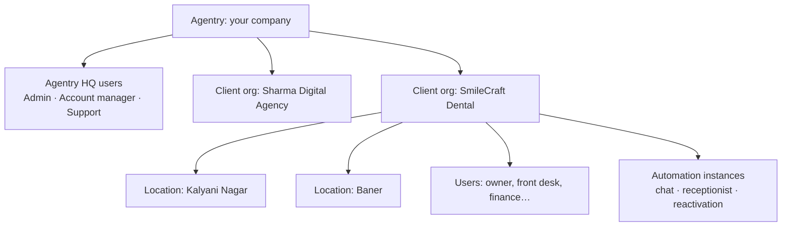
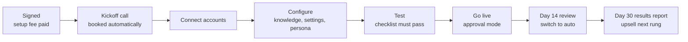
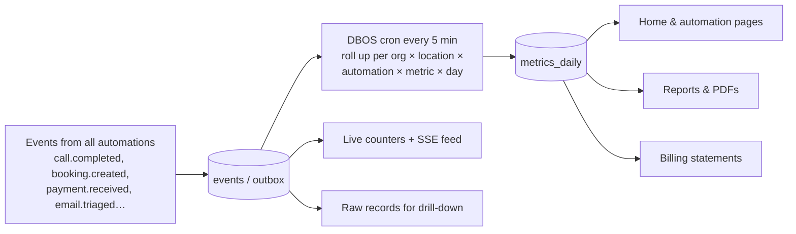

# Client portal: logins, onboarding and the all-in-one dashboard

> Agentry is agency-operated: you sell and run the agents, and each client gets **their own login** to see every automation, every number and every conversation in one place. Visual design: [DESIGN.md](DESIGN.md). Platform context: [PLAN.md](PLAN.md).

Status: spec, no code yet (2026-10-24).

---

## 1. Accounts and logins

### 1.1 Account model



- **Organisation** = one client business (one tenant; all data isolated with row-level security).
- **Locations / brands** inside an org: a clinic with 2 branches, or an agency with several brands. Stats can be filtered per location.
- **A user can belong to several orgs** (e.g. a business owner with two companies), and switches between them with an org switcher.
- **How an org is created:**
  1. **By you** in Agentry HQ (typical for agency deals), or by converting a **Demo Studio** demo (keeps the crawled profile, knowledge and persona).
  2. **By the client** from the landing page ("Get started"). The org starts in `pending_setup`, and you approve it before anything goes live.

### 1.2 Login methods

| Method | Why |
|---|---|
| **Email magic link / one-time code** | Default, no passwords to forget |
| **Google / Microsoft sign-in** | Most clients already use them |
| **Phone OTP (SMS / WhatsApp)** | Indian owners often prefer phone login |
| Passkeys | Fast, phishing-resistant on phones |
| Password + **2FA** | Required for Owner, Finance and all Agentry HQ users |

Implementation: **Better Auth** (self-hosted: organisations, invitations, roles, magic links, admin), with short-lived EdDSA JWTs verified by FastAPI. See [ADR 0002](decisions/0002-auth-better-auth.md). Built in Phase 0: email + password, magic link, organisations, roles, invitations, org switcher. Phone/WhatsApp OTP, passkeys and 2FA come in Phase 3. Either way, the API trusts only `org_id` + `role` claims from the verified token.

### 1.3 Roles and permissions

| Permission | Owner | Manager | Staff (front desk) | Finance | Viewer | Agentry Account Mgr | Agentry Support |
|---|---|---|---|---|---|---|---|
| See home dashboard & stats | ✓ | ✓ | own location | ✓ | ✓ | ✓ | ✓ |
| Conversations, calls, recordings | ✓ | ✓ | ✓ | — | — | ✓ | view-as (audited) |
| Approve / edit drafts, handle escalations | ✓ | ✓ | ✓ | invoices only | — | ✓ | — |
| Calendar & bookings | ✓ | ✓ | ✓ | — | ✓ | ✓ | — |
| Invoices & collections | ✓ | ✓ | — | ✓ | ✓ | ✓ | — |
| Pause / resume an automation | ✓ | ✓ | — | — | — | ✓ | — |
| Edit client-editable settings | ✓ | ✓ | — | — | — | ✓ | — |
| Edit Agentry-managed settings (prompts, sequences, integrations logic) | — | — | — | — | — | ✓ | — |
| Connect / disconnect accounts | ✓ | ✓ | — | — | — | ✓ | — |
| Team & roles | ✓ | — | — | — | — | ✓ | — |
| Billing, statements, payment methods | ✓ | — | — | ✓ | — | ✓ | — |
| Export all data / delete account | ✓ | — | — | — | — | on request | — |

- Every config field in an automation's schema is tagged `editable_by: client | agentry`. Clients change what is safe (hours, tone, quiet hours, who gets alerts); anything else goes through a **change request** to you.
- Security: login and session audit log, active devices list with remote sign-out, rate-limited OTPs, new-device alerts for Owner, and impersonation ("view as client") only by Agentry staff, always logged and shown to the client in their audit log.

---

## 2. Client onboarding

Promise on the landing page: **live in 7 days**. Every step can be done **by the client** in the portal **or by you** from HQ ("Agentry will do this for me" toggle). It's done-for-you by default, with self-serve for those who prefer it.

### 2.1 Journey



### 2.2 Onboarding wizard (portal)

| # | Step | What happens | Prefilled from |
|---|---|---|---|
| 1 | **Welcome & business profile** | Name, logo, address, locations, hours, holidays, timezone, currency, GSTIN, languages | Demo Studio / website crawl |
| 2 | **Plan & agreement** | Confirm purchased automations and pricing, accept terms + data processing agreement, pay setup fee (Razorpay / Stripe link) | Proposal from HQ |
| 3 | **Team** | Invite users, assign roles and locations | — |
| 4 | **Connect accounts** (only what the purchased automations need) | Gmail / Outlook, WhatsApp (Meta embedded signup), phone (forwarding guide + test call), calendars, CRM, accounting / Google Sheet, payment gateway, website widget (copy-paste snippet or "email this to my web developer"), social accounts. Each shows a live health check | Industry pack tells which are needed |
| 5 | **Data import** | Upload or connect old leads, contacts, invoices; **AI-assisted column mapping**; dedupe + consent check preview | — |
| 6 | **Knowledge & offers** | Review the auto-built FAQ, services and prices, policies, approved offers; upload documents | Website crawl |
| 7 | **Automation settings** | One card per purchased automation, with **recommended defaults** from the industry pack; only client-editable fields shown | Industry pack |
| 8 | **Persona & voice** | Agent name, tone, greeting, voice sample (listen and pick), languages | Industry pack |
| 9 | **Compliance** | AI disclosure text, call-recording notice, quiet hours, opt-in confirmation for imported lists, DND | Pack + country |
| 10 | **Test** | Chat with the agent, place a test call, send a test email to triage, simulate a lead / invoice; **checklist must pass** | — |
| 11 | **Go live** | Automations switch on in **approval mode**; day-14 review booked in the calendar | — |

- **Save and resume** at any step; progress bar; time estimate per step.
- **Blockers** are tracked with owners and ETA: WhatsApp template awaiting Meta approval, DLT registration, Google app verification, number porting.
- **Automatic nudges**: if a client stalls for 48 h, a friendly email or WhatsApp reminder ("2 steps left: connect your calendar"), and your account manager is alerted.
- **HQ mirror**: the same checklist in Agentry HQ, so you see every client's onboarding stage, blockers and days to go-live.

---

## 3. The client dashboard: all automations, all stats, all data

### 3.1 Navigation

| Section | What's inside |
|---|---|
| **Home** | Everything at a glance across all automations (§3.2) |
| **Automations** | List of their agents → one detail page per automation (§3.3) |
| **Needs you** | Approvals, escalations, disputes, low-confidence items, with a counter badge |
| **Conversations** | Every email, chat, WhatsApp thread and call (audio + transcript + summary), per contact |
| **Contacts & leads** | Pipeline board + table; each contact has a timeline across all automations |
| **Calendar** | Appointments booked by agents, by source; no-shows; fill rate |
| **Invoices** | (if collections) Ageing, follow-up status per invoice, promises to pay, recovered amounts |
| **Content** | (if content) Calendar, drafts awaiting review, published posts and engagement |
| **Reports** | Monthly results report, opportunity report, custom date ranges, scheduled reports |
| **Knowledge** | What the agents know: FAQ, services, prices, documents (client-editable) |
| **Billing** | Plan, usage vs included, results statement with evidence, invoices, payment method |
| **Settings** | Business profile, locations, team, connections (with health), notifications, compliance, audit log, data export |
| **Help** | Chat with Agentry (our own chat agent + human), tickets and change requests, book a call with the account manager |

### 3.2 Home

```
┌──────────────────────────────────────────────────────────────────────┐
│ SmileCraft Dental ▾  [All locations ▾]   [Last 30 days ▾ vs prev]  🔔 │
├──────────────────────────────────────────────────────────────────────┤
│ ₹3.1L won back │ 42 booked  │ 318 calls  │ 96 leads   │ ROI 7.4×     │
│ ▲ 18%          │ ▲ 12       │ 71 after-h │ ▲ 9%       │ vs your fee  │
├───────────────────────────────┬──────────────────────────────────────┤
│ AGENTS                         │ LIVE ACTIVITY                        │
│ ● Receptionist   31 calls today│ 10:42 Asha booked Meera · Sat 11:00  │
│ ● Website chat    9 chats      │ 10:39 Reactivation: Kavya replied    │
│ ● Reactivation   12 sent, 3 ↩  │ 10:31 Call transferred to Dr. Desai  │
│ ● Speed-to-lead   4 calls      │ 10:20 Invoice KIS/0433 paid ₹1.79L   │
│ ⚠ Inbox triage   reconnect     │ …                                    │
├───────────────────────────────┴──────────────────────────────────────┤
│ NEEDS YOU (5)  2 drafts to approve · 1 dispute · 2 escalations  [→]   │
├──────────────────────────────────────────────────────────────────────┤
│ FUNNEL  leads 96 → contacted 94 → engaged 61 → qualified 48 →        │
│         booked 42 → showed 35          (by source: chat / call / …)  │
├──────────────────────────────────────────────────────────────────────┤
│ CHARTS  bookings per day by source · response time trend ·           │
│         collections ageing (if invoices) · posts published (if content)│
└──────────────────────────────────────────────────────────────────────┘
```

- KPI tiles show **only the automations this client has**, each comparing against the previous period.
- **Every number is clickable**: number → list of underlying records → each record's timeline (the evidence).
- **Health strip**: broken connections, paused agents, template rejections, all with a "fix" button.
- Filters: date range, location, automation, channel. Timezone = the client's.

### 3.3 Automation detail page (same layout for every automation)

| Block | Content |
|---|---|
| Header | Name, status (live / approval mode / paused / error), on-off toggle (if allowed), plan, last activity |
| KPI tiles | The template's own metrics (table below) |
| Trend chart | Main metric over time, compared with the previous period |
| Funnel | The automation's own pipeline |
| Items table | The records it works on (calls, chats, emails, invoices, prospects, posts), with search, filters and drill-down |
| Settings | Client-editable fields + "request a change" for the rest |
| Activity log | Everything the agent did, with timestamps |

| Automation | KPI tiles |
|---|---|
| AI receptionist | Calls answered, after-hours calls, containment rate, bookings / reschedules / cancels, transfers, avg handle time |
| Speed-to-lead | Leads received, median time to first call, connect rate, qualified, booked |
| Website chat | Conversations, leads captured, qualified (need/budget/timeline), calls booked, top questions |
| Lead reactivation | List size, contacted, replied, re-qualified, booked, revenue reactivated |
| Cold email | Prospects found → verified → sent → replied → positive → meetings; per-mailbox health |
| Inbox triage | Emails processed by category, urgent alerts, median first-response time, drafts used as-is / edited |
| Invoice follow-up | Overdue total, recovered amount, DSO, promises to pay (kept / broken), disputes, ageing buckets |
| Content repurposing | Videos processed, posts generated / approved without edits / published, engagement |
| The Boring Machine | Calendar fill rate, bookings by source, cost per booking, show rate |

### 3.4 Reports, notifications and data access

- **Scheduled reports:** weekly summary (email/WhatsApp) and a monthly results report (PDF with ROI ×) sent automatically to the Owner.
- **Notifications** are per user: choose channels (email, WhatsApp, Telegram, push) per type (urgent, approvals waiting, daily digest, weekly report, billing, connection problems), plus quiet hours.
- **Exports:** CSV from any table; full data export (data portability under DPDP/GDPR); a read-only API key later, for clients who want data in their own BI tools.

---

## 4. How the stats work (one source of truth)



- **Metric registry**: each metric is defined once (name, event source, aggregation, unit, `higher_is_better`) and used by the portal, reports and billing. **The numbers can never disagree** between the dashboard and the invoice.
- Rollups are timezone-aware (the client's day), and backfilled when late events arrive.
- Plain Postgres is enough for a long time. If volume grows, move rollups to TimescaleDB or ClickHouse without changing the registry.

## 5. New data model pieces

`organizations`, `locations`, `memberships` (user × org × role × locations), `invitations`, `onboarding_progress` (step, status, owner, blocker, eta), `change_requests`, `support_tickets`, `metric_definitions`, `metrics_daily`, `notification_preferences`, `report_schedules`, `api_keys`, `login_audit`.

## 6. Delivery

| Phase (PLAN.md §7) | Portal scope |
|---|---|
| 0 ✅ | Auth (Better Auth orgs), roles + permission checks, org switcher, invitations, audit log, Home v0 with KPI tiles + trend, Agentry HQ client list |
| 1 ✅ | Onboarding wizard v1 (11 steps, test chat, go-live gate), Home v1 (Needs you banner, opportunity report), Automations list + detail (schema-generated settings, pause), Needs you (edit/approve drafts, handoffs), Conversations (triage + tool timeline), Knowledge, Agentry HQ Demo Studio |
| 2 | Contacts & leads, Calendar, Invoices pages; data import with AI column mapping |
| 3 | Full polish: reports + scheduled PDFs, notifications centre, billing page, exports, onboarding nudges, HQ onboarding board; PWA + push |
| 4+ | Call recordings player + live transcripts, Boring Machine view, Content pages, client API keys |
