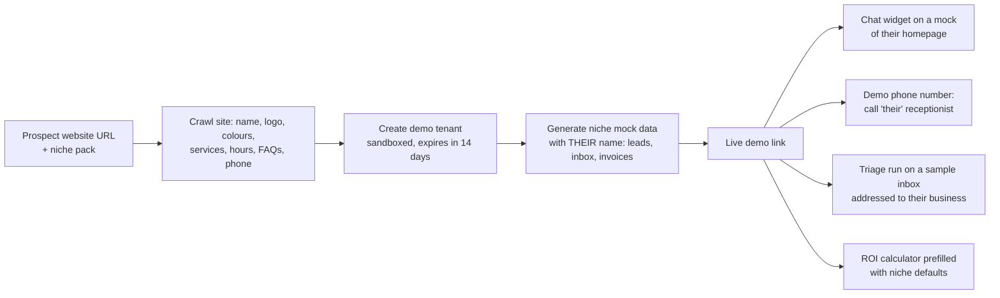

# Go-to-market: how to start

> From the reference "How to start", and what the platform must provide to make each step fast.

| # | Step | What it means | Platform feature that makes it fast |
|---|---|---|---|
| 1 | **Pick ONE automation** | One sharp offer, not a menu of nine | Catalog can be narrowed to one featured automation per niche |
| 2 | **Pick ONE type of business** | One niche: same pains, same tools, same vocabulary, referrals inside the niche | **Industry packs** (§1) |
| 3 | **Build a demo with THEIR name** | The prospect sees *their* business running the automation, not a generic demo | **Demo Studio** (§2) |
| 4 | **Send a 2-min video** | Record yourself walking through their demo; send it by email or WhatsApp | Demo Studio has a guided "record" mode + shareable link; **your own cold email automation** sends it (§3) |
| 5 | **Start small, then upsell** | Land with the entry automation, prove ROI, climb the ladder | Results report + opportunity report ([PRICING.md](PRICING.md) §4–5) |

## 1. Industry packs

A pack is everything a niche needs preconfigured, so onboarding is "fill in the blanks":

```yaml
pack: dental-clinic-in
automations: [website_chat, ai_receptionist, lead_reactivation, speed_to_lead]   # featured first: one of these
qualification: [concern, pain, area, timeline]
services_template: [consultation, cleaning, rct, aligners, implants]
faq_seed: [insurance, parking, emergencies, payment/EMI, timings]
sequences: { reactivation: dental-6-month-checkup, no_show: dental-rebook }
personas: { front_desk: "warm, reassuring, concise" }
compliance: { emergency_script: medical-in, recording_notice: true }
kpis: [bookings, after_hours_calls, no_show_rate]
customer_value_default: 8000 INR
```

Packs live in `automations/packs/` and are versioned. The first pack is built for the chosen niche, and later packs are copies with edits.

## 2. Demo Studio ("a demo with THEIR name")



- **Time to build a demo: under 10 minutes**, most of it automatic.
- Demo tenants are sandboxed: they never send real messages (outbound goes to a demo outbox), have no billing, and are deleted after expiry.
- Converting a demo into a real client keeps the configuration (knowledge base, persona, services). Onboarding is then just connecting the real accounts.
- Guardrail: the demo uses the prospect's public website information only, and is shown only to that prospect. No impersonation outside the private demo link.

## 3. Use the product to sell the product

- Your **cold email automation** finds businesses in the chosen niche (Places API), personalises the first line, and sends the 2-min video link.
- Your **website chat agent** sits on the Agentry website and books discovery calls.
- Your **inbox triage** runs on your own inbox.

This gives real usage data before the first client, plus case studies from your own pipeline.

## 4. Choosing the niche and the first automation

The reference ladder (inbox triage → invoices → lead engine) fits some niches better than others:

| Niche | Entry automation | Ladder | Fit |
|---|---|---|---|
| **B2B service firms** (digital agencies, CA/accounting firms, consultancies, IT services) | **Inbox triage** | Triage → invoice follow-up → lead engine (web chat + cold email) | Email-heavy, invoice-heavy: matches the reference ladder exactly. Mock tenant: Sharma Digital Agency |
| **Appointment businesses** (dental/skin clinics, physios, salons, coaching institutes) | **Website chat** or **AI receptionist** | Chat/receptionist → reactivation → speed-to-lead → full Boring Machine | Phone- and WhatsApp-heavy; inbox triage and invoices matter little. Mock tenant: SmileCraft Dental |
| Home services (solar, interiors, real estate) | **Speed-to-lead** | Speed-to-lead → reactivation → receptionist | High ad spend on leads, so speed matters most, but voice is needed on day one |

### Decision: target all three niches

The platform serves all three from one codebase. Niches differ only in their **industry pack**, their **entry agent** and their **landing page**. What "pick ONE" protects is *sales focus*: one message, one demo type and one set of case studies at a time. So:
- **Build** for all three: three packs in Phase 1, and each niche's entry agent as early as possible (see PLAN.md §7).
- **Sell** in focused bursts: each outbound campaign (cold email + 2-min videos) targets **one niche**, rotating between them, with niche-specific landing pages (`/for/agencies`, `/for/clinics`, `/for/home-services`).
- Home services' entry agent (speed-to-lead) needs voice (Phase 4). Until then, offer them the text version (instant WhatsApp/SMS reply + reactivation).
