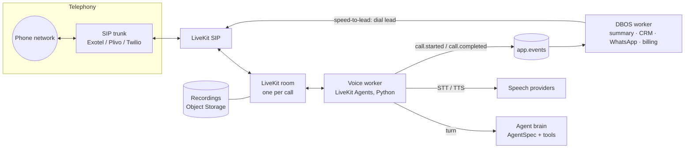

# Phase 4 — Voice (AI receptionist + speed-to-lead calls)

> **Goal:** the same agent that already chats on the website and WhatsApp can answer and make **phone calls**. That completes the AI receptionist, speed-to-lead calls and **The Boring Machine**.
> **Specs:** [ai-receptionist.md](automations/ai-receptionist.md) · [boring-machine.md](automations/boring-machine.md) · [ADR 0001](decisions/0001-runtime-and-models.md) (LiveKit Agents).
> **Status:** 4.1 and 4.2 built 2026-10-25; 4.3 built on a LiveKit US number (§11), waiting for the first real call; 4.6 done. The parts of 4.4 and 4.7 that need outgoing calls wait for an outbound-capable provider (Twilio or Plivo).

## 1. What already exists and is reused

| Piece | Today | Voice reuses it as |
|---|---|---|
| Agent brain | `AgentSpec` + LangGraph runtime (`agents/runtime.py`): persona, knowledge search, availability, booking, save lead, hand-off | The call's "LLM" step: same tools, same prompt, plus a short-reply voice style |
| Booking | Availability from staff hours; double-booking impossible | `check_availability` / `book` tools during the call |
| Lead engine | One contact per person, consent, one-voice rule, pipeline stages | Caller ID → contact; speed-to-lead claims the lead before calling |
| Events + DBOS | `call.completed` is already in the event catalogue | After the call, one workflow: summary, CRM, WhatsApp confirmation, billing meter |
| Needs you / hand-off | Hand-off cards, Reply now, take over / hand back | "Caller wants a person": warm transfer, or a callback task if nobody answers |
| Billing | Pay per booked appointment with evidence | Bookings from calls are outcomes; call recordings and transcripts are the evidence; minutes go into margin |
| Roles | Conversation permission (owner, manager, front desk) | Same: calls are conversations with `channel = 'voice'` |

## 2. Architecture

- **New process: `agentry voice`.** A LiveKit Agents worker (Python, in `backend/`) joins one room per call. It runs alongside `api` and `worker`, deploys as another k3s Deployment, and scales by number of concurrent calls.
- **Inbound (receptionist):** the client forwards their number on busy / no answer / after hours / always, or gets a new number. The SIP trunk sends the call to LiveKit SIP, a dispatch rule picks the client by the dialled number, and the worker joins.
- **Outbound (speed-to-lead):** `lead.created` → consent and calling-hours check → a DBOS workflow asks LiveKit SIP to dial the lead within about 60 seconds → the worker joins as the agent → if there's no answer, a WhatsApp follow-up, then a retry schedule.
- **Turn loop:** streaming speech-to-text → the agent brain (short context, tools) → streaming text-to-speech. Turn detection and interruptions are handled by LiveKit Agents. Target: **under 1 s** from the end of the caller's speech to the start of the reply.

## 3. Speech pipeline: two options

| | **A. Realtime speech model** (OpenAI Realtime / Gemini Live) | **B. Cascaded** (STT → our LLM → TTS) |
|---|---|---|
| Latency | Lowest, about 500–800 ms | About 800–1200 ms with streaming |
| Build effort | Lowest | Medium |
| Control | Fewer choices of voice and accent | Pick each part: Deepgram/Sarvam STT, any LLM, Cartesia/ElevenLabs/Sarvam voices |
| Indian languages | Good English; Hindi okay; regional weaker | Best (Sarvam for Hindi, Tamil, Marathi and others) |
| Tools / booking | Supported (function calling) | Native: the same LangGraph agent as chat |
| Cost per minute (rough, **check current prices**) | Higher | Lower at volume |
| Model-agnostic (our principle) | Ties a call to one vendor's realtime model | Matches the gateway approach (tiers, fallback) |

**Recommendation:** build **B (cascaded)** behind a `VoicePipeline` interface, with **A as a switchable option per client**.
- B reuses the exact agent we already test, keeps the any-model principle, and is the right fit for Indian languages.
- A is a good premium choice for English-only clients who want the snappiest feel.

## 4. Build order (milestones)

| # | Milestone | Done when |
|---|---|---|
| 4.1 ✅ | **Voice worker skeleton + test console**: `agentry voice`, LiveKit dev server (local docker), a browser "talk to your receptionist" button in the portal (WebRTC, no phone needed) | You talk to SmileCraft's receptionist in the browser; it answers from knowledge and books a slot |
| 4.2 ✅ | **Calls as conversations**: `channel = 'voice'` conversations, transcript per turn, recording (consent line spoken first), AI summary, audio player in the portal | Each test call appears in Conversations with audio, transcript and summary, for the right roles only |
| 4.3 ◐ | **Inbound phone (receptionist)** (built on LiveKit Phone Numbers; real-call check pending; spam hang-up to do): SIP trunk + LiveKit SIP, number → client dispatch, forwarding instructions in onboarding, emergency script, spam hang-up | A real phone call to the test number is answered, books, and sends a WhatsApp confirmation |
| 4.4 ◐ | **Warm transfer + callbacks** (callback cards done; transfer needs 4.3): transfer to a staff phone with a summary first; no answer → take a message, urgent alert, "Call back" card in Needs you | Transfer works; a missed transfer creates a callback card for the front desk |
| 4.5 | **Speed-to-lead calls**: outbound dialling within about 60 s of a form lead, consent + calling-hours + suppression checks, voicemail detection, retry ladder, WhatsApp fallback | A form submission rings your phone within about a minute; the call qualifies you and books |
| 4.6 ✅ | **Billing, margin, ops**: minutes metered (included + overage), call cost per client in Revenue & margin, recordings as evidence on statements, alerts for failed calls and high latency | A statement shows bookings from calls with recordings as evidence; margin includes telephony and speech cost |
| 4.7 ◐ | **Role checks + Boring Machine** (role matrix + HQ switch done; bundle needs 4.5): the same role tests as the other agents; receptionist + speed-to-lead switchable per client in HQ; the full Boring Machine bundle | Role matrix test + browser sweep pass; a Boring Machine client sees all five lead sources in one pipeline |

Each milestone ships with tests (calls simulated in text through the same pipeline) and a browser check. Real-phone checks need the accounts in §6.

## 5. Compliance (India first)

- **Disclosure:** every call opens with "You're speaking with {name}, {business}'s AI assistant. This call may be recorded." This is configurable per jurisdiction.
- **Outbound calls:**
  - only to leads who gave consent: form opt-in recorded with timestamp and source;
  - calling hours 09:00–21:00 in the lead's local time;
  - suppression list respected; "don't call me" stops all channels.
- **TRAI / DLT:** service calls to people who just asked to be contacted are transactional. Promotional calling (e.g. reactivation by phone) needs DLT registration and the scrubbing rules, so **voice reactivation stays off until that's set up**.
- **Recordings:** stored encrypted in Object Storage, retention configurable per client (default 90 days), deletable on request.
- **Medical safety (clinics):** an emergency script ("please call 108 / 112") and never giving medical advice. These come from the industry pack.

## 6. Decisions and accounts needed from you

| # | Decision | Options | My recommendation |
|---|---|---|---|
| 1 | Telephony (India) | Exotel, Plivo, Knowlarity | **Plivo** for development (SIP trunking + Indian numbers, good API); Exotel if clients prefer a local vendor |
| 2 | Telephony (US/UK) | Twilio, Telnyx | **Telnyx** (cheaper SIP) or Twilio (familiar) |
| 3 | Speech pipeline | A realtime / B cascaded | **B**, with A as an option per client |
| 4 | Speech-to-text | Deepgram, Sarvam, Google | **Deepgram** (English), **Sarvam** (Indian languages) |
| 5 | Text-to-speech | Cartesia, ElevenLabs, Sarvam | **Cartesia** (fast, natural) + **Sarvam** voices for Hindi |
| 6 | LiveKit | LiveKit Cloud / self-hosted on Oracle | **Cloud** (free tier) for development; self-host later if minutes grow |
| 7 | Recordings | On / off by default | On, with disclosure; 90-day retention |

**To start 4.1 and 4.2 nothing external is needed.** LiveKit runs locally in Docker, and the browser test console doesn't need a phone line. Speech providers can run in mock mode (scripted text) until you add keys. **From 4.3 onwards** I need the telephony account and a test number, plus speech provider keys.

## 7. Risks

| Risk | Mitigation |
|---|---|
| Latency above 1 s on Indian networks | Streaming everywhere, short prompts, the `fast` tier for the first sentence, a region close to the trunk (Mumbai), latency metric per call + alert |
| Cost per minute eats the margin | Minutes in every plan (included + overage), cheap STT/TTS by default, margin alert below 60 % |
| Bad experience damages the client's brand | Approval-mode equivalent for voice: start with **after-hours only**, review the first 20 calls with the client, then widen |
| Free-tier quotas (seen with Gemini) | Voice uses paid keys only; the gateway fallback chain applies to the brain step |

## 8. Milestone 4.1: what was built (2026-10-25)

| Piece | Where |
|---|---|
| LiveKit server (local) | `docker-compose.yml` service `livekit` (v1.13.10, dev keys) |
| Voice worker `agentry voice` | `backend/src/agentry/voice/worker.py`: LiveKit Agents 1.8, OpenAI speech-to-text and text-to-speech, Silero end-of-speech detection; every turn goes to Agentry's own agent brain (`run_turn`, channel `voice`) |
| Start a test call | `POST /org/voice/test-call` (owner, manager, Agentry staff): creates a test voice conversation and a 30-minute token whose room configuration dispatches `agentry-voice` with the client and conversation |
| Browser console | portal **Talk to your agent** (`/talk`), linked from Automations and onboarding → Test: microphone, the agent's voice, live transcript for both sides, agent state |
| Calls in the portal | conversations with `channel = voice`: "Phone call" label, Calls filter, no reply box |

**Latency, measured on a laptop:**
- Before the fixes: about 6 s from the end of the question to the start of the answer.
- After:
  - The brain step takes about 2 s: knowledge lookup 0.85 s plus model 1.1 s.
  - **Look up knowledge before asking the AI:** the agent answers in one model call instead of two.
  - **Optional fast voice model** (`AGENTRY_MODEL_VOICE`, e.g. `openai/gpt-4.1-mini`).
  - **10-minute cooldown on failed models** (all channels): stops paying for a quota-exhausted model on every call.
- Getting under 1 s end to end needs streaming speech providers (Deepgram/Cartesia) in a later milestone.

**Settings:**
- `AGENTRY_LIVEKIT_URL`, `AGENTRY_LIVEKIT_API_KEY`, `AGENTRY_LIVEKIT_API_SECRET`, `AGENTRY_LIVEKIT_PUBLIC_URL` (LiveKit's own `LIVEKIT_URL`, `LIVEKIT_API_KEY`, `LIVEKIT_API_SECRET` names work too). Development uses LiveKit Cloud since 2026-10-25; without these settings it falls back to the local `livekit` container.
- `AGENTRY_VOICE_STT_MODEL`, `AGENTRY_VOICE_TTS_MODEL`, `AGENTRY_VOICE_TTS_VOICE`, `AGENTRY_VOICE_LANGUAGE`.
- `AGENTRY_VOICE_IDLE_PROCESSES` (2), `AGENTRY_VOICE_LOAD_THRESHOLD`: no load limit in dev; 0.85 in production.

**Not deployed yet:** the k3s voice Deployment and a production LiveKit (Cloud or self-hosted) come with milestone 4.3, together with the phone numbers.

## 9. Milestone 4.2: what was built (2026-10-25)

| Piece | Where |
|---|---|
| Recording | `voice/worker.py`: the session records the caller and agent audio (`AGENTRY_VOICE_RECORD`, on by default; the greeting says "This call may be recorded"). When the call ends, `finish` copies `audio.ogg` to `var/recordings/{org}/{conversation}.ogg` (`AGENTRY_RECORDINGS_DIR`), saves duration and `ended_at`, closes the conversation and emits `call.completed` |
| AI summary | `voice/summary.py`: a DBOS step on `call.completed` reads the transcript and stores `metadata.call` = summary, intent, outcome (booked / answered / handed off / message taken / no conversation), follow-up flag and reason. Model failure leaves the call without a summary; it never fails the call |
| Recording access | `GET /conversations/{id}/recording`: same conversation permission as the transcript (owner, manager, front desk, Agentry staff; finance and viewer get 403), path-traversal guard. The dashboard proxies it at `/api/recording/{id}` with Range support so the player can seek |
| Portal | Conversation page: a **Call** card with duration, outcome badge, summary, a "Follow up" badge when someone should act, and an audio player above the transcript. The Calls list shows the summary as the preview |
| Tests | `test_voice.py`: summary stored from a simulated call; recording served to the right roles only |

**Checked in the browser:** a 41-second test call → 417 KB recording, playable in the portal; call card "1:00 min · Answered" with the summary; the front desk account can play it; no console or server errors.

**Retention (to do with 4.6):** recordings are local files for now. Production moves them to Object Storage (encrypted) with a 90-day cleanup job and a "delete recording" action; until then the k3s voice Deployment needs a volume for `var/recordings`.

## 10. Built ahead of phone numbers (2026-10-25)

| Piece | What it does | Where |
|---|---|---|
| **Callback cards** (4.4) | A caller who asks for a person or needs a follow-up gets a **Call back** card in Needs you (urgent) and an alert. The card has the caller's name, the number to call (a `tel:` button) and the summary. During a call the hand-off can't become a "Reply now" card: the agent tells the caller someone will call back and confirms their number. The summary reads the caller's name and number from the call and links or creates the contact | `agents/tools._handoff` (voice), `voice/summary.create_callback`, `approval-card.tsx` |
| **Call minutes** (4.6) | Plans can include call minutes plus a price per extra minute (HQ plan editor). Each real call is rounded up to whole minutes; test calls are never billed. Revenue & margin counts every call minute at `AGENTRY_VOICE_COST_INR_PER_MINUTE` (default ₹2, rough: check current rates) | `billing.py`, HQ billing pages |
| **Recording retention** (4.6) | Each client keeps recordings for 7–730 days (default 90), set on Talk to your agent. A daily job (03:30 IST) deletes older recordings. Owner/manager can delete one recording on request from its conversation; the transcript and summary stay | `voice/recordings.py`, `PUT /org/voice/settings`, `DELETE /conversations/{id}/recording`, migration `0010` |
| **AI receptionist in HQ** (4.7) | Agentry staff can switch the receptionist on for a client: Needs you, Conversations, Leads, Knowledge, Calendar, its settings (when it answers, transfer number) and a browser test. **Go-live waits for "Phone number connected"**, so nobody goes live without a line | `automations/ai_receptionist`, `features.py` |
| **Role matrix** (4.7) | `test_roles_voice.py`: receptionist portal, callback cards, delete/retention, minutes on the statement, for all six roles | tests |
| **Production** | `voice` service (Compose profile `voice`, k3s `voice.yaml`, off until LiveKit is configured) and a `recordings` volume shared by voice, api and worker | `docker-compose.prod.yml`, `infra/k8s`, DEPLOY.md |

**Checked with a real browser call:** the caller said "I'd like to speak to a real person about my bill… my name is Ravi Kumar and my number is +91 98765 43210". The agent said someone would call back and confirmed the number. After the call, the front desk saw an urgent "Call back Ravi Kumar" card with a **Call +919876543210** button, and the call card showed "Message taken · Follow up" and the summary.

**4.6 finished the same day:** see §11.

## 11. Phone numbers and call operations (2026-10-25)

**Telephony choice.** Plivo and Exotel only rent Indian numbers to registered Indian businesses (certificate of incorporation or Udyam, plus GST). Until Agentry has that, inbound calls use **LiveKit Phone Numbers**: a US number rented inside the same LiveKit Cloud project. It needs no separate trunk and one local number is free. It is inbound only, so outgoing calls (speed-to-lead, live transfer) need Twilio or Plivo later. Only the trunk changes; the routing below stays.

| Piece | What it does | Where |
|---|---|---|
| Number → client | Each number gets its own LiveKit dispatch rule, `agentry <number>`: a new room per call, with the `agentry-voice` agent dispatched with `{"number": ...}`. The number is stored as the client's `phone` connection, so one number maps to one client and the receptionist's go-live check passes. LiveKit's `UpdatePhoneNumber` accepts only `sip_dispatch_rule_ids` (a list) | `voice/telephony.py`, migration `0011` |
| HQ | Client page → Automations → **Phone number**: lists Agentry's LiveKit numbers, with assign and unassign. Staff only, and only for a client with the receptionist switched on | `GET /hq/phone-numbers`, `PUT/DELETE /hq/orgs/{id}/phone` |
| Incoming call | The worker finds the client from the dialled number, checks the receptionist is on and not paused, links the caller's number (`sip.phoneNumber`) to a contact, opens the conversation and greets. Unknown numbers and paused receptionists hang up | `voice/worker.start_phone_call` |
| Client portal | Connections → **Phone number**: the number and call-forwarding codes (`**61*` no answer, `**67*` busy, `**62*` unreachable, `**21*` always) | settings/connections |
| Calls as evidence | A booking made on a call shows the call's length, summary and a player on the statement. People with billing access (finance) may play a call that is evidence on a statement, and only those calls | `billing_api._statement`, `work._billing_evidence`, `statement-view.tsx` |
| Call alerts | `agentry alerts` reports calls that never finished (30 min: the voice worker died), calls where every model failed, and calls averaging over 3.5 s per reply. Each call now stores `turns`, `failed_turns` and `latency_ms {avg, max}` | `ops.py`, `voice/worker.py` |

**Checked:** assigning in HQ, the client's Connections card, and browser calls recording their timings (2 turns, 2.7 s average). **Not yet checked:** a real phone call. Calling a US number from an Indian SIM needs international calling switched on, or an app like Viber Out.
