# Phase 5 — Personal cold email

> **Goal:** find businesses that fit a client's ideal customer, find the person who decides, verify their email, write one honest personal first line from their own website, and send a short sequence from **separate sending domains**. Replies go into the lead engine, so interested prospects get booked like every other lead.
> **Spec:** [automations/cold-email.md](automations/cold-email.md) (the funnel, steps and guardrails). It is the fourth source of [The Boring Machine](automations/boring-machine.md).
> **First customer: Agentry itself.** The first campaign sells Agentry: clinics and agencies get a 2-minute demo video made with Demo Studio. That's the PLAN.md success criterion for this phase.
> **Status:** 5.1–5.3 **built 2026-10-30** (mock providers; verified with the real AI models on Agentry's own company). 5.4+ need the decisions in §6. Flow: [flows/agents/cold-email.md](flows/agents/cold-email.md).

## 1. What already exists and is reused

| Piece | Today | Cold email reuses it as |
|---|---|---|
| Website crawler | `knowledge.crawl()`: SSRF-guarded, 8 pages, text extraction (Demo Studio, knowledge) | Research a prospect's site: home, about, team, contact |
| Lead engine | One contact per person, E.164/email normalising, merge, consent, **suppression**, opt-out words, **one-owner claim** | Prospects are contacts; dedupe against clients and existing leads; replies become leads |
| Sequence engine | DBOS workflow per enrollment, steps with delays, stop on reply, catch-up, watchdog, **approval-mode drafts** (`outbound_draft`) | The 3–4 step email sequence, paced per mailbox |
| Campaigns | `app.campaigns` already allows `kind = 'cold_email'`; paced slots, pause/resume, Campaigns page | The campaign, its funnel and its schedule |
| Model gateway | Tiers, fallback, cooldown, cost per call | `writer` for first lines, `fast` for extraction, fact checks and reply classification |
| Gmail connector | OAuth, history sync, threaded drafts, send | Option B sending (§3) and reading replies |
| Billing | Outcomes with evidence (`appointment_booked`), per-booking prices | "Meeting booked from cold email" with the thread as evidence |
| Roles | Conversation permission; approval cards in Needs you | Reviewing first lines and replies, by the same roles |

## 2. Architecture

```mermaid
flowchart LR
  subgraph Build["DBOS: build_list (per campaign)"]
    SRC[Source<br/>Google Places · CSV] --> FIL[Filter<br/>ideal customer] --> DED[Dedupe<br/>clients · leads · suppression]
    DED --> CR[Crawl site] --> DM[Decision maker<br/>site → finder waterfall]
    DM --> VER[Verify email] --> RES[Research notes<br/>+ source snippets] --> LINE[First line<br/>writer] --> FC[Fact check<br/>fast]
  end
  FC --> REV[Review in portal<br/>approve · edit · drop]
  REV --> SEQ[Sequence engine<br/>3-4 steps, per-mailbox caps]
  SEQ --> SEND{Sender}
  SEND -->|A| INST[Instantly / Smartlead API<br/>warm-up + rotation]
  SEND -->|B| GW[Google Workspace mailboxes<br/>on secondary domains]
  INST & GW --> RPL[Replies<br/>webhook / Gmail sync] --> CLS[Reply classifier] --> LE[Lead engine → book]
  CLS --> SUP[Suppression]
```

**Every external provider sits behind a small interface with a mock.** That covers places, finder, verifier and sender. So the whole pipeline is built and tested now, in mock mode, against `mock-data/cold-email/` (the reference funnel: 50 found → 49 with a website → 8 valid). Real keys switch on one provider at a time.

**Data (new tables):**
- `prospect_companies`: place_id or domain, name, website, category, rating, filters passed.
- `prospects`: company, contact, role, email, verify status, research notes, source snippets, first line, fact-check result, review state.
- `sending_mailboxes`: domain, provider, daily cap, warm-up state, health.
- `email_events`: sent, bounce, reply, complaint, unsubscribe.

Campaign funnel counts come from these tables, not from counters.

## 3. Sending: the big decision

| | **A. Instantly or Smartlead** (spec's v1) | **B. Native: Google Workspace mailboxes** |
|---|---|---|
| Warm-up | Built in (their warm-up network) | You warm up by hand for 2–3 weeks, or add a warm-up tool |
| Mailbox rotation, caps, bounce handling | Built in | We build it (caps, ramp-up, auto-pause) |
| Cost | Roughly $30–100/month for the tool, plus domains and mailboxes | Domains (~₹800/yr each) + Workspace (~₹160/user/month); check current prices |
| Replies | Their webhook | Gmail sync (already built) |
| Build effort | Lower | Higher, but no third-party dependency |
| Risk | Their account rules and pricing | Getting deliverability right ourselves |

**Recommendation:** **A (Instantly)** to start. Deliverability is the part that sinks cold email, and warm-up is the hardest piece to build. Build B later behind the same interface, for clients who want no third party. **Never send from a client's main domain.**

## 4. Build order (milestones)

| # | Milestone | Done when |
|---|---|---|
| 5.1 ✅ | **Prospect pipeline in mock mode**: tables, provider interfaces + mocks, `build_list` workflow (source → filter → dedupe → crawl → decision maker → verify), funnel counts | The mock Places list reproduces the reference funnel (50 → 49 → 8) in a test and on the Campaigns page |
| 5.2 ✅ | **Research + first lines**: research notes with source snippets, `writer` first line, `fast` fact check (claim must be in a snippet), rewrite once, then flag for a human | Every first line cites a stored snippet; a planted false claim is caught |
| 5.3 ✅ | **Review in the portal**: a prospects table per campaign (approve, edit, drop, bulk approve), CSV / Google Sheet export, roles | Owner/manager approve lines; front desk can view; finance/viewer can't |
| 5.4 | **Sending**: sender interface (mock + Instantly), sending domains/mailboxes in HQ, sequence steps with per-mailbox caps and ramp-up, plain text, one-click unsubscribe, physical address, stop on reply | A campaign sends through the mock sender at the right pace; real sends once Instantly is connected |
| 5.5 | **Replies**: webhook/Gmail reply ingest, classifier (interested · not now · unsubscribe · out of office · referral · wrong person · bounce), interested → lead engine claim + Needs you card, not now → nurture in 60–90 days, unsubscribe/complaint → suppression everywhere | Each reply type lands in the right place; an unsubscribe stops every channel |
| 5.6 | **Real data providers**: Google Places (Text Search, keeps only `place_id` + refreshes details), finder waterfall (Hunter, then others if configured), verifier (MillionVerifier or ZeroBounce); cost per verified contact | A real 50-business search runs end to end with costs shown |
| 5.7 | **Agentry's own campaign + guardrails**: auto-pause on bounce > 3 % or any spam complaint, daily health per mailbox, cold-email results on Reports and statements (meetings booked), role matrix test, HQ switch | First Agentry outbound campaign live; role test + browser sweep pass |

5.1–5.3 needed **nothing external** and are done: `automations/cold_email/` (providers, research, pipeline), `api/routes/cold_email.py`, migration 0016, portal `/cold-email`, `tests/test_cold_email.py`. Google Sheet export is a CSV for now. 5.4 needs sending domains and Instantly. 5.6 needs data-provider keys.

## 5. Compliance (built in)

- **B2B only.** Business addresses of decision makers, never personal or sensitive data. First lines may only use facts from the business's own public website.
- **Every email:**
  - the sender's real business name and postal address;
  - a one-click unsubscribe (List-Unsubscribe header plus a link);
  - no tracking pixels by default;
  - plain text.
- **Opt-outs:** honoured immediately, everywhere (shared suppression list).
- **By region:**
  - **US (CAN-SPAM):** the rules above.
  - **EU/UK:** excluded by default. Turn on only with a legitimate-interest note per campaign.
  - **India (DPDP Act):** minimal data, delete on request.
- **Gmail/Yahoo bulk-sender rules:** SPF, DKIM and DMARC on every sending domain; spam rate under 0.3 % (we auto-pause well before that).

## 6. Decisions and accounts needed from you

| # | Decision | Options | My recommendation |
|---|---|---|---|
| 1 | Sending | A Instantly/Smartlead · B native Workspace | **A, Instantly** to start (§3) |
| 2 | Sending domains for Agentry's own campaign | 2–3 lookalike domains, e.g. `getagentry.in`, `agentryhq.com` | Buy **2**, after you settle the main domain; 2 mailboxes each |
| 3 | Prospect source | Google Places API · CSV/Apollo exports | **Places** (needs a Google Cloud billing account; free monthly usage covers testing) plus CSV import |
| 4 | Email finder | Hunter · Apollo · Snov · Prospeo | **Hunter** first (free tier to test), others optional in the waterfall |
| 5 | Verifier | MillionVerifier · ZeroBounce · NeverBounce | **MillionVerifier** (cheapest at volume); ZeroBounce has a small free tier |
| 6 | First target for Agentry's campaign | Clinics · agencies/CA firms · home services | **Dental clinics in one city**, the niche with the most demo material (SmileCraft, Demo Studio) |
| 7 | Review rule | Approve every line · approve first 50 then auto | **Approve every line** for the first 2 campaigns |

**Nothing is needed to start 5.1–5.3.** Domains need warm-up time (2–3 weeks), so if you agree with #2, buying them early saves time.

## 7. Risks

| Risk | Mitigation |
|---|---|
| Domains burned (spam folder) | Separate domains, warm-up, low caps (start ~20/day/mailbox), auto-pause on bounces or complaints, plain text |
| Creepy or wrong personalisation | Facts only from their website, a fact check against stored snippets, human review at first |
| Low funnel yield (~16 % valid in the reference) | Funnel shown per campaign; list sizes planned backwards from the goal; cost per verified contact tracked |
| Data-provider costs | Waterfall stops at the first hit; verify only candidates that passed filters; per-campaign budget cap |
| Legal (EU/UK, DPDP) | Region filter (EU/UK off by default), suppression, deletion on request |
