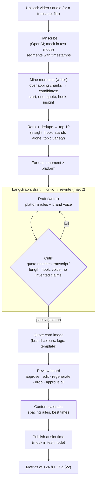

# Phase 6 — Content repurposing

> **Goal:** one long video or podcast (≈45 min) → the **10 best moments** → a post for **Instagram, LinkedIn and X** each, with an on-brand image: **30 posts, reviewed by a person, then scheduled**. Target: drafts ready in under 30 minutes.
> **Spec:** [automations/content-repurposing.md](automations/content-repurposing.md). Pricing: setup fee (brand voice + brand kit) + monthly retainer by videos per month.
> **Status:** 6.1–6.4 and 6.6 **built 2026-10-30** with the §6 recommendations (OpenAI transcription, ffmpeg installed, quote cards, sample podcast), plus test-mode publishing. Verified with the real AI on SmileCraft: 10 moments, 30 posts in ~3½ minutes. Flow: [flows/agents/content-repurposing.md](flows/agents/content-repurposing.md). Like cold email, everything is built behind interfaces with mocks first, so it works end to end before any account exists.

## 1. What already exists and is reused

| Piece | Today | Content reuses it as |
|---|---|---|
| DBOS workflows | Long, retry-safe jobs (cold email list building, sequences) | Upload → transcribe → moments → drafts → images, one durable workflow per video |
| LangGraph | In the stack, used by the chat agent | The draft → critic → rewrite loop per moment × platform |
| Model gateway | Tiers, fallback, cost per call, prompt versions | `writer` for moments and drafts, `fast` for the critic |
| Writing style | `inbox_triage/style.py` learns how a business writes from 50 sent emails | Brand voice learned from ~20 past posts (pasted or uploaded) |
| Fact check pattern | Cold email: a word check, then a model check, one rewrite, then a person | **Quote fidelity**: every quote must appear in the transcript word for word |
| Review in the portal | Cold email review cards (approve, edit, drop, approve all checked) | The review board, grouped by moment |
| Mock providers | `cold_email/providers.py` (sample data, recorded sends) | Mock transcriber (sample transcript) and mock publisher (recorded posts) |
| Roles, audit, features | Per-page guards, `automation:configure`, audit log | Owner/manager approve and schedule; front desk can look; finance/viewer can't |

## 2. Architecture

**Data (new tables):** `content_sources` (the upload, status, transcript), `content_moments` (start/end, quote, hook, score, kept), `content_posts` (platform, text, hashtags, image, critic result, review state, slot), `publications` (where and when it went out, result), `brand_kits` (logo, colours, fonts, voice profile).

## 3. Platform rules (config, editable per client)

| Platform | Shape | Length | Extras |
|---|---|---|---|
| LinkedIn | Hook line, short paragraphs, one takeaway, soft CTA | up to ~1,300 characters shown before "see more"; aim 600–900 | 0–3 hashtags |
| Instagram | Caption: hook, 2–4 short lines, CTA | up to 2,200; aim 300–600 | 5–10 relevant hashtags; image required |
| X | One post, or a 3–5 post thread for big ideas | 280 per post | 0–2 hashtags |

## 4. Build order (milestones)

| # | Milestone | Done when |
|---|---|---|
| 6.1 ✅ | **Sources + transcripts**: upload (audio/video, or SRT/VTT/TXT transcript), storage, transcriber interface (OpenAI + mock), sample 45-min transcript in `mock-data/content/` | A sample upload becomes a timestamped transcript in test mode; a real short clip transcribes with your OpenAI key |
| 6.2 ✅ | **Moments + drafts + critic**: moment mining and ranking, LangGraph draft/critic loop, quote fidelity check, brand voice from pasted past posts | The sample gives 10 distinct moments × 3 platforms = 30 drafts; a planted misquote is caught; every quote is found in the transcript |
| 6.3 ✅ | **Quote card images**: 3 templates using the brand kit (logo, colours, font), PNG per post | Every Instagram post (and optionally LinkedIn/X) has an on-brand image; changing brand colours re-renders |
| 6.4 ✅ | **Review board + calendar**: board grouped by moment (approve, edit, regenerate, drop, approve all), calendar with spacing rules (1/day LinkedIn, 1–2/day X, no two posts from one moment on the same day), drag to reschedule, roles | Owner/manager approve and schedule; front desk can view; finance/viewer can't |
| 6.5 (test mode) | **Publishing**: publisher interface (mock + the real ones you choose in §6), durable "publish at slot time", retries, a "posted" link back | In test mode posts are recorded at their slot time; real posting once accounts are connected |
| 6.6 ✅ | **Results + billing**: generated → approved without edits (quality KPI) → published; turnaround time; usage meter (videos processed) for the retainer; HQ switch | Reports show the content funnel; a statement can bill videos per month |

**6.1–6.4 need nothing external** beyond your existing OpenAI key (and only for real transcription; test mode needs nothing). 6.5 needs social accounts. Short vertical clips (9:16 Reels/Shorts with captions) stay v2: heavier compute, a separate upsell tier.

## 5. Rules built in

- **Only content the client owns.** Uploads (or later a Drive folder they connect), not downloads from other people's YouTube channels.
- **Quotes are exact.** A post may paraphrase, but anything in quotation marks must match the transcript; no invented numbers, claims or names.
- **A person approves every post** ("you still check it"). Nothing publishes without approval.
- **Files are private** to the client, deleted on request; transcripts kept while the source is kept.

## 6. Decisions needed from you

| # | Decision | Options | My recommendation |
|---|---|---|---|
| 1 | Transcription | OpenAI (key you already have) · Deepgram · Sarvam (Indian languages) | **OpenAI** now; add Sarvam later for Hindi/regional content |
| 2 | `ffmpeg` on your Mac | Install (`brew install ffmpeg`) · skip for now | **Install it**: needed for files over 25 MB (split into parts) and video frame grabs. The Docker image will include it anyway |
| 3 | Publishing | Direct APIs (LinkedIn, Instagram via your existing Meta app, X) · one unified service (e.g. Ayrshare, Buffer) · export only at first | **Export + mock publishing first** (6.1–6.4 don't need it); then **LinkedIn + Instagram direct**. X's API is paid, so add it only if clients ask; check current prices |
| 4 | Images | Quote cards (built in, free) · video frame grabs (needs ffmpeg) · AI images (cost per image) | **Quote cards** as the default; frame grabs once ffmpeg is there; AI images opt-in later |
| 5 | Demo content | A sample transcript I write (a clinic owner's podcast, fits the SmileCraft demo) · a real video of yours | **Sample transcript** for building; one real 5–10 minute clip of yours to check real transcription |
| 6 | Who approves | Owner/manager approve and schedule, front desk view | As stated; change if a client has a marketing person (could become its own role later) |

## 7. Risks

| Risk | Mitigation |
|---|---|
| Generic, "AI-sounding" posts | Brand voice from their own posts, moments grounded in exact quotes, critic checks the hook, human review |
| Misquotes | Quote fidelity check against the transcript (deterministic), then flag for a person |
| Long files (time, cost) | Split into parts, transcribe in parallel inside the workflow, cost per video shown in HQ |
| Platform API changes and review processes | Publisher interface, mock first; export (copy/download) always works |
| Rights | Uploads only; a checkbox that they own the content |
