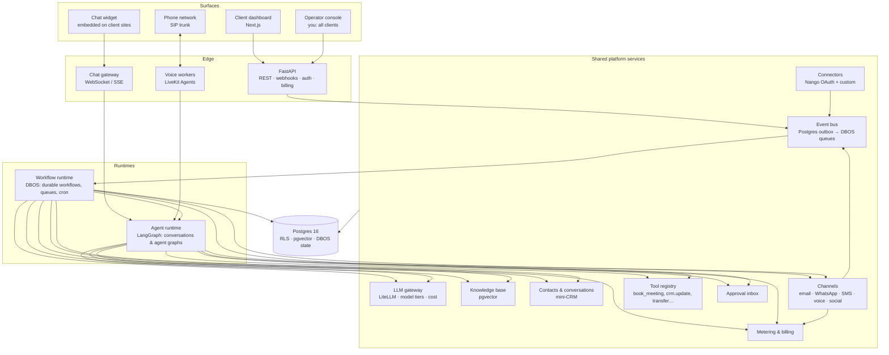

# Agentic Automations Platform — Plan

> One flexible, multi-tenant platform for selling many AI automations to many clients, on subscription, per-use or commission pricing. Each automation is a **template** assembled from shared building blocks; each client gets **instances** of templates, configured for their business.

Status: plan only, no code yet. Last updated 2026-10-24.

| Doc | What |
|---|---|
| This file | Platform architecture, stack, pricing, phases |
| [decisions/0003-models-openai-and-gemini.md](decisions/0003-models-openai-and-gemini.md) | OpenAI + Gemini tier chains with fallback, per-client overrides, test-set results |
| [decisions/0001-runtime-and-models.md](decisions/0001-runtime-and-models.md) | Why DBOS + LangGraph + LiveKit + any-LLM (and not n8n / Temporal / a single agent framework) |
| [automations/boring-machine.md](automations/boring-machine.md) | **Flagship product**: five lead sources → one lead engine → booked appointments |
| [PRICING.md](PRICING.md) | Pricing playbook: three models, "What is it worth?" calculator, default offer per automation, upsell ladder |
| [automations/invoice-follow-up.md](automations/invoice-follow-up.md) | Spec: invoice follow-up |
| [CLIENT-PORTAL.md](CLIENT-PORTAL.md) | **Client logins, roles, onboarding wizard, the all-in-one dashboard, stats architecture** |
| [DESIGN.md](DESIGN.md) | Brand, landing page, client portal, Agentry HQ, UI stack |
| [GO-TO-MARKET.md](GO-TO-MARKET.md) | How to start: one automation, one niche, demo with THEIR name, 2-min video, start small → upsell; **Demo Studio** and **industry packs** |
| [automations/inbox-triage.md](automations/inbox-triage.md) | Spec: inbox triage (entry product) |
| [automations/ai-receptionist.md](automations/ai-receptionist.md) | Spec: AI receptionist |
| [automations/lead-reactivation.md](automations/lead-reactivation.md) | Spec: lead reactivation |
| [automations/content-repurposing.md](automations/content-repurposing.md) | Spec: content repurposing (1 video → 10 moments → 30 posts) |
| [automations/cold-email.md](automations/cold-email.md) | Spec: personal cold email (Places → decision maker → verify → personal first line → sequence) |
| [../mock-data/](../mock-data/README.md) | Mock pilot clients and test sets |

**Decisions so far**

| Topic | Decision |
|---|---|
| Market | India **and** international (INR + USD; Razorpay + Stripe; WhatsApp + email; Indian languages) |
| Sender identity | Messages go out from the client's own mailbox and WhatsApp number (cold email is the exception, see §4.8) |
| Pricing | Three models from the reference: **retainer** (setup + monthly), **pay per result** (per booked appointment at 10–20% of customer value), **start small then upsell** (inbox triage → invoices → lead engine). Configurable per client. See [PRICING.md](PRICING.md) |
| Workflow engine | **DBOS** (durable workflows inside Postgres), Python |
| Agent framework | **LangGraph** where an agent loops through tools or multiple steps; direct LLM calls everywhere else |
| Models | **Model-agnostic** via LiteLLM. Free local and free-tier models in development; the cheapest model that passes the test sets in production |
| Pilots | None yet. Mock tenants in `mock-data/` |
| Name | **Agentry** |
| Business model | **Agency-operated SaaS**: you set up and run agents for clients; clients use a polished portal (results, approvals, conversations). Great UI + landing page required ([DESIGN.md](DESIGN.md)) |
| Niches | **All three**, via industry packs: B2B service firms (entry: inbox triage), appointment businesses (entry: website chat / receptionist), home services (entry: speed-to-lead). See [GO-TO-MARKET.md](GO-TO-MARKET.md) |

---

## 1. The automation catalog

| # | Automation | What it does | Category |
|---|---|---|---|
| 1 | **Invoice & payment follow-up** | Chases unpaid invoices on a 7/14/21/28-day sequence, understands replies, stops on payment | Finance |
| 2 | **Inbox triage** | Classifies every incoming email, extracts details, labels or routes it, drafts replies, alerts on urgent items, sends a daily digest | Operations |
| 3 | **Content repurposing engine** | Turns one video, podcast or blog into LinkedIn, X, Instagram, newsletter and short-video scripts in the brand voice; approval, then scheduled publishing | Marketing |
| 4 | **AI receptionist** | Answers inbound calls 24/7: FAQs from the knowledge base, books appointments, takes messages, transfers to a human | Front office |
| 5 | **Speed-to-lead AI voice agent** | Calls a new lead within ~60 seconds of a form submission, qualifies them, books a meeting, logs it to the CRM | Sales |
| 6 | **Website lead chat agent** | Embeddable chat widget that answers from the knowledge base, qualifies visitors, captures leads, books meetings, hands off to a human | Sales |
| 7 | **Lead reactivation** | Re-engages old or cold leads from the CRM over SMS, WhatsApp or email, holds the AI conversation, books the interested ones | Sales |
| 8 | **Personalised cold email** | Researches each prospect, writes a personalised first line or email, sends through warmed-up sending infrastructure, handles replies, books meetings | Sales |
| ★ | **The Boring Machine** (bundle) | Cold email + website chat + speed-to-lead + receptionist + reactivation feeding **one lead engine** (single identity, one voice, shared qualification and booking, no-show recovery) → a calendar full of booked appointments. See [spec](automations/boring-machine.md) | Sales: **flagship** |
| … | More | Review collection, appointment reminders, GST/document chasing, quote follow-up, onboarding, dunning | |

### 1.1 What they have in common

Looking across the catalog, nine automations reduce to about a dozen shared **building blocks**. Building those blocks once is what makes the platform flexible: a new automation is mostly configuration plus a small amount of glue code.

| Building block | Invoice | Inbox | Content | Receptionist | Speed-to-lead | Web chat | Reactivation | Cold email |
|---|---|---|---|---|---|---|---|---|
| Durable workflow (wait days, retry) | ● | ○ | ● | ○ | ● | ○ | ● | ● |
| **Sequence engine** (step N on day X, stop on event) | ● | | | | ○ | | ● | ● |
| Conversational agent (multi-turn, tools) | ○ | | | ● | ● | ● | ● | ○ |
| Single-shot LLM tasks (classify / extract / draft) | ● | ● | ● | ○ | ○ | ○ | ● | ● |
| Agent graph with loops (draft → critique → rewrite) | | | ● | | | | | ○ |
| Knowledge base (RAG over client docs/site) | | ● | ○ | ● | ● | ● | ● | ○ |
| Contacts / leads (mini-CRM + CRM sync) | ● | ● | | ● | ● | ● | ● | ● |
| Calendar booking | | | | ● | ● | ● | ● | ● |
| Channel: email | ● | ● | ○ | | | | ● | ● |
| Channel: WhatsApp / SMS | ● | | | ○ | ○ | | ● | |
| Channel: voice (phone) | | | | ● | ● | | ○ | |
| Channel: web chat widget | | | | | | ● | | |
| Channel: social publishing | | | ● | | | | | |
| Approval inbox (human in the loop) | ● | ● | ● | ○ | | ○ | ● | ● |
| Outcome attribution (₹ recovered, meeting booked) | ● | | | ○ | ● | ● | ● | ● |

● core · ○ optional

**Key observation:** invoice follow-up, lead reactivation and cold email are the *same* sequence engine with different content and stop conditions. Receptionist, speed-to-lead and web chat are the *same* conversational agent on different channels (phone in, phone out, browser).

---

## 2. Architecture



### 2.1 Three runtimes, because automations behave in three different ways

| Runtime | For | Latency | Tech |
|---|---|---|---|
| **Workflow runtime** | Anything that waits (days for an invoice, hours for a transcription, until a scheduled publish time) or must not run twice | Seconds to weeks | **DBOS** workflows + queues + scheduled jobs |
| **Agent runtime** | Multi-turn conversations with tools (chat, WhatsApp threads) and agent graphs with loops (content draft → critique → rewrite) | Sub-second to minutes | **LangGraph** with a Postgres checkpointer |
| **Voice runtime** | Live phone calls: speech-to-text → LLM → text-to-speech in under a second, interruptions, call transfer | Under 1 s per turn | **LiveKit Agents** (Python) + SIP trunk |

They connect through the same pieces: a voice call ends → `call.completed` event → a DBOS workflow books the meeting, writes it to the CRM, sends the WhatsApp confirmation and records a billing meter.

### 2.2 The event bus: how automations trigger and chain

Everything that happens is an event: `lead.created`, `email.received`, `invoice.overdue`, `payment.received`, `call.completed`, `message.replied`, `content.uploaded`, `booking.created`.
- Written to a Postgres **outbox** table in the same transaction as the change, then dispatched by DBOS queues. No Kafka needed at this scale.
- Automation instances **subscribe** to events with filters.
- Automations can **chain**. For example, inbox triage classifies an email as a sales enquiry → emits `lead.created` → speed-to-lead calls them within 60 s → books a meeting.

### 2.3 Agent spec: one definition, any channel

An agent (persona, instructions, knowledge, tools, guardrails) is defined **once** and runs on any channel. The AI receptionist, the website chat agent and the WhatsApp reactivation agent for a client can share the same "brain":

```python
AgentSpec(
    key="front_desk",
    persona="Asha, front-desk assistant at {business_name}",
    instructions=prompt("front_desk/v3"),
    knowledge=["website", "faq", "price_list"],          # knowledge-base collections
    tools=["book_meeting", "check_availability", "crm.upsert_lead", "transfer_to_human", "take_message"],
    model_tier="conversation",                            # resolved via LLM gateway
    languages=["en", "hi"],
    guardrails=Guardrails(no_pricing_promises=True, max_discount=0, pii_redaction=True),
    handoff=Handoff(when=["angry", "asks_for_human", "low_confidence"], to="client_team"),
)
```

### 2.4 Automation template = code + config

```python
class SpeedToLead(AutomationTemplate):
    key = "speed_to_lead"
    name = "Speed-to-lead AI voice agent"
    category = "sales"
    config = SpeedToLeadConfig                 # Pydantic → JSON Schema → dashboard settings form
    requires = [Cap.LEAD_SOURCE, Cap.VOICE_OUTBOUND, Cap.CALENDAR]
    optional = [Cap.CRM_SYNC, Cap.WHATSAPP]
    triggers = [On("lead.created", where="source in config.sources")]
    workflow = speed_to_lead_workflow          # DBOS workflow
    agents = {"caller": "qualifier"}           # AgentSpec keys
    metrics = ["time_to_first_call", "connect_rate", "qualified_rate", "meetings_booked"]
    meters = [Meter("call_minutes"), Meter("meeting_booked", outcome=True)]
```

### 2.5 How flexible is "flexible"? Three levels

| Level | Who | How | Example |
|---|---|---|---|
| **1. Configure** | Client, in the dashboard | Settings form generated from the template's config schema | Change the reminder days, working hours, tone, which calendar |
| **2. Customise** | You (operator), per client | Edit prompts, personas, sequences, knowledge, tool permissions. Versioned, tested against the test sets | A dental clinic's receptionist that also handles insurance questions |
| **3. Build** | Developer | New `AutomationTemplate` in code, reusing building blocks: usually **1–3 days** once the platform exists | A new "review collection" automation |

**No drag-and-drop workflow builder in v1.** Visual builders are where n8n and Make already compete; your value is *finished, outcome-guaranteed automations*. A JSON "recipe" format (trigger → steps → actions) can be added later if many small variations appear.

### 2.6 Data model (shared spine)

| Group | Tables |
|---|---|
| Tenancy & access | `organizations` (tenants), `locations`, `users`, `memberships` (role + locations), `invitations`, `login_audit` (row-level security on everything below) |
| Onboarding & support | `onboarding_progress`, `change_requests`, `support_tickets` |
| Stats | `metric_definitions`, `metrics_daily`, `notification_preferences`, `report_schedules` |
| Catalog | `automation_templates` (code-registered), `automation_instances` (tenant × template × config × status), `agent_specs`, `prompt_versions` |
| Connections | `connections` (Nango connection IDs, encrypted secrets), `phone_numbers`, `sending_domains`, `whatsapp_numbers` |
| People | `contacts`, `companies`, `leads` (stage, source, score), `crm_links` (external IDs) |
| Interactions | `conversations` (channel-agnostic), `messages`, `calls` (recording, transcript, summary), `bookings` |
| Work | `events` (outbox), DBOS's own workflow tables, `tasks`, `approvals`, `sequences`, `sequence_enrollments` |
| Knowledge | `kb_sources`, `kb_documents`, `kb_chunks` (pgvector) |
| Domain-specific | `invoices`, `payments` (invoice); `content_sources`, `content_assets`, `publications` (content) |
| Money | `pricing_plans`, `usage_events`, `outcomes` (attributed results), `statements`, `llm_costs` |
| Trust | `audit_log`, `consents` (call/SMS/WhatsApp/email), `suppression_list` (opt-outs, DND) |

### 2.7 Client portal & Agentry HQ

You operate the platform, so setup happens mostly in Agentry HQ. The client portal is **results first, mobile first**. Visual design: [DESIGN.md](DESIGN.md).

Full spec (logins and roles, 11-step onboarding wizard, Home and per-automation pages, reports, one metric registry shared by dashboard, reports and billing): **[CLIENT-PORTAL.md](CLIENT-PORTAL.md)**.


| Area | What |
|---|---|
| **Overview** | Results across all automations: ₹/$ recovered, leads contacted, meetings booked, calls answered, posts published, hours saved |
| **Automations** | Catalog → install → connect → configure → go live; status and health per instance |
| **Unified inbox** | One queue for everything that needs a human: drafts to approve, escalated chats and calls, disputes, low-confidence items |
| **Conversations** | Every email, chat, WhatsApp thread and call (with recording and transcript) per contact |
| **Contacts & leads** | Mini-CRM with timeline across automations, stages, CRM sync status |
| **Agents** | Personas, voices, brand voice, knowledge base, tools, test console ("talk to your receptionist") |
| **Content** | Content calendar, drafts per platform, published posts |
| **Reports** | Per-automation funnels and KPIs; export |
| **Billing** | Plan, usage, outcome statements with evidence |
| **Settings** | Team, connections, phone numbers, domains, consent and compliance settings |

**Operator console (you):** **Demo Studio** (prospect URL → personalised demo link), **industry packs**, ROI calculator and proposal generator for prospects, all clients, onboarding checklist per client, per-client prompt overrides, test-set runs, failures and alerts, **margin per client per automation** (LLM + voice minutes + messaging cost vs revenue), audited impersonation. White-label resale is out of scope for now.

---

## 3. Tech stack

| Layer | Choice | Why |
|---|---|---|
| Dashboard + operator console | **Next.js 15 + TypeScript + Tailwind + shadcn/ui** | Same as your other projects |
| Chat widget | Preact + Shadow DOM, one `<script>` tag | Small, doesn't clash with client site CSS |
| API | **FastAPI** (Python 3.12), Pydantic v2 | Same language as the AI, voice and workflow code |
| Workflow runtime | **DBOS Transact** (Python, MIT) | Durable sleep/recv/send, queues, cron, exactly-once steps; **only needs Postgres** |
| Agent runtime | **LangGraph** + `PostgresSaver` | Multi-turn tool-calling agents, agent graphs, interrupts for approval |
| Voice runtime | **LiveKit Agents** (Python, Apache 2.0) + LiveKit server (self-host or LiveKit Cloud) | Open source; pluggable speech-to-text, LLM and text-to-speech; turn detection; SIP in/out |
| Telephony | Twilio / Telnyx (global), **Plivo / Exotel** (India) SIP trunks | Local numbers, Indian compliance |
| Speech | Deepgram (STT), **Sarvam AI** (Indian-language STT/TTS), ElevenLabs / Cartesia (TTS), all pluggable | Quality vs cost per language |
| LLM gateway | **LiteLLM** (library or proxy) | Any provider; model tiers; fallbacks; per-tenant cost tracking |
| Models | Dev: **Ollama** (local) + Gemini free tier. Prod: chosen per tier by test sets (OpenAI / Claude / Gemini / Groq / open models) | No lock-in; cost control |
| DB | **Postgres 16** + **pgvector** + RLS; SQLAlchemy 2 + Alembic | One database for app data, vectors and workflow state |
| Cache / rate limits | Redis | Per-tenant and per-channel throttles |
| Connectors | **Nango** (open source, self-host) for OAuth and 250+ APIs (Gmail, Outlook, HubSpot, Zoho, Salesforce, Pipedrive, GoHighLevel, Google Calendar, QuickBooks, Xero…); custom for Tally and Sheets | Don't hand-build OAuth refresh for every CRM |
| Calendar | Google / Microsoft Calendar via Nango, or **Cal.com** (open source) | Booking across receptionist, chat, speed-to-lead |
| Messaging | Gmail API / Microsoft Graph; Meta WhatsApp Cloud API; MSG91 / Twilio SMS; **Telegram Bot API** (owner alerts) | Client's own identity |
| Demos | **Demo Studio**: prospect URL → sandboxed demo tenant with THEIR name in under 10 min ([GO-TO-MARKET.md](GO-TO-MARKET.md)) | "Build a demo with THEIR name" |
| Cold email sending | Dedicated sending domains + mailboxes; integrate **Instantly / Smartlead** APIs, or self-run SMTP with warm-up | Deliverability is its own discipline; protect the client's main domain |
| Social publishing | Platform APIs (LinkedIn, X, Meta, YouTube) or a unified API (Ayrshare / Buffer) | Many platforms, one interface |
| Media | ffmpeg; Whisper / Deepgram for transcription; S3-compatible storage | Content repurposing |
| Auth | **Better Auth** (self-hosted: organisations, invitations, roles, magic links, admin) with EdDSA JWTs verified in FastAPI. See [ADR 0002](decisions/0002-auth-better-auth.md) | Multi-org, invites, roles; data in our Postgres |
| Billing | Stripe Billing + Razorpay Subscriptions, usage-based | India + international |
| Observability | OpenTelemetry → Grafana/Loki/Tempo; **Langfuse** (LLM traces, cost, evals) | Debugging agents; margin per tenant |
| Package mgmt | **uv** workspace (Python) + pnpm (JS) | Fast, one lockfile per language |
| Deploy | Docker → **k3s on Oracle Cloud** (Mumbai/Hyderabad region for Indian latency); LiveKit Cloud first, self-host later | Existing setup; voice needs UDP and low latency |

### Repo layout (as built in Phase 0)

```
agentic-automations/
  apps/
    web/                    # Next.js marketing site (landing page, ROI calculator, demo form)
    dashboard/              # Next.js client portal + Agentry HQ; Better Auth lives here (/api/auth/*)
  packages/
    ui/                     # design tokens (light/dark) + shared components
  backend/                  # Python (uv): package `agentry`
    src/agentry/
      api/                  # FastAPI routes: public, me, org, hq
      worker/               # DBOS worker: outbox dispatch, rollups, event handlers
      llm/                  # LiteLLM gateway (model tiers, mock mode), prompt registry, eval runner
      notify/               # platform email
      auth.py db.py events.py audit.py metrics.py permissions.py seed.py cli.py
    migrations/             # Alembic (plain SQL, explicit RLS policies)
    prompts/                # versioned prompt files
    config/metrics.yaml     # metric registry
    tests/                  # tenancy (RLS), API, LLM
  config/roles.json         # roles & permissions shared by dashboard and API
  infra/postgres/init.sql   # DB roles and schemas
  mock-data/                # mock tenants + test sets
  docs/
```

Later phases add `services/voice/` (LiveKit agents), `apps/widget/` (chat widget), and `backend/src/agentry/{agents,sequences,channels,connectors,knowledge,crm,billing}` plus `automations/<key>/` as each building block arrives.

---

## 4. Per-automation notes (detailed specs to follow in `docs/automations/`)

### 4.1 Invoice & payment follow-up
See [automations/invoice-follow-up.md](automations/invoice-follow-up.md). Uses sequences + single-shot LLM + email/WhatsApp + payments.

### 4.2 Inbox triage
Full spec: [automations/inbox-triage.md](automations/inbox-triage.md). Reference: classify (Urgent / Client / Promotion / Spam) → label → urgent: WhatsApp/Telegram alert to owner; otherwise the AI drafts a reply **as a draft in the thread** and the human sends. Summary: Trigger: `email.received` (Gmail push / Graph subscription) → `fast` tier classify + extract → label/move/forward → optional knowledge-grounded draft reply to the approval inbox → urgent alerts (Slack/WhatsApp) → daily digest (cron). Emits `lead.created` / `invoice.reply` / `support.ticket` for other automations. Meter: emails processed.

### 4.3 Content repurposing engine
Full spec: [automations/content-repurposing.md](automations/content-repurposing.md). Summary: Trigger: upload or link (YouTube, podcast RSS, blog URL, Drive folder watch) → DBOS workflow: download → transcribe → **LangGraph graph**: extract key ideas → per-platform draft (fan out) → critic node checks brand voice, length and hook → rewrite (max N loops) → approval → schedule → publish → collect engagement metrics. Per-client **brand voice profile** learned from their past posts. Meter: source pieces processed / assets generated.

### 4.4 AI receptionist
Full spec: [automations/ai-receptionist.md](automations/ai-receptionist.md). Reference: 24/7 incoming calls → FAQ / book / reschedule / cancel → transfer to human if needed. Summary: Inbound call → SIP → LiveKit → agent (`AgentSpec` with knowledge, booking, transfer, take-message tools). After the call: summary, CRM update, follow-up WhatsApp/email, missed-call text-back. Business hours and holiday rules, warm transfer to staff. Meter: call minutes; outcome: bookings.

### 4.5 Speed-to-lead AI voice agent
Reference flow: form / Facebook ad lead → wait ~1 min → AI voice call → qualify → book. `lead.created` from form, ads (Meta lead ads), CRM or inbox triage → DBOS: consent and DND check → call within ~60 s (respecting calling hours) → qualify with a script → book or hand to a human → retry policy if no answer (call again, then SMS/WhatsApp) → CRM write-back. Meter: calls; outcome: meetings booked.

### 4.6 Website lead chat agent
Reference flow: greet → 3 questions (need, budget, timeline) → qualified: CRM + book a call; not qualified: a helpful answer, no hard sell. Widget → chat gateway → same `AgentSpec` model as the receptionist, plus lead-capture form-filling in conversation, booking, human takeover from the unified inbox. Knowledge from a site crawl. Meter: conversations; outcome: leads captured / bookings.

### 4.7 Lead reactivation
Full spec: [automations/lead-reactivation.md](automations/lead-reactivation.md). Reference: old leads (sheet/CRM) → AI calls/messages **one by one** → re-qualifies → books. Summary: CSV or CRM import → segment → sequence (SMS/WhatsApp/email) with an AI conversational reply handler → interested → book → CRM stage update. Needs consent and opt-in checks first. Outcome: reactivated leads / bookings.

### 4.8 Personalised cold email
Full spec: [automations/cold-email.md](automations/cold-email.md). Summary: Prospect list (CSV / Apollo-style source) → enrichment (website scrape + LLM research summary per prospect) → personalised email → sequence through **dedicated sending domains**, never the client's main domain → reply classification (interested / not now / unsubscribe / OOO) → book. Deliverability guardrails: warm-up, daily caps per mailbox, bounce and spam monitoring. Outcome: positive replies / meetings.

### 4.9 The Boring Machine (bundle)
Not a separate automation: a **bundle template** that installs automations 4–8 plus the **lead engine** policy: identity resolution, one-owner-at-a-time contact policy (inbound beats outbound), shared qualification, a shared booking service with reminders and no-show recovery, a unified pipeline and attribution. Priced per booked (or showed) appointment. Full spec: [automations/boring-machine.md](automations/boring-machine.md).

---

## 5. Pricing

Full playbook: **[PRICING.md](PRICING.md)**. Summary:

| Model | Shape | Typical automations |
|---|---|---|
| **Retainer** | Setup fee once + monthly retainer | Content repurposing, inbox triage, receptionist, cold email |
| **Pay per result** | Per booked appointment = 10–20% of the client's customer value; or % of overdue amount recovered | Speed-to-lead, reactivation, web chat, Boring Machine, invoices |
| **Start small → upsell** | Inbox triage → invoice follow-up → lead engine | Every new client |

Platform features this needs: flexible `PricingPlan` (setup, retainer, included usage + overage, per-result fixed or % of customer value, revenue share, caps, pilot period), **ROI calculator + proposal PDF**, **monthly results report with ROI multiple**, an **opportunity report** generated from inbox triage (missed leads, overdue invoices) to drive upsells, outcome evidence on every billed result, and margin per client.

## 6. Compliance (varies by automation)

| Area | Rules to respect |
|---|---|
| All | DPDP Act 2023 (India), GDPR (EU), data processing agreements, data residency, deletion on request, audit log |
| AI disclosure | Tell callers and chat users they are talking to an AI assistant (required in several jurisdictions; good practice everywhere) |
| Voice outbound | India: TRAI rules for commercial calls, DND registry scrub, approved number series. US: TCPA, where AI-generated voices count as "artificial voice" and need prior express consent. Calling-hour limits |
| Call recording | Consent announcement; two-party consent states/countries |
| WhatsApp | Opt-in; Meta-approved templates outside the 24 h window |
| SMS | India: DLT-registered headers and templates; US: 10DLC registration |
| Cold email | CAN-SPAM (US), GDPR legitimate interest + easy opt-out (EU), unsubscribe honoured globally, separate sending domains |
| Collections | No harassment, no third-party disclosure, quiet hours |

Built into the platform: a `consents` table, a global `suppression_list` per tenant (opt-outs, DND, bounces), and a pre-send compliance check every channel must pass.

---

## 7. Delivery phases

Ordered so each phase adds a **new building block** and reuses the earlier ones.

| Phase | Builds | New building block | Exit criteria |
|---|---|---|---|
| **0. Platform core + brand** ✅ *built 2026-10-24* | Monorepo, tenancy + RLS, auth, event outbox, DBOS worker, LiteLLM gateway with model tiers, Nango, prompt registry + eval runner, audit, mock-data seeding; **design system (`packages/ui`) + landing page v1** with ROI calculator and demo-request form; **auth (orgs, roles, invites, org switcher)** | Core, brand | Two mock tenants isolated; landing page live and collecting demo requests |
| **1. Entry agents (text)** ✅ *built 2026-10-24* | **Inbox triage** (B2B entry) + **website chat agent** with knowledge base, AgentSpec + LangGraph, booking service (clinics entry; also runs on agentry's own site); **3 industry packs**; **Demo Studio v1**; **onboarding wizard v1**; client portal **Home + Automations pages**, Needs you, Conversations; metric registry + daily rollups | Email, agents, knowledge, booking, demos | Triage test set ≥ 90%; SmileCraft chat books a slot; a demo with a prospect's name is built in under 10 min |
| **1b. Real channels** ✅ *built 2026-10-24* | **Gmail** (OAuth, sync, labels, threaded drafts, send on approval) and **WhatsApp Cloud API** (signed webhooks, AI assistant, 24-hour rule, statuses, templates); Connections page; setup guides in `docs/setup/` | Connectors, encrypted credentials | 6 end-to-end tests against fake Google/Meta; real use needs the Google OAuth client and Meta app from the guides |
| **2. Sequences + lead engine** ✅ *built 2026-10-24* | **Sequence engine** → **invoice follow-up** (B2B rung 2) + **lead reactivation** (text) + instant-text **speed-to-lead**; lead engine core (identity, one-owner rule, pipeline); WhatsApp/SMS; consent + suppression | Sequences, lead engine, messaging | Invoice + reactivation scenarios in `mock-data/` pass; duplicate leads merge |
| **3. Billing + launch** ✅ *built 2026-10-24* | Setup + retainer billing (Stripe/Razorpay, GST invoices), client portal polish (reports + scheduled PDFs, notifications, exports, onboarding nudges, PWA), **Agentry HQ**, proposal PDF, k3s deploy on Oracle, backups, alerts. *Built:* pricing plans incl. pay-per-booking + capped recovery share, evidence-backed monthly statements, disputes, payment links, results report with ROI, CSV exports, notification preferences, HQ client page + margin + proposal builder, Docker images, k3s manifests, backups, alerts ([DEPLOY.md](DEPLOY.md)). *Also done 2026-10-25:* monthly results email (2nd, 09:00 IST), installable portal (PWA), onboarding reminders (stalled 3+ days) + ops list, partial-credit disputes, production images verified in Compose and k3s | Billing, ops | **First paying clients**, in any niche, on text agents |
| **4. Voice** 🟡 *in progress: 4.1 browser calls + 4.2 recordings and call summaries built 2026-10-25; 4.3 phone numbers next ([PHASE-4-VOICE.md](PHASE-4-VOICE.md))* | LiveKit, SIP trunks, speech providers; **speed-to-lead calls** (home-services entry) + **AI receptionist** (clinics upsell); **pay-per-result billing** with evidence → full **Boring Machine** | Voice runtime, outcome billing | Under 1 s average response latency; form → call in ~60 s; per-booking statement correct |
| **5. Cold email** 🟡 *planned 2026-10-25: [PHASE-5-COLD-EMAIL.md](PHASE-5-COLD-EMAIL.md)* | Places sourcing, finder waterfall, verification, grounded first lines, sending via Instantly/Smartlead, replies into the lead engine. Used **for Agentry's own outreach** (sending the 2-min demo videos) and as a client agent | Enrichment, deliverability | Mock Places funnel reproduced; first Agentry outbound campaign running |
| **6. Content repurposing** | Ingest + transcription, 10 moments × 3 platforms, critic loop, quote cards, review board, calendar, publishing | Agent graphs, media, publishing | One 45-min video → 30 posts with images in under 30 min |
| **7. More** | Review collection, appointment reminders, quote follow-up… as new packs and templates | — | Each new automation takes days, not weeks |

**Why this order (all three niches):** each niche's *entry* agent arrives as early as possible: B2B and clinics in Phase 1 (text only, cheap to build), home services in Phase 4 once voice exists. Phase 2's sequence engine serves all three (invoices, reactivation, speed-to-lead texts). Revenue starts in Phase 3. The landing page goes live in Phase 0 so demand builds while the product is being built.

## 8. Name: Agentry

**Agentry** (agents + foundry). Tagline candidates: *"Your AI workforce, done for you."* / *"AI agents that do the boring work. You keep the results."*

| Product line | Name |
|---|---|
| Platform / company | Agentry |
| Lead engine bundle | **The Boring Machine** (by Agentry) |
| Individual agents | Agentry Receptionist, Agentry Chat, Agentry Reactivate, Agentry Speed-to-Lead, Agentry Outbound, Agentry Inbox, Agentry Collect, Agentry Studio |
| Operator console | Agentry HQ |

To do before launch: check domains (.ai / .in / .com) and trademarks (ipindia.gov.in, USPTO). If "Agentry" is taken, fall back to a variant (e.g. *getagentry*, *agentry.ai*) or a runner-up name.

## 9. Open questions

1. Domain and trademark availability for Agentry.
2. Which niche leads the **first outbound campaign** (the platform serves all three; outreach is still best run one niche at a time, see GO-TO-MARKET.md §4).
