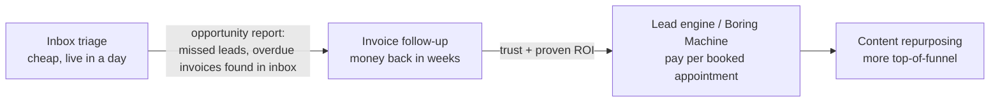

# Pricing playbook

> How Agentry charges clients, and what the platform must support to make it work. Prices below are **starting hypotheses** to test with the first prospects, not market research.

## 1. Three ways to charge (from the reference "How to charge")

| Model | How it works | Best for | Risk sits with |
|---|---|---|---|
| **1. Retainer** | **Setup fee** (once) + **monthly retainer**, paid every month | Content repurposing, inbox triage, receptionist, cold email infrastructure | Client |
| **2. Pay per result** | A fee per **booked appointment**, set at **10–20% of what one customer is worth** to the client. "You win when they win." | Speed-to-lead, reactivation, website chat, the Boring Machine | You |
| **3. Start small, then upsell** | Get a foot in the door with a cheap, quick win, then climb the ladder: **inbox triage → invoices → lead engine** | Every new client | Shared |

Most real deals are a **hybrid**: a setup fee (covers onboarding cost), a small retainer (covers running costs: voice minutes, messaging, domains), and pay-per-result on top.

## 2. "What is it worth?" (value-based price anchor)

```
money lost per month = leads per month × % missed × close rate × value per customer
your fee            = a slice of the money you win back
```

| | Reference example (US) | India example (dental clinic) |
|---|---|---|
| Leads per month | 100 | 150 |
| Missed (not answered or not followed up) | 20% → 20 | 30% → 45 |
| Would buy | 1 in 5 | 1 in 4 |
| Customers lost | 4 | ~11 |
| Value per customer | $500 | ₹8,000 |
| **Lost per month** | **$2,000** | **₹90,000** |
| Per-result fee (10–20% of customer value) | $50–100 per booking | ₹800–1,600 per booking |
| Or retainer (≈ 20–30% of the money won back) | $400–600 / month | ₹18,000–27,000 / month |

The calculator is a **platform feature** (§5): it is used in sales calls, put into proposals, and repeated every month with *real* numbers on the client's results report.

## 3. Default offer per automation

| Automation | Default model | Setup fee covers | Monthly retainer covers | Per-result option | Value anchor |
|---|---|---|---|---|---|
| **Inbox triage** (entry product) | Retainer, low | Connect mailbox, categories, routing rules | Emails processed | — | Hours saved × staff cost; leads no longer missed |
| **Invoice follow-up** | Retainer **or** % of recovered overdue | Source connection (sheet/Tally/Zoho), sequence and templates | Active invoices, WhatsApp | 1–3% of overdue amount recovered | Overdue ₹/$ recovered, lower days-to-get-paid |
| **Content repurposing** | **Setup + monthly retainer** | Brand voice profile, image templates, account connections | Long videos per month (each gives 10 moments × 3 platforms = **30 posts**) | — | Cost of a content editor or agency |
| **Personal cold email** | Setup + retainer, or per booked meeting | Domains, mailboxes, warm-up (2–3 weeks), ideal-customer profile, copy | Prospects researched and emailed, data credits | 10–20% of customer value per booked meeting | New meetings per month |
| **Website chat agent** | Setup + small retainer, or per booked call | Knowledge base from site, questions, widget install | Conversations | Per qualified lead or booked call | Visitors turned into booked calls |
| **Speed-to-lead** | **Pay per result** (slice of won-back money) | Form/ads hookup, call script, calendar | Included call minutes | 10–20% of customer value per booking | "What is it worth?" calculator |
| **AI receptionist** | Retainer with included minutes + overage | Phone number, knowledge base, transfer rules | Call minutes | Per booked appointment | Missed calls × value |
| **Lead reactivation** | **Pay per result** ("no win, no fee") | Import + clean the old-lead list | — | Per booked appointment | Revenue from leads they had written off |
| **The Boring Machine** | Setup + retainer + per booking | All of the above, one onboarding | Minutes, messages, domains | Per booked (or attended) appointment | Calendar fill rate |

## 4. The upsell ladder (start small)



**Inbox triage pays for its own upsell.** Once triage reads the inbox, the platform can generate an **opportunity report** with no extra work:

> *Last 30 days: 23 sales enquiries — 7 answered after more than 24 h, 4 never answered. 11 emails about invoices; ₹2.4 L mentioned as overdue. Estimated revenue at risk: ₹1.1 L/month.*

That report is the pitch for the next rung.

## 5. What the platform must support

| Capability | Detail |
|---|---|
| **Pricing plans** | Per client and per automation instance: `setup_fee` (one-time), `retainer` (monthly, annual discount), included usage + overage, per-result fees (**fixed** or **% of the client's customer value**), revenue share (% recovered), monthly caps, minimum fee, free pilot period, contract term |
| **Customer value** | Stored per client (and per service, e.g. aligners vs cleaning) so per-result fees can be calculated as 10–20% of it |
| **Outcome evidence** | Every billed result links to its proof: conversation or call + booking, or payment + reminder |
| **ROI calculator** | Public page + operator console: inputs → money lost → suggested retainer and per-result prices; exports a **proposal PDF** |
| **Monthly results report** | Per client: results, money won back (estimated, with method shown), fee paid, **ROI multiple**. Mainly a retention tool |
| **Opportunity report** | Generated from inbox triage (and later from other automations) to support upsells |
| **Billing** | Setup fee as a one-time invoice; retainer as a subscription; results and overage as metered usage. Stripe (international) + Razorpay (India); GST invoices for Indian clients |
| **Margin view** | Cost per client (LLM, voice minutes, messaging, data credits, domains) vs revenue |

```python
PricingPlan(
    setup_fee=Money(25000_00, "INR"),
    retainer=Money(9999_00, "INR"),
    included={"call_minutes": 500, "emails_processed": 5000},
    overage={"call_minutes": Money(6_00, "INR")},
    per_result=[Result("appointment_booked", pct_of_customer_value=0.15, min=Money(500_00, "INR"))],
    revenue_share=[Share("overdue_recovered", rate=0.02, cap=Money(25000_00, "INR"))],
    pilot_days=14, term_months=3,
)
```
