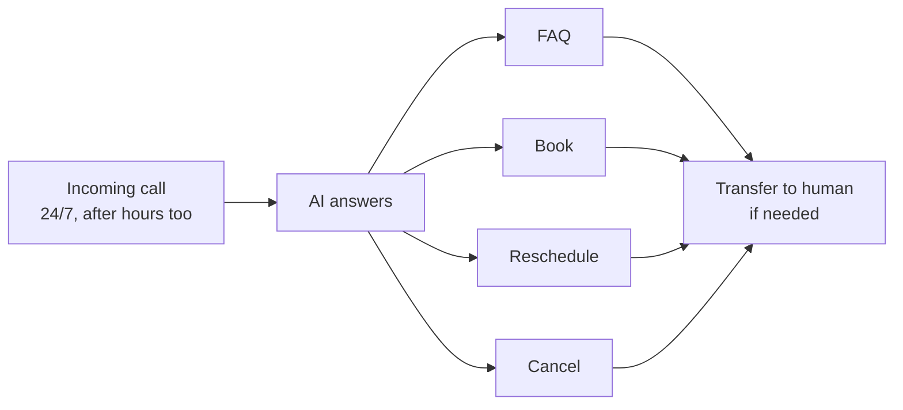
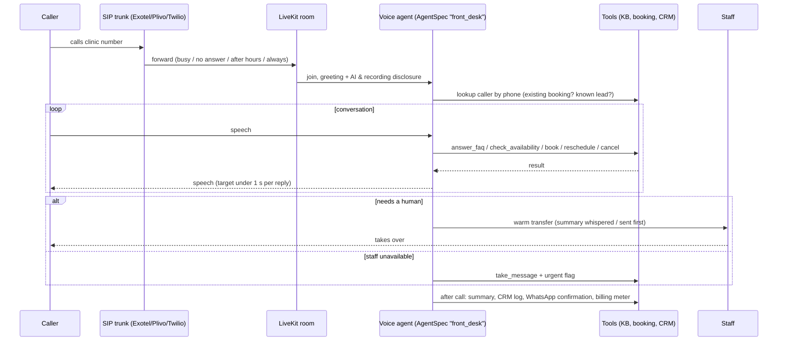

# Automation: AI Receptionist

> Part of the [Agentic Automations Platform](../PLAN.md) and one of the five sources of [The Boring Machine](boring-machine.md). Pricing: retainer with included minutes + overage, optionally per booking (see [PRICING.md](../PRICING.md)).

Status: spec, no code yet (2026-10-24).

## 1. Reference ("#2 AI receptionist")

**Missed call = missed customer.**

## 2. Product version

### 2.1 Details

| Topic | Decision |
|---|---|
| Number setup | **Call forwarding** from the existing number (on busy, no answer, after hours, or always) so the client keeps their number; or a new local number. India: Indian numbers through licensed providers (Exotel / Plivo); international: Twilio / Telnyx |
| Intents | From the reference: **FAQ, book, reschedule, cancel**, plus take a message, directions/hours, pricing questions (approved ranges only), "talk to a person" |
| Caller recognition | Caller ID matched to contacts → "I see you have an appointment on Tuesday at 5, do you want to move it?" Identity is confirmed (name or date of birth) before changing anything |
| Transfer to human | Warm transfer (SIP REFER / dial-out bridge), with the summary sent to the staff member first; if nobody answers, the AI comes back, takes a message and sends an urgent alert |
| Safety | Emergency script per industry (e.g. medical: advise calling emergency services 112/108; never give medical advice); angry or confused caller → human; spam/robocall detection → polite hang-up |
| Languages | English + Hindi at launch (+ Marathi/Tamil per client); speech providers chosen per language (Sarvam for Indian languages) |
| Latency budget | Under 1 s from end of caller speech to start of reply: streaming STT → LLM (`conversation` tier, short context) → streaming TTS, with good turn detection and interruption handling |
| After the call | Summary + transcript + recording in the conversation timeline; WhatsApp/SMS confirmation of bookings; CRM update; missed-transfer follow-up task |
| Disclosure & consent | "You're speaking with Asha, SmileCraft's AI assistant. This call may be recorded." Recording settings per jurisdiction |

## 3. Metrics
Calls answered (by hour → after-hours share), **containment rate** (resolved without a human), bookings / reschedules / cancellations, transfers, average handle time, response latency p50/p95, caller satisfaction (optional SMS rating).

## 4. Mock data
SmileCraft call scenarios in `mock-data/boring-machine/scenarios.jsonl` (Sunday hours FAQ, Monday booking, Hindi pain call → transfer, reschedule via reminder).
