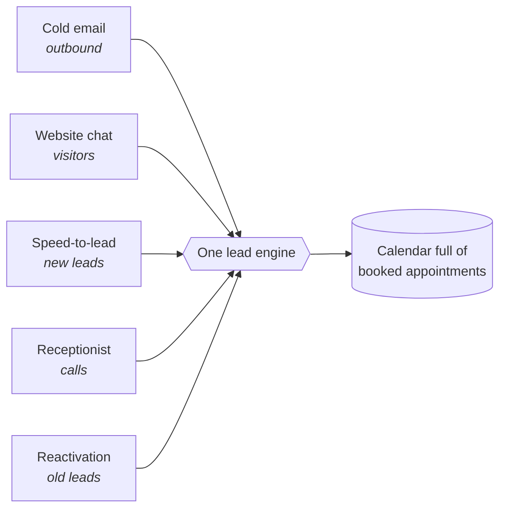
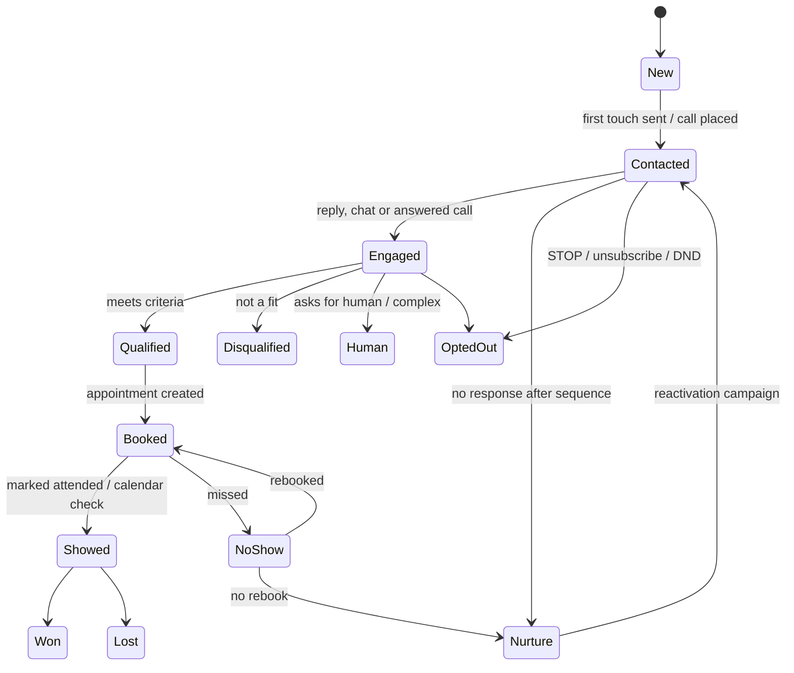
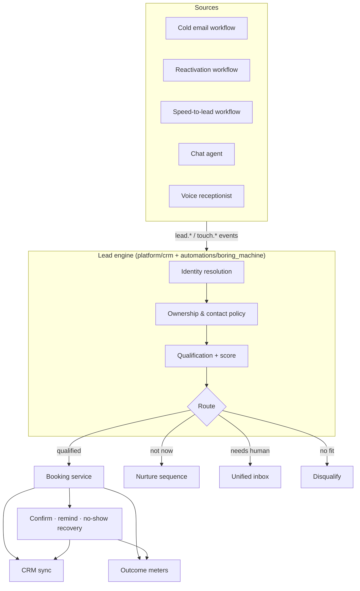

# Product: The Boring Machine (one lead engine)

> Part of the [Agentic Automations Platform](../PLAN.md). Flagship product: five lead automations feeding **one lead engine** whose only job is a **calendar full of booked appointments**.

Status: spec, no code yet (2026-10-24).

## 1. Reference (from screenshot "#1 The boring machine")

It's called "boring" because every part of it is unglamorous, repetitive work: answering, calling back, following up, re-engaging, booking. Businesses lose most of their leads by not doing this consistently. The machine does it every time, for every lead, at any hour.

## 2. What the five sources are and what each adds

| Source | Lead temperature | Starts when | Channel | Platform building blocks |
|---|---|---|---|---|
| Cold email | Cold (outbound) | Prospect list uploaded | Email from dedicated sending domains | Enrichment, sequences, reply classifier |
| Website chat | Warm (on the site now) | Visitor opens the widget | Web chat | AgentSpec, knowledge base, widget |
| Speed-to-lead | Hot (just filled a form) | `lead.created` from form, ads or CRM | Voice call within ~60 s, then WhatsApp/SMS | Voice runtime, retry policy |
| Receptionist | Hot (calling in) | Inbound call | Voice | Voice runtime, same AgentSpec |
| Reactivation | Lukewarm (old leads) | CRM or CSV import of past leads | WhatsApp / SMS / email | Sequences, conversational reply agent |

### 2.1 Source details from the reference screenshots

**Website chat agent (#5)**: the chat bubble greets ("Hi! How can I help you?") → asks **3 questions: need, budget, timeline** → *qualified?*
- **Yes** → add to CRM + **book a call** (in the chat, using the booking service).
- **No** → a **helpful answer, no hard sell** (knowledge-base answer, optional email capture for nurture).
- Default qualification schema for every client = `need`, `budget`, `timeline` (clients can add more, e.g. `area`, `pain`).

**Speed-to-lead (#4)**: form or Facebook ad lead → **wait ~1 minute** → AI voice agent **calls** → **qualifies** → **books on the calendar**. "Call them while they still care."
- The ~1-minute wait is deliberate: it gives the lead time to finish submitting and put the phone down, and it feels human rather than robotic. It is configurable (30–120 s).
- If there's no answer, a WhatsApp/SMS goes out immediately ("Tried calling about your enquiry, when's a good time?"), then retries per policy.
- Sales message from the reference: replying within 5 minutes instead of 30 makes a lead *21× more likely to qualify* (InsideSales.com + MIT study, 2007). It's an old study, so in sales material quote the client's own before/after speed metrics as soon as they exist.

**Personal cold email (#6)**: see [cold-email.md](cold-email.md). **AI receptionist (#2)**: see [ai-receptionist.md](ai-receptionist.md). **Lead reactivation (#3)**: see [lead-reactivation.md](lead-reactivation.md).

## 3. The lead engine: what "one engine" must guarantee

The five sources are useful on their own. The engine is what makes them **one product**:

### 3.1 One lead, not five
- **Identity resolution**: normalise phone (E.164) and email. Match on phone, then email, then name + company (fuzzy, sent for review if unsure). Merge into one `contact` with one `lead` per pipeline.
- Every touch from every source lands on the same **lead timeline**: emails, chats, calls (recording + transcript), WhatsApp messages, bookings.

### 3.2 One voice: no double-contacting
- At most **one automation owns the conversation** with a lead at any time (`lead.active_owner`).
- Priority: **inbound beats outbound**, and **hot beats cold**: receptionist call > website chat > speed-to-lead > reactivation > cold email.
  - Example: a cold-email prospect calls the business, so the receptionist takes over and the cold sequence pauses.
  - Example: a reactivation lead books, so every sequence for that lead stops.
- A global per-lead **frequency cap** and quiet hours across all channels, plus a consent and suppression check before every touch.

### 3.3 One qualification model
- Each client defines qualification questions once (e.g. service needed, budget, location, timeline, decision maker). Every agent (chat, voice, WhatsApp) uses the same schema and fills in whatever it learns.
- Lead score = rules + LLM judgement, with a reason shown to the client.

### 3.4 One booking service
- Calendars: Google / Microsoft / Cal.com. Supports **service types** (duration, location or video, price), staff **round-robin** or routing by skill or area, buffers, working hours, holidays and timezones.
- Every agent uses the same tools: `check_availability`, `book`, `reschedule`, `cancel`.
- **After booking** (this is what keeps the calendar *full*, not just booked):
  - Confirmation via WhatsApp / email / SMS with add-to-calendar.
  - Reminders at 24 h and 2 h, with reply to confirm, reschedule or cancel (handled by the agent).
  - **No-show recovery**: if nobody marks "showed", the lead enters a rebooking sequence.
  - Cancellations go into a waitlist / fill-the-gap offer to warm leads.

### 3.5 One pipeline

### 3.6 One source of truth for results
- **Attribution**: first touch (where the lead came from), booking touch (which agent booked it), and every touch in between.
- **Funnel per source**: leads → contacted → engaged → qualified → booked → showed → won.
- **Speed metrics**: time to first touch (target under 60 s for form leads), time to booking.
- **Cost per booked appointment** per source (LLM + voice minutes + messaging + sending infrastructure) vs the client's revenue per appointment, which gives ROI per client.
- **Calendar fill rate**: booked slots ÷ available slots.
- Two-way **CRM sync** (HubSpot, Zoho CRM, GoHighLevel, Pipedrive, Salesforce) via Nango. Pipeline stages are mapped to the client's CRM stages.

## 4. How it runs on the platform

- Each source is its own `AutomationTemplate` and can be sold alone.
- **The Boring Machine is a bundle template**: it installs the five sources plus the lead-engine policy (ownership priority, shared qualification, shared booking, shared persona) with one onboarding flow.
- The same `AgentSpec` ("front desk") powers the chat, receptionist and speed-to-lead agents, so the business has one consistent voice everywhere.

## 5. Onboarding a client (target: live in one day)

1. Business profile: services, prices, areas served, hours, FAQs. The website is crawled into the knowledge base automatically, then the client edits it.
2. Calendars + staff + service types.
3. Qualification questions and disqualifiers.
4. Persona: name, tone, languages, voice.
5. Connect the sources the client wants: website widget snippet, forms or ads webhook, phone number (new or forwarded), old-leads CSV/CRM, cold prospect list + sending domains.
6. Test console: talk to the agent by chat and phone, and run a simulated lead through every source.
7. Go live in **approval mode** for outbound messages for the first week.

## 6. Pricing

Following the reference "How to charge" and "What is it worth?" (full playbook in [PRICING.md](../PRICING.md)):
- **Pay per result**: per **booked appointment**, priced at **10–20% of what one customer is worth** to the client (stored per client and per service, so a high-value service such as implants is priced higher).
- **Retainer**: setup fee + monthly retainer (covers voice minutes, messaging, sending domains).
- **Hybrid** (default for the full bundle): setup + small retainer + per booking.
- Sales anchor: the "What is it worth?" calculator (leads × % missed × close rate × customer value = money lost per month). The fee is a slice of what is won back.

Every billed appointment links to the evidence (conversation or call + booking record) on the monthly statement.

## 7. Delivery inside the platform phases (v1 = Phase 4, v2 = Phase 5, v3 = Phase 6 of the plan)

| Step | Scope | Why this order |
|---|---|---|
| **v1: text** | Lead engine core (identity, ownership, qualification, pipeline), booking service with reminders and no-show recovery, **website chat**, **reactivation** (WhatsApp/SMS/email), speed-to-lead over **WhatsApp/SMS** (instant text first) | No voice infrastructure needed; reactivation gives the fastest ROI (uses leads the client already has) |
| **v2: voice** | Voice runtime; speed-to-lead **calls**; **AI receptionist** | Hardest piece, built on a working engine |
| **v3: outbound** | **Cold email** with enrichment, sending domains, warm-up and deliverability monitoring | Most compliance and deliverability risk; adds new leads once conversion is proven |

## 8. Mock tenant

`t_smilecraft` (SmileCraft Dental, Pune) in `mock-data/boring-machine/`: services, staff calendars, FAQs, an old-leads list for reactivation, incoming form leads, and scripted chat/call scenarios for testing.
