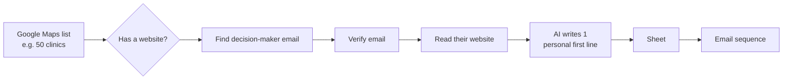
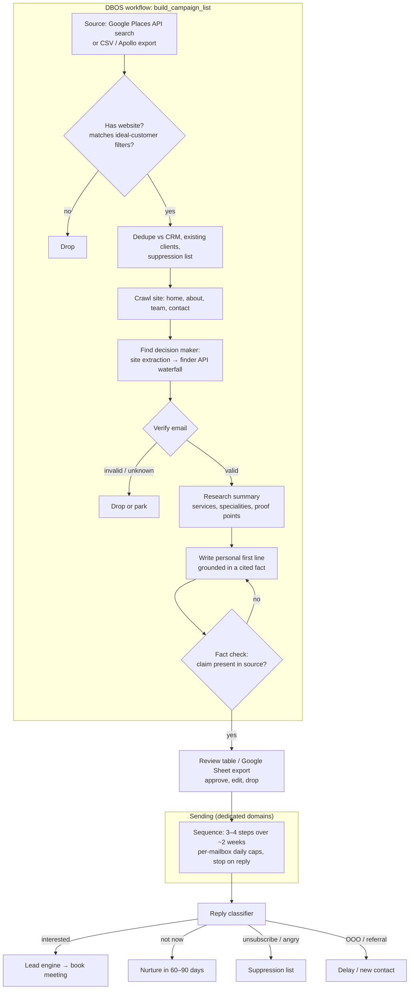

# Automation: Personal Cold Email

> Part of the [Agentic Automations Platform](../PLAN.md) and one of the five sources of [The Boring Machine](boring-machine.md). Pricing: setup + retainer, or per booked meeting (see [PRICING.md](../PRICING.md)).

Status: spec, no code yet (2026-10-24).

## 1. Reference ("#6 Personal cold email")

Example run: **50** businesses found → **49** have a website → **8** valid emails.

**Lesson from the funnel:** only ~16% of businesses ended up with a valid decision-maker email. Plan list sizes backwards from the goal. For 20 positive conversations a month you may need well over a thousand businesses at the top. The dashboard shows this funnel for every campaign, and the ROI calculator uses it.

## 2. Product version

### 2.1 Steps in detail

| Step | How | Notes |
|---|---|---|
| Source | **Google Places API** (Text Search, e.g. "dental clinic in Pune"): name, address, phone, website, rating, review count. Also CSV / Apollo exports | Use the official API, not scraping of the Maps UI. Check Places caching terms: store `place_id`, refresh details instead of keeping copies |
| Filter | Has website + ideal-customer rules: category, area, min rating or reviews, size signals | Rules configured per campaign |
| Decision maker | 1) LLM extraction from team/about/contact pages (names, roles, emails); 2) finder API **waterfall** (Hunter / Apollo / Snov / Prospeo, whichever is configured); 3) pattern guess (`first@domain`) **only if verified** | Prefer named owner or partner over `info@` |
| Verify | ZeroBounce / NeverBounce / MillionVerifier: `valid` / `catch_all` / `invalid` / `unknown` | Send only to `valid`; `catch_all` optional with a small cap |
| Research | Summarise the website: services, specialities, recent updates, review themes | Store source snippets |
| First line | `writer` model writes **one** personal opening line (optionally the full email) referencing a **real, cited fact** | No personal or sensitive data; nothing creepy; no flattery templates |
| Fact check | Second pass checks the line's claim appears in the stored snippet | Fails go back for a rewrite, then to a human |
| Review | In-dashboard table (and Google Sheet export, as in the reference) to approve lines | Approval required for the first campaigns |
| Send | v1: **Instantly / Smartlead API** for warm-up, mailbox rotation and sending; our platform owns the list, copy and replies. v2: native sending through Google Workspace / M365 mailboxes on secondary domains | Never the client's main domain |
| Replies | Webhook → `fast` classifier: interested · not now · unsubscribe · OOO · referral · wrong person · bounce | Interested → `lead.created` into the lead engine (one-owner rule applies) |

### 2.2 Deliverability guardrails (built in, not optional)
- Separate sending domains (lookalikes of the client brand) with SPF, DKIM and DMARC; 2–3 weeks of warm-up before any campaign.
- Low daily caps per mailbox with gradual ramp-up; plain text; no tracking pixels by default; one-click unsubscribe; spam-complaint and bounce monitoring that **auto-pauses** a mailbox or campaign.
- Global suppression list per client, shared with every other automation.

### 2.3 Compliance
B2B only. CAN-SPAM (US): physical address, honour opt-outs. EU/UK: legitimate-interest assessment and easy opt-out, or exclude the region. India: DPDP Act for personal data. Gmail/Yahoo bulk-sender rules: authentication, one-click unsubscribe, low spam rate.

## 3. Metrics
Funnel per campaign: found → with website → decision maker found → verified → sent → replied → positive → booked. Also: cost per verified contact (data credits), cost per booked meeting.

## 4. Mock data
`mock-data/cold-email/places-sample.jsonl`: a small Places-style list whose expected outcomes reproduce the reference funnel shape (some without websites, generic inboxes only, invalid and catch-all emails, an existing client to dedupe, a suppressed contact).
