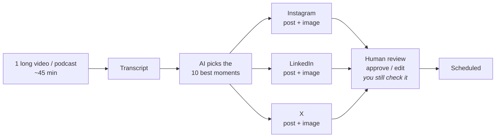
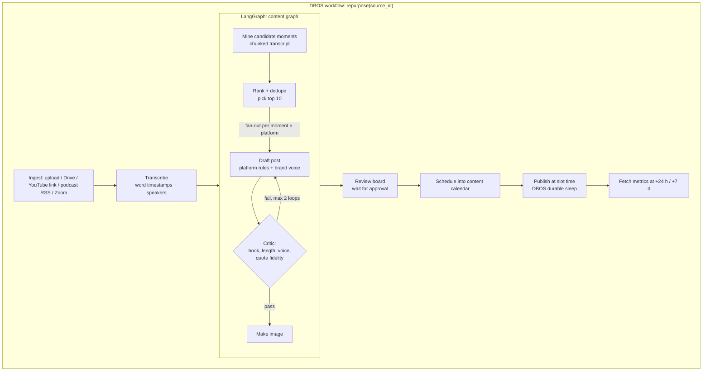

# Automation: Content Repurposing Engine

> Part of the [Agentic Automations Platform](../PLAN.md). Pricing: **setup fee + monthly retainer** (see [PRICING.md](../PRICING.md)).

Status: spec, no code yet (2026-10-24).

## 1. Reference ("#7 Content repurposing")

**One 45-minute video → 10 moments × 3 platforms = 30 posts with images**, reviewed by a human, then scheduled.

## 2. Product version

### 2.1 Steps in detail

| Step | How | Notes |
|---|---|---|
| Ingest | Upload, Google Drive folder watch, podcast RSS, Zoom/Meet recordings, YouTube link | Only content the client owns or has rights to. Uploading or Drive is preferred over downloading from YouTube |
| Transcribe | Deepgram / Whisper / AssemblyAI; **Sarvam** for Indian languages; word timestamps + speaker labels | Long-running step, so it runs in DBOS and is retry-safe |
| Mine moments | `writer` model over overlapping transcript chunks → candidates with `start`, `end`, `quote`, `hook`, `insight`, `standalone` score | Each moment must make sense without context |
| Rank | Score = insight + hook strength + standalone + topic variety; drop near-duplicates; keep top **10** (configurable) | The client can swap moments on the review board |
| Draft | Per platform: **Instagram** caption + hashtags; **LinkedIn** post (hook line, short paragraphs); **X** post or short thread | Platform rules (length, tone, hashtags) live in config |
| Critique | Checks brand voice, hook, length, **quote fidelity** (every quote must match the transcript exactly), no invented claims or numbers | Max 2 rewrite loops, then flagged for a human |
| Image | Default: **branded quote card** rendered from an HTML template (brand kit: logo, colours, fonts) to PNG via Playwright. Option: **frame grab** from the video at the moment's timestamp (ffmpeg) with a text overlay. Option: AI-generated image | Templates are cheap and always on brand; AI images are opt-in |
| Review | Board grouped by moment: approve / edit / regenerate / drop, plus **bulk approve** | Reference: "you still check it." Always on |
| Schedule | Content calendar: spacing per platform (e.g. 1/day LinkedIn, 1–2/day X), best-time slots, no two posts from the same moment on the same day | Drag to reschedule |
| Publish | LinkedIn API, X API, Instagram Graph API (needs a Business/Creator account), or a unified API (Ayrshare/Buffer) | X API access is paid. Check the tier |
| Learn | Engagement metrics fed back: which hooks and topics perform → ranking weights + prompt examples | v2 |

### 2.2 Brand setup (paid for by the setup fee)
- **Brand voice profile**: built from ~20 past posts plus a short questionnaire (tone, words to use and avoid, emoji policy, CTA style).
- **Brand kit**: logo, colours, fonts, 3–5 quote-card templates.
- **Connected accounts** + default posting schedule.

### 2.3 Later (v2)
- **Short vertical clips** (9:16 Reels/Shorts) with burned-in captions and speaker reframing (ffmpeg + face tracking). This is heavier compute, so it should be a separate upsell tier.
- Newsletter and blog post outputs from the same moments.

## 3. Metrics
Posts generated → approved **without edits** (quality KPI) → published → engagement. Turnaround time from upload to drafts ready (target: under 30 min for a 45-min video).

## 4. Retainer tiers (hypothesis)

| Tier | Long videos per month | Posts per month | Platforms | Extras |
|---|---|---|---|---|
| Starter | 2 | ~60 | 3 | Quote cards |
| Growth | 4 | ~120 | 3–4 | + frame grabs, newsletter |
| Pro | 8 | ~240 | 4+ | + vertical clips |
