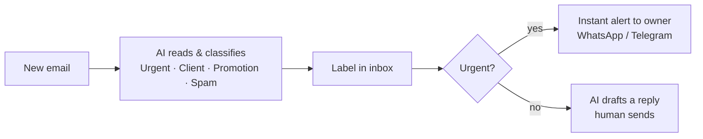
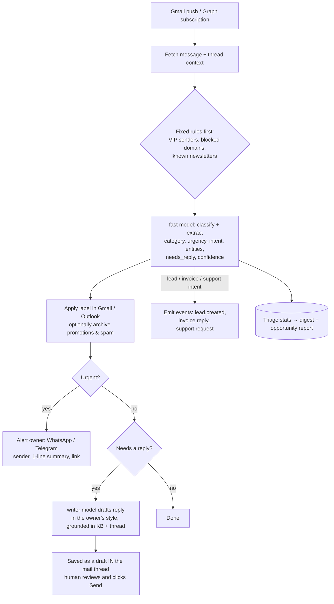

# Automation: Inbox Triage

> Part of the [Agentic Automations Platform](../PLAN.md). **Entry product** on the upsell ladder (inbox triage → invoices → lead engine). Pricing: low setup + low monthly retainer (see [PRICING.md](../PRICING.md)).

Status: built (Phase 1, 2026-10-24); escalation of unanswered urgent emails added 2026-10-25 (§2.2).

## 1. Reference ("#9 Inbox triage")

## 2. Product version

### 2.1 Details

| Topic | Decision |
|---|---|
| Categories | Defaults from the reference: **Urgent, Client, Promotion, Spam**, plus **Lead**, **Invoice/Payment**, **Newsletter**, **Other**. Clients can rename, add or remove categories |
| Urgency | Rules (VIP list, keywords like "legal notice", "outage", "payment failed") + model judgement with a reason. Urgency is a flag, separate from category (a Client email can be urgent) |
| Alerts | WhatsApp (Cloud API template) or **Telegram bot** (free, instant, the easiest to set up). One-tap link to open the email. Quiet hours, max alerts per hour, and "escalate if unread for 30 min" |
| Drafts | Created as **real drafts inside the email thread** (Gmail `drafts.create` / Graph `createReply`), so the human sends from their normal mail app. **The AI never sends.** No separate approval screen needed |
| Writing style | Learned from ~50 recent sent emails (tone, greeting, sign-off, length), stored as a style profile, never retrained on content |
| Grounding | Knowledge base (services, prices, policies) + thread history; unknown facts go in `[brackets]` for the human to fill in |
| Daily digest | Morning summary via email / WhatsApp / Telegram: urgent items still open, clients waiting longest, leads, invoices mentioned |
| Chaining | Lead emails → `lead.created` (lead engine); payment replies → invoice automation; support → ticket |
| **Opportunity report** | From the stats: enquiries answered late or never, overdue amounts mentioned, response-time trend. This is the upsell pitch (see PRICING.md §4) |
| Privacy | Store metadata + classification + short summary; message bodies kept only briefly (e.g. 7 days) for drafting, then deleted; no training on client mail |

### 2.2 Urgent alerts and escalation (built 2026-10-25)

| Setting | Effect |
|---|---|
| **Alert the owner**: immediately (default) or only if still unanswered | "Only if unanswered" alerts the team first (manager, plus front desk if they opted in). If nobody but the owner gets alerts, the owner is alerted immediately anyway |
| **Alert again if still unanswered after N minutes** (default 30, 0 = never) | A second alert, "Still unanswered after 30 min: …", to whoever gets **escalation** alerts: owners by default, managers and front desk can opt in on Notifications |
| Quiet hours | No alert at night: a held first alert goes out when quiet hours end, and an escalation never fires inside quiet hours |

**Handled** (no escalation) means any of:
- a reply sent from Agentry **or straight from Gmail** (the Gmail thread has a sent message after the email);
- the draft card approved, edited, discarded or marked handled;
- the conversation closed.

The check runs in its own durable workflow per urgent email (`escalation.follow_up_urgent`), so worker restarts don't lose it.

### 2.3 Gotcha: Google and Microsoft app verification
- Reading and labelling Gmail needs **restricted scopes** (`gmail.modify`). A production app needs **Google OAuth verification plus an annual third-party security assessment (CASA)**. Unverified apps are capped at 100 users, which is fine for pilots. Plan time and budget for this before scaling.
- Microsoft 365: `Mail.ReadWrite` may need **tenant admin consent** in business accounts. Include it in the onboarding checklist.

## 3. Metrics
Emails processed, % auto-labelled (no correction), urgent alerts sent and acknowledged, median first-response time (before vs after), drafts sent as-is / edited / discarded.

## 4. Mock data
`mock-data/inbox-triage/sharma-inbox.jsonl`: 16 emails for Sharma Digital Agency with expected category, urgency, needs_reply, alert, and events emitted.
