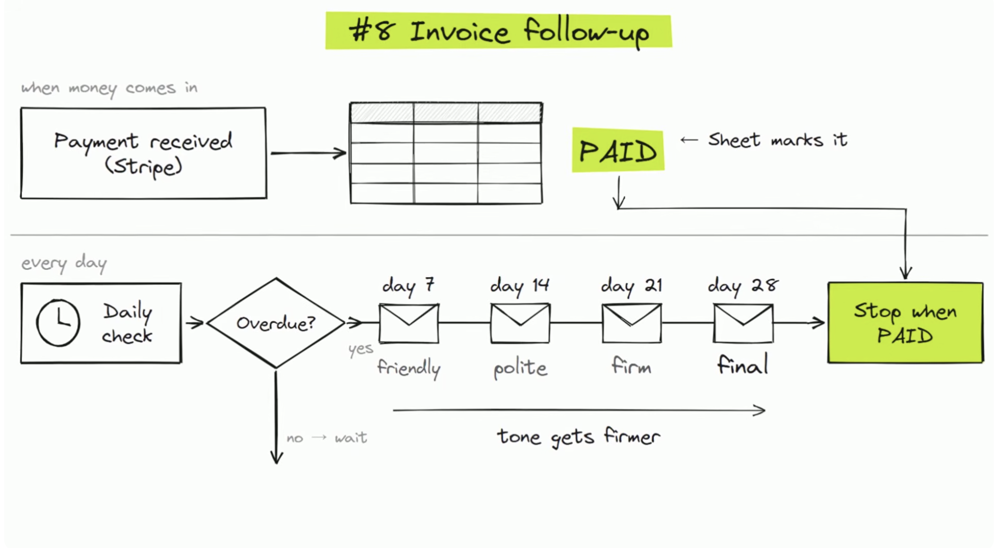
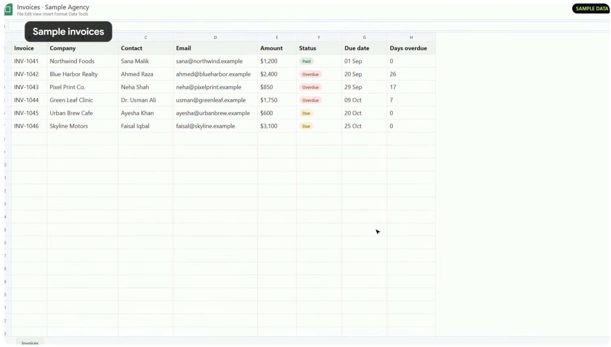
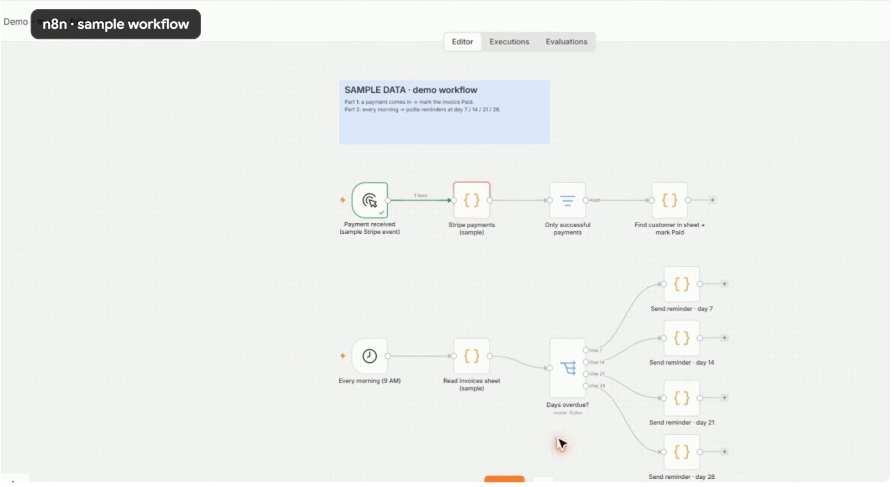
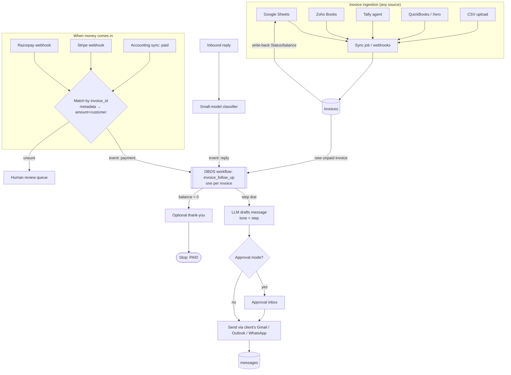

# Automation: Invoice & Payment Follow-up

> Part of the [Agentic Automations Platform](../PLAN.md). Built on the shared platform: workflow runtime (DBOS), channels (email, WhatsApp), payments connectors, approval inbox, billing meters.

Status: built (Phase 2, 2026-10-24); end-to-end fixes 2026-10-25 (see docs/flows/agents/invoice-follow-up.md).

---

## 1. Reference automation (from screenshots)

| Concept diagram | Data source | n8n prototype |
|---|---|---|
|  |  |  |

### 1.1 What the reference does

The reference is two independent flows that share a Google Sheet (`Invoice, Company, Contact, Email, Amount, Status, Due date, Days overdue`):

1. **When money comes in**: Stripe `payment received` webhook → keep only successful payments → find the customer in the sheet → set `Status = Paid`.
2. **Every day at 9 AM**: read the sheet → work out *days overdue* → route on exactly day **7 / 14 / 21 / 28** → send a reminder email whose tone escalates: **friendly → polite → firm → final** → stop when the row is `Paid`.

### 1.2 Gaps in the reference that a paid product must close

| # | Gap in the n8n demo | Consequence | Fix in our platform |
|---|---|---|---|
| 1 | Routes on `days_overdue == 7` (exact match) | If the 9 AM job fails or the server is down that day, that reminder is **skipped forever** | Track `last_step_sent` per invoice and send the **next due step** whenever it is reached or passed |
| 2 | No record of what was sent | If the job runs twice, the same reminder is **sent twice** | Idempotency key `(invoice_id, step)` + `messages` table |
| 3 | Marks Paid by **finding the customer** | A customer with 3 open invoices has the wrong one, or all of them, marked paid | Put `invoice_id` in Stripe/Razorpay payment-link metadata and match on that; fall back to amount + customer, sent to a human for review |
| 4 | Ignores partial payments | A ₹50k invoice paid ₹20k is either marked Paid or keeps getting full-amount reminders | `amount_paid` / `balance_due`; reminders quote the balance |
| 5 | No reply handling | "I paid yesterday" or "This is wrong" still gets the *firm* email | AI reply classifier pauses, stops or escalates the sequence (§2.3) |
| 6 | Fixed templates | Generic, one language, ignores history | AI-personalised drafts within tone guardrails, with an approval mode |
| 7 | Only email, only Stripe, only one sheet | Doesn't fit Indian SMBs (WhatsApp, UPI, Tally) | Connector framework |
| 8 | One hard-coded workflow per client | 50 clients means 50 copies to maintain | One automation definition with per-tenant config (§3) |
| 9 | Timezones and holidays not handled | Reminders at 9 AM server time, including on Sunday or Diwali | Per-tenant timezone, quiet hours, business-day calendar |

## 2. Product version

### 2.1 Flow

### 2.2 Default sequence (editable per client and per customer segment)

Matches the reference (days 7, 14, 21, 28 after the due date), plus an optional pre-due nudge and a hand-off at the end:

| Step | When | Tone | Default channels | Extras |
|---|---|---|---|---|
| 0 *(optional, off by default)* | Due − 3 days | Heads-up | Email | Payment link |
| 1 | Due + 7 | **Friendly** | Email | Payment link, invoice PDF |
| 2 | Due + 14 | **Polite** | Email + WhatsApp | |
| 3 | Due + 21 | **Firm** | Email + WhatsApp | CC the client's account owner |
| 4 | Due + 28 | **Final** | Email + WhatsApp | States the next action (late fee, pause service), never threatening |
| 5 | Due + 30 | — | Task for a human | Call script + summary generated by AI |

Each step sends **when it is reached or passed** (gap #1). Only the *latest* missed step is sent, never a burst of catch-up emails.

### 2.3 The agentic parts

The schedule, retries and stop-on-payment are deterministic code. The LLM handles language and judgement only:

| Task | Model | Output |
|---|---|---|
| Draft each reminder in the step's tone, using customer name, history, past promises and language (EN / HI / Hinglish / others) | `writer` model tier | Subject + body; amounts, dates and links are **injected from the DB as placeholders**, never generated |
| Classify inbound replies | `fast` model tier, structured output | `promise_to_pay{date}` · `already_paid{utr?}` · `dispute{reason}` · `resend_invoice` · `partial_payment{amount,date}` · `ooo{return_date}` · `wrong_contact{new_contact?}` · `opt_out` · `other` |
| Read payment proof (UTR screenshot, bank receipt PDF) | `vision` model tier | `{utr, amount, date, payer}` → matched against gateway or bank records |
| Weekly collections digest for the client | `writer` model tier | Narrative + list of top risks |
| Call script for the human hand-off | `writer` model tier | Talking points + full context |

What each classification does to the workflow:

| Classification | Action |
|---|---|
| promise_to_pay | Pause until promised date + 1 day; if still unpaid, resume with a "you mentioned…" message |
| already_paid | Ask for a UTR or receipt if none was given, then verify; matched → Paid, unmatched → human |
| dispute | **Stop** and open a dispute ticket for the client |
| resend_invoice | Auto-reply with the PDF; the sequence continues |
| partial_payment | Update balance; next reminders quote the remaining balance |
| ooo / wrong_contact | Delay, or switch to the new contact after client approval |
| opt_out | Stop all automated messages to that contact (legal requirement) |
| other / low confidence | Send to a human |

**Guardrails:**
- Approval mode is on for new tenants. They can switch to auto-send per step later, e.g. auto for friendly, approval for final.
- Tone guardrails in the prompt, plus a post-check: no threats, no legal claims the client hasn't configured, no contact with third parties.
- Quiet hours and business days per tenant timezone; a per-contact frequency cap.
- A prompt version and model ID are stored with every message for audit and evaluation.
- An evaluation set (~100 real-ish replies) runs in CI for the classifier.

### 2.4 Google Sheets as a first-class source (like the reference)

Many small clients live in a sheet. Supported natively:
- Connect via Google OAuth, then pick the spreadsheet and tab, then **map columns** (Invoice, Customer, Email, Phone, Amount, Due date, Status). Mapping is guessed by AI and confirmed by the user.
- Poll every 10 min plus the Drive push channel. Upsert by invoice number.
- **Write-back**: when we mark an invoice Paid or partial, we update the Status, Amount paid and Last reminder columns in their sheet, so the client's existing habits keep working.

---

## 3. Billing for this automation

### 3.1 Commission attribution

An invoice payment is **attributable** when all of these hold:
1. It matches the plan's `basis`: for `overdue_only` the invoice was past due when paid; `all_recovered` counts any invoice we sent at least one reminder for.
2. At least one message was **delivered** for that invoice.
3. Payment was received within `attributionWindowDays` of the last delivered message.

- **Strong**: paid through our Razorpay or Stripe link. The payment carries `invoice_id`, so the proof is direct.
- **Weak**: seen through accounting or sheet sync, or a manual mark-paid. It counts only if `strongAttributionOnly = false`, and is listed separately.

Monthly cycle: compute `usage_events` → generate a **commission statement** (PDF + dashboard view) with evidence per line (messages, timestamps, payment reference) → the client has **7 days to dispute** lines → finalise → charge via Stripe or Razorpay metered billing.

### 3.2 Unit economics

The admin console tracks per tenant: LLM cost (Langfuse), WhatsApp conversation cost, email/SMS cost, gateway fees, and the resulting **gross margin**. It alerts when a tenant's margin drops below a threshold.

---
