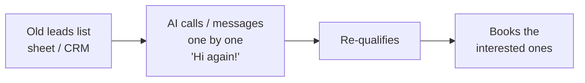
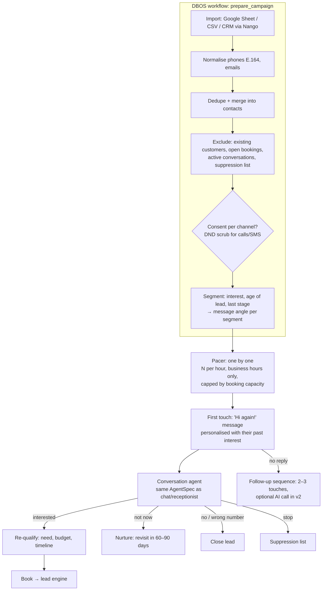

# Automation: Lead Reactivation

> Part of the [Agentic Automations Platform](../PLAN.md) and one of the five sources of [The Boring Machine](boring-machine.md). Pricing: **pay per result**, per booked appointment ("no win, no fee"), see [PRICING.md](../PRICING.md).

Status: spec, no code yet (2026-10-24).

## 1. Reference ("#3 Lead reactivation")

**No new ad spend**: the money was already spent on leads that went cold.

## 2. Product version

### 2.1 Details

| Topic | Decision |
|---|---|
| Channels | v1: **WhatsApp** (Meta-approved marketing template for the first message; free-form once they reply), **SMS**, **email**. v2: **AI voice call** (same voice runtime as speed-to-lead) |
| "One by one" | A **pacer** sends a few messages at a time, never a blast: protects WhatsApp number quality and sender reputation, feels personal, and makes sure the client can actually handle the bookings that come in. Rate auto-reduces if replies or bookings back up |
| Personalisation | The first message references what they were interested in and when ("Hi Rahul, you'd asked about clear aligners in March…"). Offer angle per segment (e.g. free assessment, new EMI option) from the client's approved offers only |
| Re-qualification | Same schema as the rest of the lead engine (need, budget, timeline + client extras) |
| Ownership | If the lead is already talking to another automation (e.g. called the receptionist), reactivation waits (lead-engine one-owner rule) |
| Consent | WhatsApp needs prior opt-in; SMS in India needs DLT templates + DND scrub; calls follow the voice rules. Leads without valid consent for a channel are skipped for that channel |
| Results | Per campaign: list size → eligible → contacted → replied → re-qualified → booked → showed; **revenue reactivated** (bookings × customer value) for the ROI report |

## 3. Pricing fit
Per booked appointment at 10–20% of customer value. Optional small setup fee for list cleaning and template approval.

## 4. Mock data
Uses `mock-data/boring-machine/old-leads.csv` and the reactivation scenarios in `scenarios.jsonl` (opted-out, no consent, duplicate, "still too expensive").
