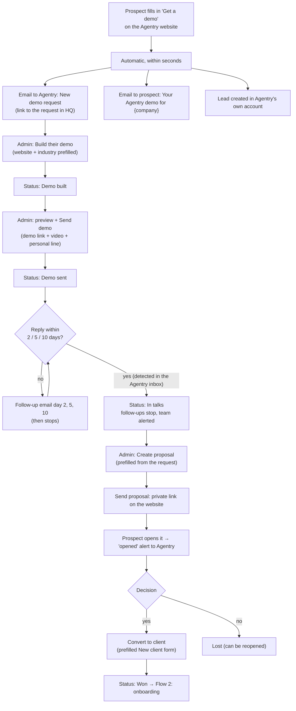
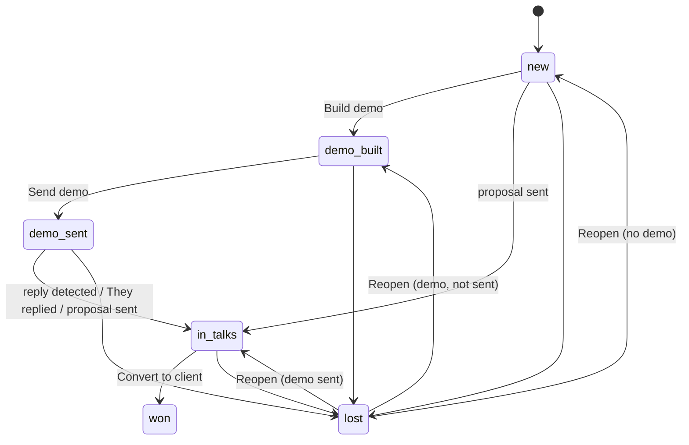

# Flow 1: Sales: demo request → demo → proposal → client

Agentry sells to businesses with a personal demo: a chat assistant that already knows the prospect's own website. Everything below is worked in **Agentry HQ → Demo requests → (the request)**.

## Diagram

## Steps

| # | Step | Who | What happens |
|---|---|---|---|
| 1 | **Form on the website**: name, email, phone, company, website, type of business, message | Prospect | The request is saved; a bot trap (hidden field) drops spam silently |
| 2 | **Automatic emails** | System | Agentry gets "New demo request: {company}" with a link to HQ. The prospect gets a personal confirmation ("we're building a demo for {company}…"), signed with `AGENTRY_SALES_SIGNATURE` |
| 3 | **Lead in Agentry's own account** | System | The request becomes a lead (stage *new*) in Agentry's own portal: Agentry runs on Agentry |
| 4 | **Build their demo** | Agentry admin | Their website and industry are prefilled. Agentry reads up to 8 pages and creates a demo assistant with their name, services and colours at `/demo/<their-name>`. Status → **Demo built** |
| 5 | **Send the demo** | Agentry admin | Paste a walkthrough video link (e.g. Loom) and a personal line → **Preview email** → **Send demo**. Status → **Demo sent**. Blocked while links would point at `localhost` |
| 6 | **Follow-ups** | System | Day 2, 5 and 10 after sending, while the status is still *Demo sent*. Any status change stops them. "Send again" restarts them; only one copy of each is ever sent |
| 7 | **Reply detection** | System | Every 2 minutes the Agentry Gmail inbox is read (read-only). A reply → status **In talks**, follow-ups stop, the reply shows under "Their replies", Agentry is alerted. Out-of-office replies are recorded only; bounces are flagged. "They replied" can also be clicked by hand |
| 8 | **Call + notes** | Agentry admin | Notes on the request (only Agentry sees them) |
| 9 | **Proposal** | Agentry admin | **Create proposal** opens the builder prefilled (business, contact, email, niche, suggested agents). Adjust the numbers → **Send proposal**. The client gets an email with a summary and a private link (`/proposal/<token>`) with **Download as PDF** and **Reply to get started**. Sending moves the request to **In talks** |
| 10 | **Opened alert** | System | The first time the client opens the proposal, Agentry gets "{business} opened your proposal". HQ shows opened time and view count |
| 11 | **Convert to client** | Agentry admin | Opens **New client** prefilled (name, website, owner name and email, agents for their industry). Creating it marks the request **Won** and links it to the client page → [Flow 2](02-client-onboarding.md) |
| 12 | **Lost / Reopen** | Agentry admin | Lost stops everything; Reopen returns to the furthest step really reached |

## Status flow

## Who does what

| Step | Prospect | Agentry admin | System |
|---|---|---|---|
| Request a demo | ✓ | | |
| Confirmation, alert, lead | | | ✓ |
| Build, send demo, proposal, convert | | ✓ | |
| Follow-ups, reply detection, opened alerts | | | ✓ |
| Mark lost / reopen, notes | | ✓ | |

## Settings that matter

| Setting (`.env`) | Purpose |
|---|---|
| `SMTP_*`, `MAIL_FROM` | The Agentry Gmail that sends (and whose inbox is read for replies) |
| `AGENTRY_OPS_EMAIL` | Where Agentry's alerts go |
| `AGENTRY_WEB_URL` | Public website address used in demo and proposal links (must not be `localhost` to send) |
| `AGENTRY_SALES_SIGNATURE` | How sales emails are signed |
| `AGENTRY_SALES_INBOX_MINUTES` | How often replies are checked (default 2) |

**Code:** `backend/src/agentry/sales.py`, `sales_inbox.py`, `worker/sales_jobs.py`, HQ routes in `api/routes/hq.py`; dashboard `hq/demo-requests/[id]`, `hq/proposal`; website `proposal/[token]`, `demo/[slug]`.
