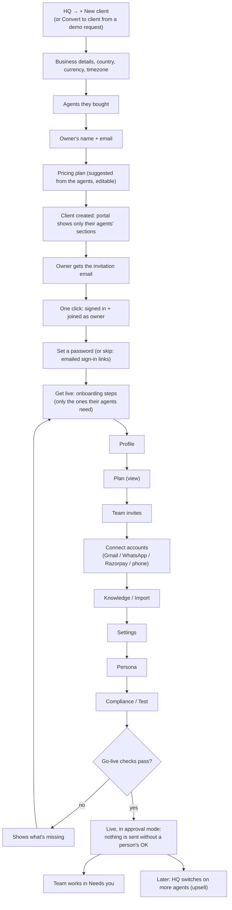

# Flow 2: Client onboarding

From "they said yes" to agents working. What a client sees is decided by the **agents Agentry switched on for them**: an inbox-triage-only client never sees invoices or campaigns, and can't reach them by URL.

## Diagram

## Steps

| # | Step | Who | Details |
|---|---|---|---|
| 1 | **Create the client** | Agentry admin | HQ → **+ New client**: business, country/currency/timezone, **agents**, owner's name and email, **plan** (suggested from the agents: setup, monthly, usage, pay per result, GST). From a demo request everything is prefilled |
| 2 | **Invitation** | System | The owner gets "{inviter} invited you to {business} on Agentry" with a one-click link |
| 3 | **Join** | Owner | One click signs them in (only people who have never signed in; existing users sign in normally) and joins them as owner. They're offered **Set a password**, or skip and use emailed sign-in links. The link stops working once used, cancelled, or after 7 days |
| 4 | **Profile** | Owner or Agentry | Business name, website, address, timezone |
| 5 | **Plan** | Owner (view) | Shows what they're paying |
| 6 | **Team** | Owner | Invite manager, front desk, finance, viewer: each gets the same one-click invitation |
| 7 | **Connect** | **Owner** (or manager) | Only the cards their agents need: Gmail (they sign in with Google themselves), WhatsApp (Meta details), Razorpay/Stripe, phone number (assigned by Agentry) |
| 8 | **Knowledge / Import** | Owner, manager or Agentry | Website pages, pasted text, uploaded PDF/Word/CSV; invoices or old leads imported from CSV/Excel |
| 9 | **Settings** | Owner, manager | Each agent's settings (generated forms; Agentry-only fields are read-only for clients) |
| 10 | **Persona** | Owner, manager or Agentry | Assistant name, tone, greeting, sign-off |
| 11 | **Compliance / Test** | Owner, manager | Consent rules for outbound messages; test chat or a browser test call |
| 12 | **Go live** | Owner, manager or Agentry | Checks per agent (e.g. Gmail connected, invoices imported, phone assigned). Agents start in **approval mode** |
| 13 | **Daily work** | Team | Needs you, Conversations, Leads, Invoices, Campaigns, depending on the agents ([agent flows](agents/)) |
| 14 | **Upsell** | Agentry admin | HQ → client → Automations: switch on another agent; a live client gets it in approval mode |

## Agentry admin can do the setup for them

HQ → client → **Open their portal** (or **Do their onboarding**). Agentry then sees exactly what the client sees, can fill any step except signing in to the client's Google or Meta accounts, and every action is recorded in the client's audit log as Agentry staff.

## What each agent adds

| Agent | Sections | Connections | Go-live needs |
|---|---|---|---|
| Inbox triage | Needs you, Conversations, Leads, Knowledge | Gmail | Gmail connected |
| Website chat | Needs you, Conversations, Leads, Knowledge, Calendar | (widget snippet) | Knowledge, test chat |
| WhatsApp assistant | Needs you, Conversations, Leads, Knowledge, Calendar | WhatsApp | WhatsApp connected |
| Invoice follow-up | Needs you, Conversations, Invoices | Gmail, WhatsApp, Razorpay/Stripe | Invoices imported, Gmail or WhatsApp |
| Lead reactivation | Needs you, Conversations, Leads, Campaigns, Calendar | WhatsApp, Gmail | Gmail or WhatsApp |
| Speed-to-lead | Needs you, Conversations, Leads, Calendar | WhatsApp, Gmail | Gmail or WhatsApp |
| AI receptionist | Needs you, Conversations, Leads, Knowledge, Calendar | Phone number | Knowledge, test, phone number assigned |

Always shown: Home, Automations, Reports, Team, Audit log, Billing, Notifications & data.

## Who does what

| | Owner | Manager | Front desk | Finance | Viewer | Agentry |
|---|---|---|---|---|---|---|
| Create client, choose agents, plan | | | | | | ✓ |
| Accept invitation, set password | ✓ | ✓ | ✓ | ✓ | ✓ | |
| Profile | ✓ | | | | | ✓ |
| Invite / remove team, change roles | ✓ | view | view | view | view | ✓ |
| Connect Gmail / WhatsApp | ✓ | ✓ | | | | (sets up, client signs in) |
| Knowledge, settings, persona | ✓ | ✓ | | | | ✓ |
| Go live, pause agents | ✓ | ✓ | | | | ✓ |
| Billing, statements | ✓ | | | ✓ | | ✓ |
| Audit log | ✓ | ✓ | | | | ✓ |
| Export data | ✓ | | | | | ✓ |

**Signing in later.** The sign-in page has **Password** (with an eye button to show what you typed) and **Email me a link**.
**Forgot password?** (under the password field) emails a reset link: it works once, for 1 hour, and also works for
people who have only ever used emailed links (it creates their password). Saving a new password signs them out on
their other devices. The page answers the same whether or not the email has an account.

## Notifications each person gets (changeable on Account & notifications)

| Notification | Default on for | Can opt in |
|---|---|---|
| Urgent emails, chats or WhatsApps that need a person | Owner, Manager | Front desk |
| Urgent email still unanswered (second alert) | Owner | Manager, Front desk |
| Daily inbox digest | Owner, Manager | Front desk |
| New statements | Owner, Finance | |
| Monthly results report | Owner, Manager | Anyone |

**Code:** `clients.py`, `features.py`, `api/routes/hq.py`, `api/routes/setup.py`; dashboard `hq/new`, `hq/[orgId]`, `onboarding`, `invite/[id]`, `accept-invitation/[id]`, `lib/clients.ts`.
