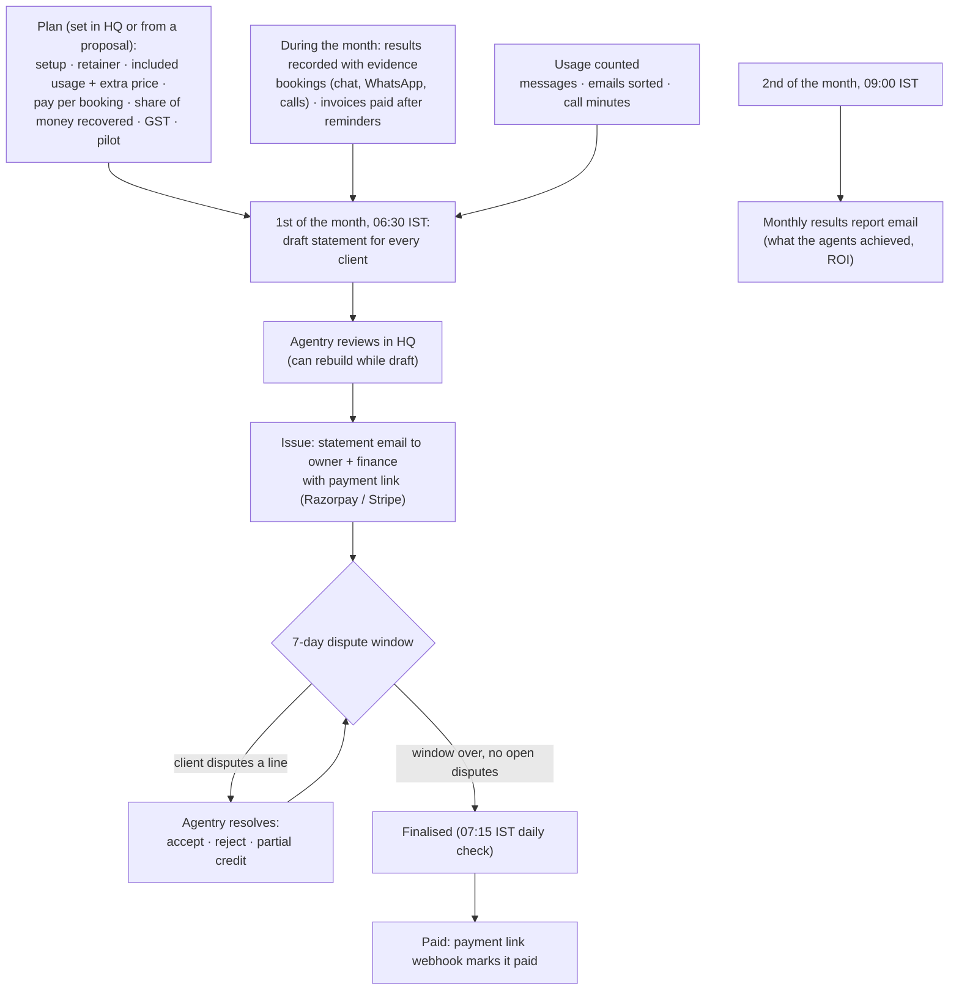

# Flow 3: Billing and statements

Each client has one pricing plan. Every month Agentry builds a statement from the plan, the client's usage and the **results the agents produced**, each with evidence the client can check.

## Diagram

## Steps

| # | Step | Who | Details |
|---|---|---|---|
| 1 | **Plan** | Agentry admin | HQ → client → Pricing plan. Setup fee (billed once), monthly retainer, included messages / emails / **call minutes** with a price per extra, **pay per booked appointment** (fixed or % of customer value with a minimum), **share of overdue money recovered** (with a cap), GST, pilot period (no retainer until a date). A sent proposal's plan can be applied too |
| 2 | **Results during the month** | System | A booking from website chat, WhatsApp or a phone call → an *appointment booked* result with evidence (service, time, conversation; for calls, the recording and summary). A payment after reminders → *money recovered*, matched strongly or weakly to the invoice. Test chats and calls never count |
| 3 | **Draft statement** | System | 1st of each month: lines for setup, retainer (zero during a pilot), usage over the included amount (call minutes rounded up per call), results, recovery share, then GST |
| 4 | **Review and issue** | Agentry admin | HQ → client → Statements → **Issue**. Owner and finance get the email with a payment link |
| 5 | **Check and dispute** | Owner, Finance | Billing → the statement: every line shows the results behind it ("Show the results behind this line"; calls play right there). Dispute a line within 7 days with a reason |
| 6 | **Resolve disputes** | Agentry admin | Accept (line removed), reject (stays), or partial credit (credit line added, chosen results excluded) |
| 7 | **Finalise** | System | After the window, with no open disputes |
| 8 | **Payment** | Client | Pays through the link; the payment webhook marks the statement paid |
| 9 | **Monthly report** | System | 2nd of the month: results report email to owners and managers (and anyone who opted in) |

## Who does what

| | Owner | Manager | Front desk | Finance | Viewer | Agentry |
|---|---|---|---|---|---|---|
| See plan and statements | ✓ | | | ✓ | | ✓ |
| Dispute a line | ✓ | | | ✓ | | |
| Set plan, issue statements, resolve disputes | | | | | | ✓ |
| Pay | ✓ | | | ✓ | | |
| Revenue & margin across clients | | | | | | ✓ |

## Revenue & margin (Agentry only)

HQ → Revenue & margin: per client, revenue vs cost to serve (AI model calls, WhatsApp templates, call minutes at `AGENTRY_VOICE_COST_INR_PER_MINUTE`). Margins under 60 % are highlighted.

**Code:** `billing.py`, `api/routes/billing_api.py`, `worker/billing_jobs.py`; dashboard `billing/`, `hq/[orgId]/statements`, `hq/billing`, `components/hq-billing.tsx`.
