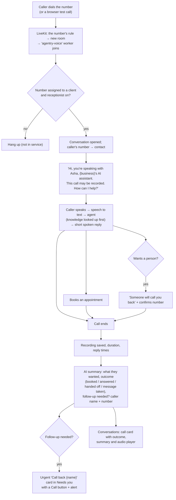

# AI receptionist (voice)

Answers the client's phone calls with the same brain as website chat: answers from knowledge, books, takes messages. Every call is recorded (the caller is told), summarised, and turned into a **Call back** card when a person should follow up.

## Setup

1. **Agentry assigns a phone number** in HQ → client → Automations → Phone number (today: US numbers rented in LiveKit Cloud; Indian numbers need a provider with business KYC).
2. **The client forwards calls** to it (shown on Connections): `**61*number#` no answer, `**67*` busy, `**62*` unreachable, `**21*` always (`##21#` to turn off). Or gives the number out directly.
3. Knowledge, persona, settings (when it answers, transfer number), **test call in the browser** (Talk to your agent), **go live** (needs knowledge, test and a phone number).

## Diagram

## Steps after a call

| # | What | Who |
|---|---|---|
| 1 | Call card in Conversations: length, outcome, summary, recording | Owner, manager, front desk |
| 2 | **Call back** card: tap **Call +91…**, then **Done, called back** | Front desk |
| 3 | Bookings count as results; minutes count as usage on the statement | System |
| 4 | Recordings are deleted after the client's retention period (default 90 days); owner/manager can delete one sooner | System / owner, manager |
| 5 | Ops alerts: calls that never finished, calls where the AI couldn't answer, slow replies (over 3.5 s) | Agentry |

## Who does what

| | Owner | Manager | Front desk | Finance | Viewer | Agentry |
|---|---|---|---|---|---|---|
| Talk to your agent (browser test call) | ✓ | ✓ | | | | ✓ |
| Receptionist settings, recording retention | ✓ | ✓ | | | | ✓ |
| Calls: transcript, summary, recording | ✓ | ✓ | ✓ | evidence calls only | | ✓ |
| Call back cards | ✓ | ✓ | ✓ | | | ✓ |
| Delete a recording | ✓ | ✓ | | | | ✓ |
| Assign / unassign the phone number | | | | | | ✓ |

## Not built yet
- Live transfer to a staff phone, and outgoing calls (speed-to-lead calls): need an outbound provider (Twilio or Plivo).
- Indian numbers: need Plivo/Exotel business KYC.

**Code:** `voice/` (`worker.py`, `summary.py`, `recordings.py`, `telephony.py`), `automations/ai_receptionist`, `api/routes/voice.py`. Plan: [PHASE-4-VOICE.md](../../PHASE-4-VOICE.md).
