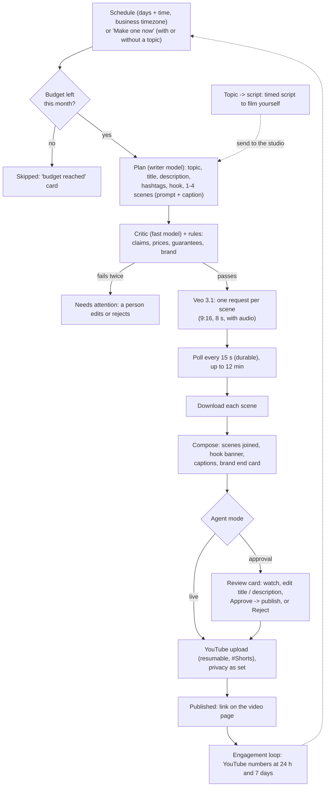

# AI video studio: short videos made and posted on a schedule

The n8n "YT Agent using Veo 3.1" flow (a timer, a Gemini agent writes an idea, Veo makes the video, poll until done,
upload to YouTube), rebuilt as an Agentry agent. **Models:** the plan is written by **OpenAI** (Gemini as fallback); the
video is made by **Google Veo 3.1**. OpenAI removed its Videos API (Sora 2 / Sora 2 Pro) on 24 Sep 2026 with no replacement. On top of the n8n flow, Agentry adds:

| n8n flow | Agentry |
|---|---|
| One fixed prompt | Topics from the business: its topic list, services and FAQs (knowledge), brand kit and voice; never the same topic twice in 60 days |
| One 8-second clip | 1-4 scenes (8 s each) stitched into one Short, with the hook as a banner, captions per scene and the brand end card (same Pillow + ffmpeg overlays as vertical clips) |
| A Wait node looping on HTTP | A durable DBOS workflow: polls the video model every 15 s for up to 12 minutes, survives restarts, and never makes the same video twice |
| Uploads whatever came back | A critic checks the plan first (no invented claims, prices, guarantees, medical / financial promises, competitors, or anything off-brand); one rewrite, else a person decides |
| Always public | Approval mode: a review card with the video, title and description; Approve publishes. Live: publishes at the slot, public / unlisted / private as set |
| No cost control | The cost per video is estimated before generating (video models bill per second); a monthly budget stops it; usage is billed per video (plan: AI videos included / per extra video) |
| Nothing after upload | The video page shows where it went (YouTube link); views and likes come back at 24 h and 7 days (engagement loop), and topics that did well are tried first |

## Flow

- **Topic → script** (Videos → Scripts): no budget for generated video? A topic (or the next unused one) becomes a timed
  30–60 s script: hook, 4–7 beats (say / show / text on screen), close, caption and hashtags, checked by the same
  risky-wording rules. Film it on a phone, or send it to the studio to be generated.
- **Engagement loop:** published videos get their YouTube views, likes and comments at 24 h and 7 days; what worked is
  saved on the business profile and the planner tries the best topics first (see [v3-agents.md](v3-agents.md)).

## Setup

1. **Switch it on** in HQ.
2. **Veo** uses `AGENTRY_VIDEO_API_KEY`, else the server's `GEMINI_API_KEY`; Veo needs a **paid Gemini API plan** (the free tier has no Veo: the video fails with that message). Without any key the studio runs in **test mode**: each scene is a plain branded test clip, so the whole flow can be tried without cost.
3. **Connect YouTube** in Settings → Connections. Sign in with the Google account that owns the channel. This needs the **YouTube Data API v3** enabled in the Google Cloud project and the redirect URI already used for Gmail. YouTube makes videos uploaded by unverified API projects **private** until the project passes Google's audit, so plan for that before relying on public uploads.
4. **Settings** (Automations → AI video studio):
   - topics
   - style
   - language
   - days and time
   - scenes per video
   - Veo fast or standard
   - privacy
   - monthly budget

## Cost

Video models bill per second. The studio estimates the cost before generating, using the rates in settings so a 2-scene, 16-second Veo fast video is about $2.40:
- **fast:** $0.15 a second
- **standard:** $0.40 a second

So a 3-scene (24 s) fast video costs about $3.60. Change the rates if Google's prices change. Videos stop when the month's budget would be passed.

Code: `backend/src/agentry/automations/video_studio/`, `connectors/youtube.py`, migration 0037.

## Who can do what

| | Owner | Manager | Front desk | Finance | Viewer | Agentry |
|---|---|---|---|---|---|---|
| Open Videos and Scripts | ✅ | ✅ | ✅ | — | — | ✅ |
| Make one now, write scripts, edit plans, generate, approve / publish, reject | ✅ | ✅ | — | — | — | ✅ |
| Settings (topics, schedule, privacy, budget) | ✅ | ✅ | — | — | — | ✅ |
| Connect YouTube | ✅ | ✅ | — | — | — | ✅ |
| Switch the agent on, rates | — | — | — | — | — | ✅ |

Opening needs `conversation: read`; everything that makes or publishes needs `automation: configure`
(`api/routes/videos.py`). Finance and viewers are sent to Home and don't see Videos in the menu. Opening is checked by
`tests/test_role_matrix.py` ([roles-matrix.md](../roles-matrix.md)).
