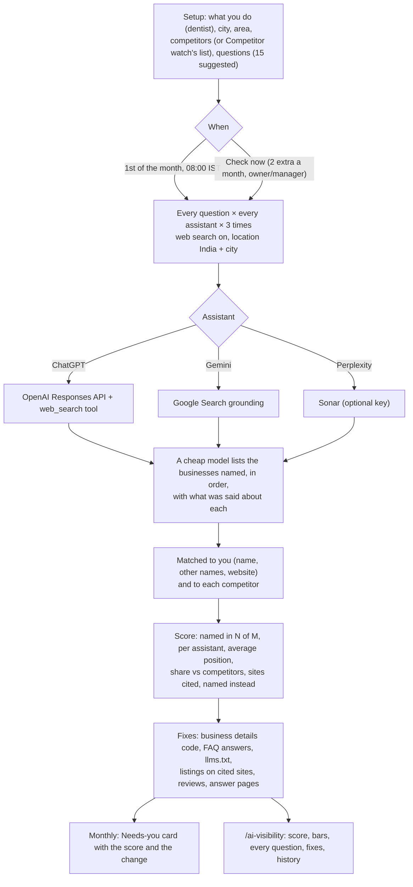

# AI visibility: do ChatGPT, Gemini and Perplexity recommend the business?

Plan: [PLAN-TRY-IT-AND-AI-VISIBILITY.md](../../PLAN-TRY-IT-AND-AI-VISIBILITY.md) (part B). Code: `backend/src/agentry/ai_search.py` (shared
with the website audit), `automations/ai_visibility/`, API `api/routes/ai_visibility_api.py`, page `/ai-visibility`, migration 0052.
Tests: `tests/test_ai_visibility.py`.

## What the owner sees

- **Named in N of M answers (%),** the change since last time, and the average position when named.
- **By assistant:** ChatGPT, Gemini and Perplexity separately.
- **You and your competitors:** the share of the answers that named any of you.
- **Named most often instead** and **where the assistants looked** (the sites they cited, e.g. practo.com, justdial.com).
- **What to fix:**

  | Fix | When | What |
  |---|---|---|
  | Business details | No LocalBusiness-type structured data on the home page | Code to paste into the site's `<head>`, built from the business profile |
  | FAQ answers | No FAQPage on the site | The questions where they weren't named, to answer on an FAQ page |
  | llms.txt | Always | A short plain-text summary for AI tools, ready to paste |
  | Listings | The assistants cited directories | "Be listed on these with the same name, address and phone" |
  | Reviews | Others were named "for their reviews" | Ask happy customers for Google reviews |
  | Answer pages | Questions where they were never named | **Write the page** (Local SEO drafts it, when the client has Local SEO) |

- **Every question:** how often it named them, best position, who it named instead.
- **Month by month:** the trend.

## Rules

- Each question is asked **3 times** per assistant (`AGENTRY_AI_VISIBILITY_REPEATS`), because answers vary. 15 questions × 2 assistants × 3 = 90 answers.
- An assistant whose provider key is missing is skipped. One that fails with a quota or key error is skipped for 10 minutes, so
  the others still run. Answers that failed aren't counted.
- No assistant keys at all (local, tests) means mock answers, marked "test answers" on the page.
- Two extra checks a month on top of the monthly one, and only one check at a time.
- The page says plainly that this is an **estimate measured the same way every month**: the assistants' API answers are close to,
  not the same as, what a person sees in the apps.
- **Cost:** about $0.02 per question with ChatGPT web search, so roughly $1.5–4 per business per month (in `llm_calls`, tier `search`).

## Who can do what

| Role | Can |
|---|---|
| Owner, Manager | Set up, **Check now**, **Write the page** |
| Front desk, Finance, Viewer | See the page (read only) |
| Agentry staff | Everything, on any client |
