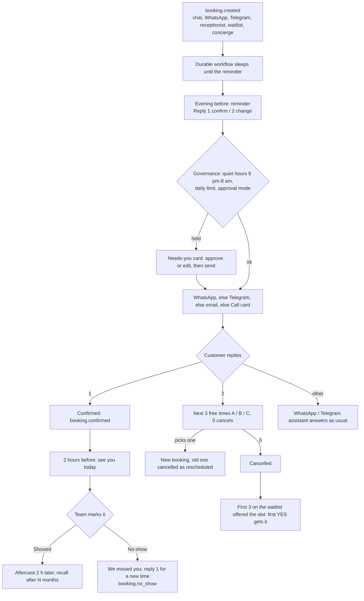

# Appointment Concierge (ROADMAP-V2 9.3)

Fewer no-shows and fuller diaries. It works on every appointment in the business's calendar, whoever booked it (website chat,
WhatsApp/Telegram assistant, AI receptionist, reactivation, the waitlist or the concierge itself).

Code: `backend/src/agentry/automations/appointment_concierge/`, API `api/routes/calendar_api.py`, page `/calendar`,
migration 0024 (`bookings.concierge`, `bookings.cancel_reason`, `app.waitlist`). Tests: `tests/test_appointment_concierge.py`.

## The journey of one appointment

| When | What the customer gets | What happens next |
|---|---|---|
| Booked | (the confirmation the booking agent already sends) | a DBOS workflow sleeps until the reminder |
| Evening before, 6 pm (setting) | "a reminder: your Cleaning is Mon 02 Nov at 10:00 AM with Dr. Desai. Reply 1 to confirm or 2 to change the time." | `concierge.awaiting = confirm` |
| They reply **1** (or yes / ok / haan) | "Thanks Meera, see you …" | status → confirmed, event `booking.confirmed` |
| They reply **2** (or change / reschedule) | the next 3 free times as A / B / C, or 0 to cancel | `awaiting = pick_slot`, `offered = [times]` |
| They reply **B** | "You're booked: Cleaning, Tuesday 3 November at 11:00 AM" | new booking (confirmed), old one cancelled "rescheduled" |
| 2 hours before (setting) | "See you at 10:00 AM today" | — |
| Team marks **Showed** | aftercare message 2 hours after the visit (only if the business wrote one) | recall after N months (default 6) if they haven't booked again |
| Team marks **No-show** | "we missed you today. Reply 1 and we'll find you a new time." | event `booking.no_show`; "1" → three times as above |
| Cancelled (by them, the team or a reschedule) | the first 3 people on the waitlist for that service: "a slot just opened … Reply YES" | first YES gets it; the others go back to waiting |

Bookings made too late for the evening reminder (e.g. at 7 pm for tomorrow) get no reminder: they just booked.

## Channels

For each message, in order: WhatsApp (free text inside the 24-hour window, else the approved template set by Agentry in
the concierge settings) → Telegram (if they've used the business's bot) → email from the business's Gmail/Outlook →
otherwise a **Call** card (hand-off) in Needs you. Without a mailbox connected, email messages are recorded in the
conversation, not sent (test mode).

## Who decides

- Messages the business starts (reminders, no-show, waitlist offers, recalls, aftercare) go through governance action
  `appointment_concierge.send`: quiet hours (9 pm–8 am) and a daily limit of 300. In approval mode, or beyond a limit,
  each one becomes a Needs-you card; approving it (edits allowed) sends it.
- Replies to the customer (confirmations, times, "you're booked") go straight out.
- Replies about an appointment are answered by the concierge **before** the WhatsApp/Telegram assistant sees them;
  anything else ("what are your hours?") goes to the assistant as before.

## Calendar page (/calendar)

- The week by day, with status, who booked it, contact details (not for viewers), and what the concierge is waiting for.
- Buttons: Mark confirmed (future), Showed / No-show (past), Cancel (asks first; offers the slot to the waitlist).
- Waitlist panel: add someone (name, phone or email, service, notes), remove them, see who has an offer open.
- Roles: see *Who can do what* below. A role that can't see the calendar is sent to Home and the menu hides it.

## Notifications

`booking.cancelled` and `booking.no_show` are in the Notification Center catalogue (Leads & bookings) for rules.

## Who can do what

| | Owner | Manager | Front desk | Finance | Viewer | Agentry |
|---|---|---|---|---|---|---|
| Open the calendar | ✅ | ✅ | ✅ | — | ✅ | ✅ |
| See customers' contact details | ✅ | ✅ | ✅ | — | — | ✅ |
| Confirm, Showed / No-show, Cancel, manage the waitlist | ✅ | ✅ | ✅ | — | — | ✅ |
| Approve concierge message cards in Needs you | ✅ | ✅ | ✅ | — | — | ✅ |
| Change concierge settings (reminder times, templates, recall months) | ✅ | ✅ | — | — | — | ✅ |

From `api/routes/calendar_api.py` (`calendar: read` / `calendar: act`, contacts need `conversation: read`) and
`config/roles.json`; opening is checked by `tests/test_role_matrix.py` ([roles-matrix.md](../roles-matrix.md)).
