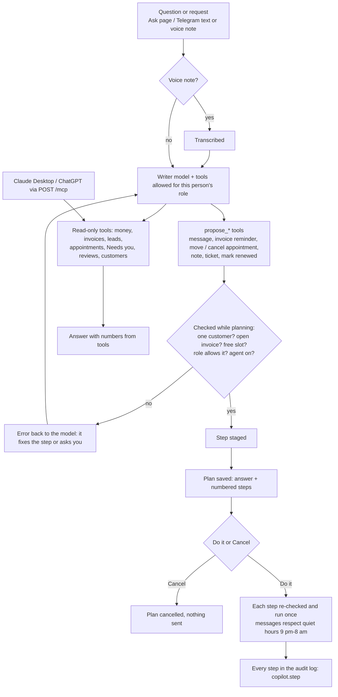

# Ask your business + the Agentry MCP server (ROADMAP-V2 9.1 part 2, 2.6; business copilot ROADMAP-V3 C1)

Plain questions ("what's overdue?", "how many leads this week?", "what's on tomorrow?") answered from the business's own
data, in the portal (**Ask**), on the Telegram team bot (any message that isn't a command, typed or as a **voice note**),
and from Claude Desktop, ChatGPT or any MCP app. Since 2026-11-02 Ask can also **do things**: "remind Rohan about E-1 and
note he promised Friday" becomes a plan of checked steps that runs only when a person taps **Do it**.

Code: `backend/src/agentry/copilot.py` (questions), `copilot_actions.py` (plans), `api/routes/copilot_api.py`, page `/ask`,
`telegram_team.py` (voice notes, plan buttons), migrations 0030 (`app.api_tokens`) and 0049 (`app.copilot_plans`).
Tests: `tests/test_copilot.py`, `tests/test_copilot_actions.py`.



## How an answer is made

- The `writer` model gets the question and a fixed set of **read-only tools**: money summary, overdue invoices, leads,
  appointments, Needs you, conversations, expenses, reviews, find a customer. Each tool is a query written in code,
  run inside the business's own data (row-level security). The model never writes SQL and can't change anything.
- **Permissions:** a person only gets the tools their role allows (front desk: no money; finance: no conversations or
  leads), every call is checked again, a customer lookup shows invoice counts only to people with money access, and the
  model is told which areas are outside the person's role so it says so instead of working around it.
- Up to 4 rounds of tool calls; every number must come from a tool result. Each question is an agent run (Runs).
- Without a model (tests, outages) a keyword route picks one tool and shows its result.

## Plans: asking it to do things

- When the person's role can act, the model also gets **propose** tools. Each needs the right permission, and some need
  an agent switched on:

  | Step | Needs | Agent |
  |---|---|---|
  | Message a customer (WhatsApp, else Telegram, else email) | conversation: act | — |
  | Remind about an unpaid invoice (amount and payment link from the books) | invoice: act | — |
  | Move an upcoming appointment (checked against free slots) / cancel it | calendar: act | — |
  | Add an internal note | conversation: act | — |
  | Open a support ticket | conversation: act | Support desk |
  | Mark a renewal renewed | conversation: act | Renewals |

- **Checked while planning.** Is there exactly one matching customer (two Rohans: it asks which)? Is the invoice open?
  Is the new time free? A failed check goes back to the model as an error it can fix; nothing is staged.
- **Nothing happens until Do it.** The portal shows the plan with **Do it** / **Cancel**; Telegram shows the same as two
  buttons. Only the person who asked (or Agentry staff) can run it, and only once (a second run is refused).
- **Run.** Every step is checked again (permission, agent still on) and run on its own: one failed step doesn't undo the
  others, and the result of each is shown. Customer messages follow quiet hours (9 pm–8 am): at night the step fails with
  that reason instead of sending. Each step is written to the audit log (`copilot.step`, via portal or Telegram).
- MCP apps stay read-only: they never get the propose tools.

## MCP server (Claude Desktop, ChatGPT…)

- **Ask → Use with Claude or ChatGPT → Create a token.** The token (`agt_…`) is shown once with a ready config:
  ```json
  {"mcpServers": {"agentry": {"type": "http", "url": "https://api.agentry.duckdns.org/mcp",
                              "headers": {"Authorization": "Bearer agt_…"}}}}
  ```
- `POST /mcp` speaks MCP over Streamable HTTP (JSON-RPC: initialize, tools/list, tools/call, ping). Tools are marked
  read-only. The token's owner and business are looked up on every call with their **current** role: change their role
  or remove them, and the token follows at once. Revoke a token from the same page. Only a SHA-256 of a token is stored;
  creating and revoking are in the audit log.

## Who can do what

| | Owner | Manager | Front desk | Finance | Viewer | Agentry |
|---|---|---|---|---|---|---|
| Ask questions (Ask page, Telegram, MCP token) | ✅ | ✅ | ✅ | ✅ | ✅ | ✅ |
| Questions about money | ✅ | ✅ | — | ✅ | ✅ | ✅ |
| Questions about conversations and leads | ✅ | ✅ | ✅ | — | — | ✅ |
| Plan + run: messages, notes, tickets, renewals | ✅ | ✅ | ✅ | — | — | ✅ |
| Plan + run: invoice reminders | ✅ | ✅ | — | ✅ | — | ✅ |
| Plan + run: move or cancel appointments | ✅ | ✅ | ✅ | — | — | ✅ |
| Create / revoke their own MCP tokens | ✅ | ✅ | ✅ | ✅ | ✅ | ✅ |

Viewers only read: they never get propose tools. Permissions come from `config/roles.json` and are checked when the plan is
made and again when it runs.
