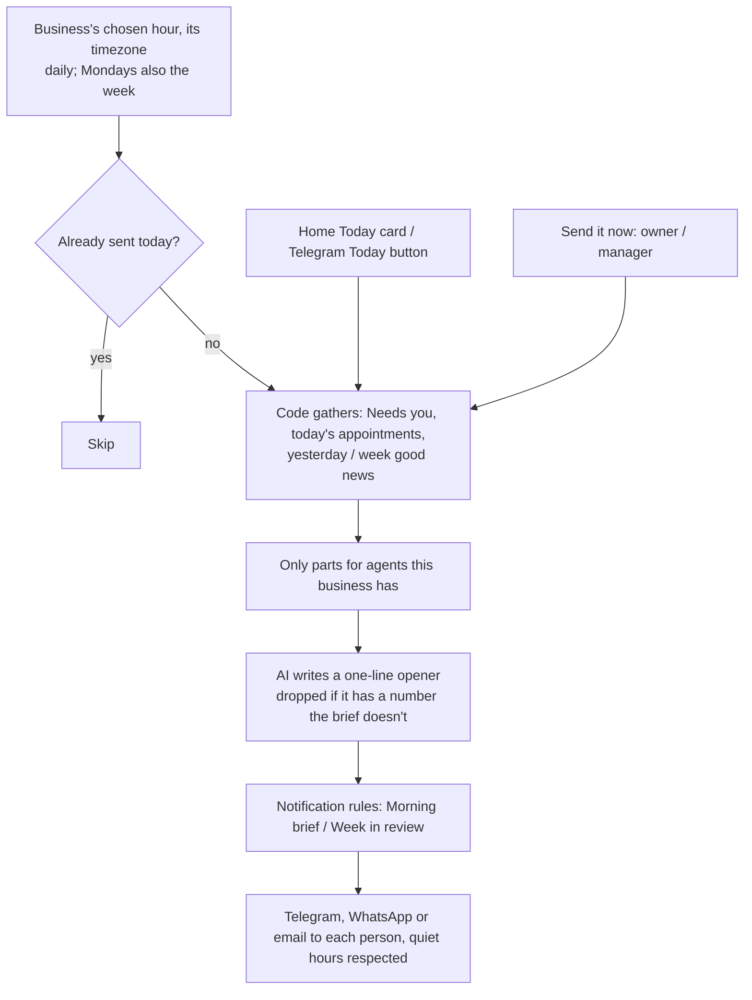

# Business Pulse

A morning brief for the owner and a Monday week in review, on Telegram, WhatsApp or email, plus a "Today" card on
Home and a **☀️ Today** button in the Telegram team bot. Included in every plan.

Code: `backend/src/agentry/pulse.py`, API `api/routes/notification_center.py` (`/org/pulse`, `/org/pulse/settings`,
`/org/pulse/send-now`), Home → Today card, Telegram team bot ☀️ Today. Tests: `tests/test_pulse.py`.

## What's in it

1. **Needs you** (ranked; each with what to do and a link):
   - cards waiting over 4 hours;
   - people asking for a call back;
   - urgent emails still open;
   - overdue money, with the biggest invoice;
   - new leads not contacted;
   - posts waiting for approval.
2. **Today:** appointments booked for today.
3. **Yesterday / this week** (good news): money received, bookings made, new leads, calls answered, emails sorted,
   interested cold-email replies, posts published.

Only the parts for agents the business has appear. The numbers and the order come from code. The AI writes only the
one-line opener of the sent brief, and that line is dropped if it mentions a number the brief doesn't have.

## When and to whom

- **Morning brief:** every day at the business's chosen hour (5–12, default 8:00), in its own timezone, once a day.
- **Week in review:** Mondays at the same hour.
- **Who gets it:** set in Notification rules (*Morning brief*: owner; *Monday week in review*: owner and manager by
  default). Channels, quiet hours and email fallback all work as for any notification.
- **Settings:** owners and managers use Home → Today → Brief settings: on/off, hour, weekly on/off, and **Send it now**.

## Who can do what

| | Owner | Manager | Front desk | Finance | Viewer | Agentry |
|---|---|---|---|---|---|---|
| See the Today card / ☀️ Today | ✅ | ✅ | ✅ | ✅ | ✅ | ✅ |
| Change brief settings, Send it now | ✅ | ✅ | — | — | — | ✅ |
| Choose who receives it (Notification rules) | ✅ | ✅ | — | — | — | ✅ |

What each person sees in the card follows their role (e.g. money lines need invoice access). Settings need
`automation: configure`.
