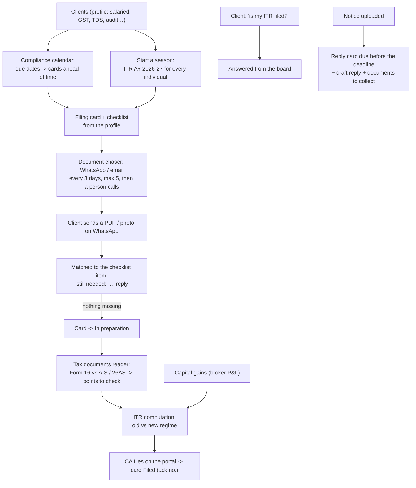
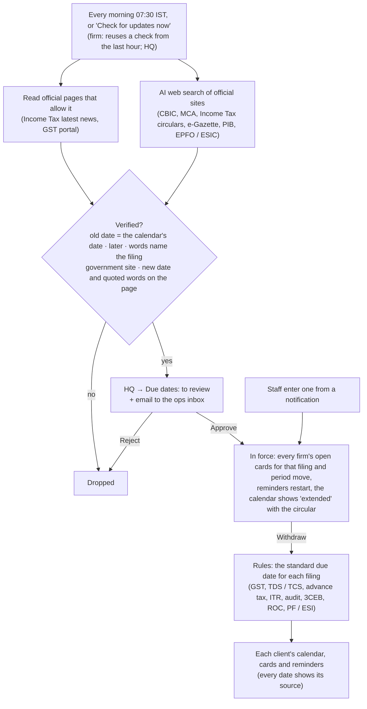

# CA Firm pack: the 13 CA agents

For chartered accountants, tax consultants and small compliance / law firms. Sold as the **CA Firm** pack (HQ → Packs,
[PACKS.md](../../PACKS.md)) or agent by agent. Everything sits on one shared base: the firm's **clients** (Clients
page), one **card per filing** (Filings board) and the **files** clients send.

**The CA files.** Agents prepare, check and chase. Nothing is filed or uploaded to a government portal, and no portal
password is stored. **Every number is traceable** to the line of the file it came from. Where a model reads a document,
anything it can't trace is flagged and never used silently.

## Setup

1. Switch on the pack in HQ. The client page → **Pack** card → *Give them this pack*, with the price filled in.
2. In their portal, go to **Clients**. Add the firm's clients, or import a CSV / Excel file with Name, PAN, Mobile, Email, GSTIN and Type. Then tick what applies to each one: salaried, GST, TDS, audit, company, and so on. Checklists and due dates follow these ticks.
3. **Connect WhatsApp** (and Gmail) so reminders go out and clients' documents come in. Agentry sets the approved WhatsApp template for reminders sent outside the 24-hour window (Automations → Document chaser / Compliance calendar).
4. Automations start in setup or approval mode. Nothing goes to clients until an agent is live.

## Diagram

## The agents

| Agent | Where | What it does | Checks that keep it honest |
|---|---|---|---|
| **Filing tracker** | Filings | A board with five columns: documents pending, in preparation, in review, filed, verified. Each card has an owner, a due date and an ack number. "My work" shows one person's cards. **Seasons** create a card for every matching client in one go. Clients who ask "is my ITR filed?" on WhatsApp get the answer from the board. | Only that client's own filings are shared. Cards due within 3 days, or overdue, become Needs-you cards. |
| **Document chaser** | Filing cards, client page | Builds a checklist from the filing type and the client's profile. Files sent on WhatsApp or uploaded are matched to the checklist item they answer. Reminders go out until nothing is missing, and then the card moves on. | The model only picks an item from the checklist. Below 60% confidence the file is kept and the firm gets a card to match it by hand. After 5 reminders the firm gets a "call them" card. |
| **Tax documents reader** | Client page | Reads Form 16, AIS, TIS and 26AS into lines. Points to check: TDS per deductor, salary per employer, and income in AIS that isn't in Form 16 (deposit and savings interest, dividends, shares sold, rent). Exports to Excel. Has a sample Form 16 and AIS. | Each line keeps its exact source text. A line whose quote isn't in the document, or whose amount isn't in its quote, is untraced and left out of the comparisons. It also flags a PAN that doesn't match the client's. |
| **Compliance calendar** | Compliance | Covers GSTR-1/3B (monthly or QRMP), TDS payment and returns, PF/ESI, advance tax, ITR (31 Jul, or 31 Oct with an audit), the 3CA/3CD audit report, GSTR-9, AOC-4/MGT-7 (LLP Form 8/11) and DIR-3 KYC. Each due date goes on the board 30 days ahead, and clients are reminded 7 and 2 days before. | Dates follow the client's profile. When the government extends a date, edit the card's due date. |
| **GST reconciliation** | Client page | Compares GSTR-2B (portal JSON, Excel or CSV) with the purchase register. Results: matched, amount differs, not in 2B (ITC at risk), not in the books, or a different GSTIN. Writes a message for each supplier who hasn't filed. | Invoice numbers are compared ignoring case, separators, leading zeros and a /24-25 year suffix. Amounts come only from the files. |
| **ITR preparation** | Client page | Computes old vs new regime for AY 2026-27. It fills in from the reader and the latest capital gains result, and the CA edits every figure. Handles 87A (₹12 lakh with marginal relief), 111A/112A, the unused basic exemption, surcharge and cess. Says which regime is better and which ITR form fits. | Plain code with tests against hand calculations. Surcharge marginal relief isn't applied, and a note says so. |
| **Capital gains** | Client page | Reads a broker tax P&L or CAMS statement and splits gains into STCG/LTCG by section, before and after 23 Jul 2024. Applies grandfathering at the 31 Jan 2018 market value, and taxes debt funds bought from April 2023 at slab rates. | Shares bought before Feb 2018 without that market value are flagged. Rows with missing dates or values are flagged. |
| **Bank statement classifier** | Client page | Tags every line of an Excel/CSV statement. Gives totals by category, business receipts (digital and cash) and 44AD/44ADA presumptive income. Flags cash deposits over ₹10 lakh (SFT) and cash receipts of ₹2 lakh or more (269ST). | The firm's own rules come first, then built-in patterns, then the model. Lines tagged by the model are marked. A correction can become a rule for that payee. |
| **Notice handler** | Client page, Filings | Reads a notice for its section, assessment year, DIN, dates, demand, why it was sent and what to do, and drafts a reply. Creates a reply card due 5 days before the deadline, with the documents to collect. | Dates, DIN and demand must appear in the notice's text, or they're dropped and flagged. Quotes are kept only when they're word for word. |
| **TDS returns** | Client page | Checks a payments register: PAN, rate per section (FY 2025-26), thresholds (including the 194C ₹1 lakh yearly total) and 201(1A) interest at 1% and 1.5% a month. Gives 24Q/26Q lines by quarter. | Rates and due dates are code. Interest on a short deduction isn't estimated, because it depends on when the shortfall is paid. |
| **Tax audit (3CD)** | Client page | Tests the ledger for 40A(3) (₹10,000, or ₹35,000 for transporters), 43B, 36(1)(va), 43B(h) MSME (45/15 days), 269SS/269T/269ST and 40(a)(ia), and lists the disallowance per clause. | The auditor decides. Each exception gives its ledger rows. |
| **Recurring entries & budgets** | Recurring entries | Books rent, retainers, EMIs and subscriptions as ready bookkeeping documents on their dates, catching up any missed dates. The bookkeeping budgets alert at 80%. | Never booked twice (one document per entry per date). |
| **Excel desk** | Excel desk | Turns a PDF or photo into Excel in the firm's own column layout, reconciles two sheets, and answers questions about a sheet. | The model only reads tables and turns questions into a filter/group/sum. The numbers are computed by code. Numbers not found in the source are marked "check". |

A daily job at 9:30 IST puts due dates on the board, sends due-date cards, sends document reminders and books recurring entries.

## Due dates: where they come from, and official extensions

Code: `backend/src/agentry/automations/ca/calendar.py` (the rules), `due_dates.py` (extensions), `worker/due_date_jobs.py`, API
`/org/ca/compliance/updates` (firms) and `/hq/due-dates` (Agentry staff), migration 0055. Tests: `tests/test_due_dates.py`.

| Filing | Standard date used | Notes |
|---|---|---|
| GSTR-1 / 3B monthly | 11th / 20th | |
| GSTR-1 / 3B quarterly (QRMP) | 13th / 22nd or 24th | 22nd or 24th from the GSTIN's state (22nd if no GSTIN) |
| CMP-08 / GSTR-4 (composition) | 18th after the quarter / 30 Apr | Composition dealers get no GSTR-1 / 3B / 9 |
| GSTR-7 / GSTR-8 | 10th | GST TDS deductors / e-commerce operators |
| GSTR-9 | 31 Dec | |
| TDS / TCS payment | 7th; March by 30 Apr | |
| TDS 24Q / 26Q · TCS 27EQ | 31 Jul, 31 Oct, 31 Jan, 31 May · 15 Jul, 15 Oct, 15 Jan, 15 May | |
| Advance tax | 15 Jun / Sep / Dec / Mar | |
| ITR | 31 Jul; 31 Oct with audit; 30 Nov with transfer pricing | |
| Tax audit report · Form 3CEB | 30 Sep · 31 Oct | |
| AOC-4 / MGT-7 (company) | 30 / 60 days after the AGM | The client's AGM date; without it 30 Oct / 29 Nov (AGM assumed 30 Sep) |
| LLP Form 8 / 11 | 30 Oct / 30 May | |
| DIR-3 KYC | 30 Sep | |
| PF / ESI | 15th | |

Not on the calendar: professional tax (differs by state), 15CA/CB (per payment), Form 24G (government offices). An extension
applies only to cards still on the date it replaces: a card a firm edited by hand keeps its own date.
`AGENTRY_DUE_DATES_AUTO_APPLY=true` applies changes verified on the official page without waiting for staff (off by default).

**First real find (2026-11-12):** Circular No. 07/2026 (28 Sep 2026): ITR AY 2026-27 for audit cases 31 Oct → 21 Nov 2026, audit
reports 30 Sep → 21 Oct 2026. Both verified on incometax.gov.in.

## Official figures: rates, thresholds, limits, festival dates

Code: `backend/src/agentry/official_rules.py` (the registry), checked by the same daily run as due dates
(`automations/ca/due_dates.py`: `rule_candidates`, `verify_rule`, `decide_rule`), migration 0056 (`app.rule_updates`).
HQ → **Official updates** lists every figure with its source, changes to review, changes in force and a form to enter one;
firms see the figures in use on the compliance calendar ("Tax rates and limits the agents use").

| Agent | Figures (the law for FY 2025-26 / AY 2026-27 unless changed) |
|---|---|
| ITR preparation | New regime slabs, standard deduction (₹75,000 new / ₹50,000 old), 87A rebate (₹12 lakh / ₹60,000 new; ₹5 lakh / ₹12,500 old), 80C ₹1.5 lakh, 80CCD(1B) ₹50,000, home loan interest ₹2 lakh, 112A exemption ₹1.25 lakh, 111A 20%, 112A 12.5%, cess 4% |
| Capital gains | Long-term after 12 months (listed equity) / 24 months (other), rates changed on 23 Jul 2024 |
| TDS returns | Rate (individuals, others) and threshold for 194A, 194C, 194H, 194I, 194J, 194Q, 194-IA, 194T, 194D; no-PAN 20%; interest 1% / 1.5% a month; 194C yearly ₹1 lakh |
| Tax audit (3CD) | 40A(3) ₹10,000 (₹35,000 transporters), 269SS/T ₹20,000, 269ST ₹2 lakh, 43B(h) 45 days, 40(a)(ia) 30% |
| Bank statement classifier | SFT cash deposits ₹10 lakh, 44AD 6% / 8%, 44ADA 50% |
| Festival campaigns | Each lunar festival's date per year; next year's dates are left open and filled when announced |

A found change must: be a new value of a figure on the list (its old value is the one in force), have the quoted words about
that figure, apply from FY 2026-27 or later (an old page restating an earlier year's figure is dropped), and come from a
government site with the new value and the quoted words on the page. Approving it makes every agent use it within two
minutes (API, try-it boxes, daily jobs); withdrawing goes back. The tax figures say which year's law they follow
(`BASE_FY`): move it and the defaults when the code is updated to a new Finance Act.

**Real check (2026-11-12):** the Income Tax site confirms the TDS rates and thresholds were kept unchanged under the
Income-tax Act, 2025. An old FAQ page restating the ₹50,000 standard deduction (AY 2024-25) was dropped by the year check.

## Who can do what

| | Owner | Manager | Front desk | Finance | Viewer | Agentry |
|---|---|---|---|---|---|---|
| See clients, filings, compliance, results | ✅ | ✅ | ✅ | ✅ | ✅ | ✅ |
| Add clients, move cards, upload, run the tools | ✅ | ✅ | ✅ | ✅ | — | ✅ |
| Settings (reminder days, tolerances) | ✅ | ✅ | — | — | — | ✅ |
| Switch agents on, the pack, WhatsApp templates | — | — | — | — | — | ✅ |

Reading needs conversation or money access (viewers have money read); working needs `conversation: act` or `invoice: act`
(`automations/ca/core.py`). Each tool's endpoints also need its own agent switched on: the Filings board needs the
filing tracker, Compliance the compliance calendar, and so on. Opening is checked by `tests/test_role_matrix.py`
([roles-matrix.md](../roles-matrix.md)).

Everything that changes something is in the audit log. Deleting a client deletes their filings and files.

## Samples to demo with

Every tool has a **Try the sample** button:
- **Form 16 + AIS:** the TDS differs by ₹5,000, and 4 kinds of income are missing from Form 16.
- **GSTR-2B + purchase register:** ₹6,900 of ITC is at risk.
- **Broker P&L:** includes grandfathering and a debt fund.
- **Bank statement:** includes a ₹2.5 lakh cash deposit.
- **143(1)(a) notice:** respond by 11 Nov 2026.
- **TDS register:** five problems to fix.
- **Ledger:** ₹3.48 lakh of 3CD disallowances.

All the sample files are in `backend/samples/ca/`.

Code: `backend/src/agentry/automations/ca/`, `api/routes/ca_api.py`, migrations 0035-0036. Tests: `test_ca_desk.py`,
`test_ca_tools.py`, `test_agent_packs.py`.
