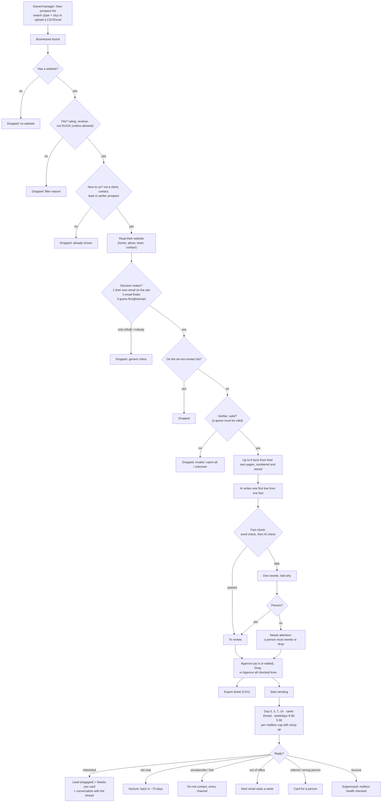

# Personal cold email

Finds businesses that fit, the person who decides, verifies their email and writes **one honest first line from a fact on their own website**. A person reviews every line, then it sends a short sequence from separate sending mailboxes and sorts the replies. **Today it runs in test mode:** the business list is a sample and emails are recorded, not delivered, until Agentry connects real providers (Instantly for sending, Google Places, Hunter and MillionVerifier for data).

Plan and milestones: [PHASE-5-COLD-EMAIL.md](../../PHASE-5-COLD-EMAIL.md). Spec: [automations/cold-email.md](../../automations/cold-email.md).

## Setup

1. **Switch it on** in HQ (client page → automations → Personal cold email). Agentry's own company has it on: Agentry is the first customer.
2. **Settings** (Automations → Personal cold email): what you offer and your postal address (both used once sending exists). Agentry-only: allow catch-all addresses, allow EU/UK businesses (both off).
3. Searches use the **sample list** (50 dental clinics in Pune, `mock-data/cold-email/`) until real providers are connected in 5.6: Google Places, an email finder (Hunter) and a verifier (MillionVerifier).

## Diagram

## The funnel

The campaign page shows how many businesses reached each step and why the others dropped out. These are counted from the rows themselves, not from counters. The sample list reproduces the reference funnel:

| Found | Website | Fits | New | Decision maker | Verified | Line ready |
|---|---|---|---|---|---|---|
| 50 | 49 | 46 | 45 | 15–16 | **8** | 8 |

Measured on 30 Oct with the real AI models: the same 8, every line passed the fact check, and 2 needed one rewrite.

## Sending (5.4)

- **Mailboxes:** Agentry adds them in HQ (client page → Cold email sending mailboxes), always on a separate domain; the
  business's own domain is refused. Each ramps up: 5 emails on day one, +3 a day, up to its daily limit (default 30).
- **Start:** needs approved lines, *what you offer* and *postal address* in the agent's settings, and an active mailbox.
  "Add N approved" puts later approvals into a running campaign. Pause / Resume any time; dropping a person stops them.
- **The emails:** plain text. Day 0: their first line, what you offer, "worth a 15-minute call?". Day 3: a short bump.
  Day 7: one more reason. Day 14: "I'll stop here". All in one thread from the same mailbox; each has the sender, the
  business, the postal address and an unsubscribe link, plus the one-click `List-Unsubscribe` header.
- **When:** the worker checks every 5 minutes; emails go out on weekdays, 9:30–17:30 in the business's timezone.
- **Health:** a mailbox pauses itself on any spam complaint, or over 3 % bounces after 20 sends. Its threads wait
  rather than jump to another mailbox. Agentry can resume it from HQ.

## Replies (5.5)

The `fast` model reads each reply (with a keyword fallback) and the reply stops the sequence, except out-of-office:

| Reply | What happens |
|---|---|
| Interested | Contact + lead (engaged, owned by cold email) in the lead engine, a conversation with our emails and their reply, and a Needs-you card "Interested: …" |
| Not now | Lead in nurture; back in about 75 days |
| Unsubscribe (reply or link) | Do-not-contact for email, WhatsApp, SMS and calls, immediately |
| Out of office | The next email waits a week |
| Referral / wrong person | A card so a person can reach the right contact |
| Bounce | Address suppressed (bounce); mailbox health checked |

The campaign page counts people emailed, emails sent, replies, interested, meetings booked, bounces and unsubscribes.
**Test mode:** Agentry staff see *Simulate a reply* on each emailed person, to show a client what happens.

## Safeguards

- **Facts only from their own website.** The line must be based on one numbered fact; the word check rejects numbers, places or services the fact doesn't contain, and claims like "best" or "award". The AI check is a second opinion. A line that fails twice can't be approved until a person edits it.
- **No invented addresses.** Emails the AI reads off a page are kept only if they appear on the page word for word; a guessed address is used only if the verifier says "valid".
- **Never twice.** A business already prospected (reached "new" in an earlier list), a client's or lead's domain, and anyone on the do-not-contact list are skipped. For Agentry's own lists, Agentry's clients are skipped too.
- **EU/UK off by default**; B2B only; nothing is sent from this page.

## Who does what

| | Owner | Manager | Front desk | Finance | Viewer | Agentry |
|---|---|---|---|---|---|---|
| Create lists (search or upload) | ✓ | ✓ | | | | ✓ |
| See lists, funnel, people and lines | ✓ | ✓ | ✓ | | | ✓ |
| Approve, edit, drop lines; approve all checked | ✓ | ✓ | | | | ✓ |
| Export the sheet (has business emails) | ✓ | ✓ | | | | ✓ |
| Start, pause, resume sending; stop a person | ✓ | ✓ | | | | ✓ |
| Reply to interested people (Needs you) | ✓ | ✓ | ✓ | | | ✓ |
| Switch it on, sending mailboxes, allow catch-all / EU-UK | | | | | | ✓ |

Every create, approve, drop and bulk approve is in the audit log.

## What's next

Connect the real providers: Instantly for sending (and its reply/bounce/complaint webhook into `replies.py`), then Google Places, Hunter and MillionVerifier (5.6). Then Agentry's own live campaign (5.7).
