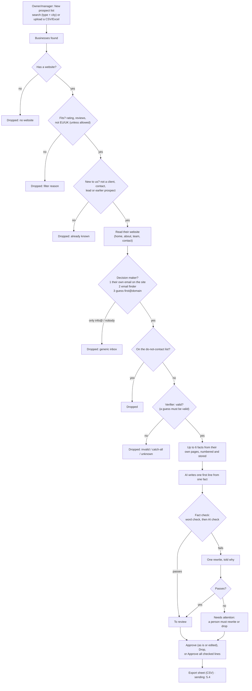

# Personal cold email

Finds businesses that fit, the person who decides, verifies their email and writes **one honest first line from a fact on their own website**. A person reviews every line. **Sending isn't built yet** (Phase 5.4): today it builds and reviews lists only.

Plan and milestones: [PHASE-5-COLD-EMAIL.md](../../PHASE-5-COLD-EMAIL.md). Spec: [automations/cold-email.md](../../automations/cold-email.md).

## Setup

1. **Switch it on** in HQ (client page → automations → Personal cold email). Agentry's own company has it on: Agentry is the first customer.
2. **Settings** (Automations → Personal cold email): what you offer and your postal address (both used once sending exists). Agentry-only: allow catch-all addresses, allow EU/UK businesses (both off).
3. Searches use the **sample list** (50 dental clinics in Pune, `mock-data/cold-email/`) until real providers are connected in 5.6: Google Places, an email finder (Hunter) and a verifier (MillionVerifier).

## Diagram

## The funnel

The campaign page shows how many businesses reached each step and why the others dropped out. These are counted from the rows themselves, not from counters. The sample list reproduces the reference funnel:

| Found | Website | Fits | New | Decision maker | Verified | Line ready |
|---|---|---|---|---|---|---|
| 50 | 49 | 46 | 45 | 15–16 | **8** | 8 |

Measured on 30 Oct with the real AI models: the same 8, every line passed the fact check, and 2 needed one rewrite.

## Safeguards

- **Facts only from their own website.** The line must be based on one numbered fact; the word check rejects numbers, places or services the fact doesn't contain, and claims like "best" or "award". The AI check is a second opinion. A line that fails twice can't be approved until a person edits it.
- **No invented addresses.** Emails the AI reads off a page are kept only if they appear on the page word for word; a guessed address is used only if the verifier says "valid".
- **Never twice.** A business already prospected (reached "new" in an earlier list), a client's or lead's domain, and anyone on the do-not-contact list are skipped. For Agentry's own lists, Agentry's clients are skipped too.
- **EU/UK off by default**; B2B only; nothing is sent from this page.

## Who does what

| | Owner | Manager | Front desk | Finance | Viewer | Agentry |
|---|---|---|---|---|---|---|
| Create lists (search or upload) | ✓ | ✓ | | | | ✓ |
| See lists, funnel, people and lines | ✓ | ✓ | ✓ | | | ✓ |
| Approve, edit, drop lines; approve all checked | ✓ | ✓ | | | | ✓ |
| Export the sheet (has business emails) | ✓ | ✓ | | | | ✓ |
| Switch it on, allow catch-all / EU-UK | | | | | | ✓ |

Every create, approve, drop and bulk approve is in the audit log.

## What's next

5.4 sending (sending domains, mailboxes, caps, unsubscribe), 5.5 replies into the lead engine, 5.6 real data providers, 5.7 Agentry's own live campaign and auto-pause guardrails.
