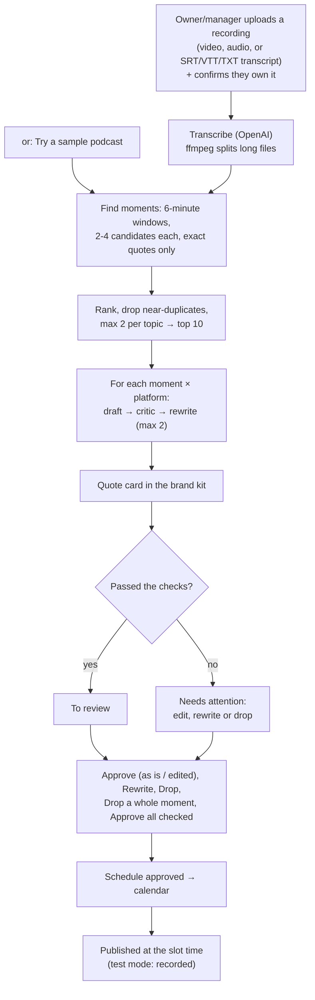

# Content repurposing

One long video or podcast becomes about **30 posts** for LinkedIn, Instagram and X, each with a branded quote card, in the business's own voice. A person approves every post; the calendar spaces them out; they publish at their time.
**Test mode today:** posts are recorded at their slot time, not posted, until Agentry connects the social accounts (Phase 6.5).

Plan: [PHASE-6-CONTENT.md](../../PHASE-6-CONTENT.md). Spec: [automations/content-repurposing.md](../../automations/content-repurposing.md).

## Setup

1. **Switch it on** in HQ (client page → automations → Content repurposing).
2. **Brand kit** (Content → Brand kit): main and accent colours, card style (bold, light, split), handle, logo, platforms, moments per recording (default 10).
3. **Voice:** paste 10–20 past posts; Agentry learns how they write (only the guide is kept, not the posts).
4. **Settings** (Automations → Content repurposing): a call to action, used only where it fits.

## Diagram

## What the checks catch

| Check | Why |
|---|---|
| Every moment's quote is in the transcript, word for word | A model that paraphrased doesn't get a moment |
| Anything in quotation marks in a post is in the transcript | No misquotes |
| Every number is in the recording around the moment ("22%" matches "22 percent") | No invented statistics |
| Length and hashtag limits per platform; a real first-line hook (LinkedIn, Instagram) | Posts that fit the platform |
| No AI filler ("game-changer", "unlock", "delve"…) | Posts that sound like a person |
| A second opinion from the `fast` model | Invented claims or a tone that would embarrass the business |

A draft that fails is rewritten up to twice with the reasons; if it still fails it waits as **needs attention** and can't be approved until a person edits it.

## The calendar

Starting tomorrow, in the business's timezone: **LinkedIn** weekdays at 9:30, **Instagram** daily at 12:30, **X** at 10:00 and 16:00. Two posts from the same moment never land on the same day. Any post can be moved to another time. The worker publishes due posts every 5 minutes.

Measured on 30 Oct with the real AI on the 45-minute sample: **10 moments, 30 posts with images in about 3½ minutes**; 29 passed the checks first time, the 30th after one rewrite.

## Who does what

| | Owner | Manager | Front desk | Finance | Viewer | Agentry |
|---|---|---|---|---|---|---|
| Upload, delete recordings; try the sample | ✓ | ✓ | | | | ✓ |
| See recordings, posts, calendar | ✓ | ✓ | ✓ | | | ✓ |
| Approve, edit, rewrite, drop; schedule and move posts | ✓ | ✓ | | | | ✓ |
| Brand kit and voice | ✓ | ✓ | | | | ✓ |
| Switch it on; connect social accounts (6.5) | | | | | | ✓ |

Everything is in the audit log. Deleting a recording deletes its file, transcript, moments, posts and images (posts already published stay on the platforms).

## What's next

6.5: real publishing (LinkedIn and Instagram first, through the platforms' APIs), 6.6: results (approved without edits, published, turnaround) on Reports and a videos-per-month meter for the retainer. v2: short vertical clips, newsletter and blog outputs.
