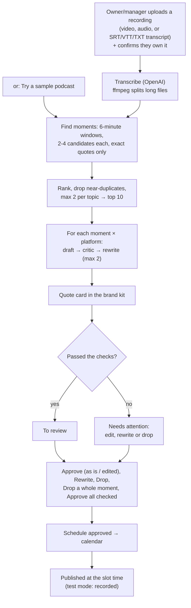
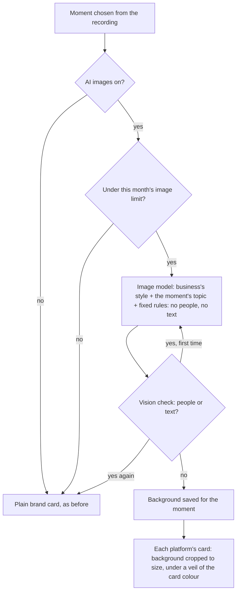

# Content repurposing

One long video or podcast becomes about **30 posts** for LinkedIn, Instagram and X, each with a branded quote card, in the business's own voice. A person approves every post; the calendar spaces them out; they publish at their time.
**Test mode today:** posts are recorded at their slot time, not posted, until Agentry connects the social accounts (Phase 6.5).

Plan: [PHASE-6-CONTENT.md](../../PHASE-6-CONTENT.md). Spec: [automations/content-repurposing.md](../../automations/content-repurposing.md).

## Setup

1. **Switch it on** in HQ (client page → automations → Content repurposing).
2. **Brand kit** (Content → Brand kit): main and accent colours, card style (bold, light, split), handle, logo, platforms, moments per recording (default 10).
3. **Voice:** paste 10–20 past posts; Agentry learns how they write (only the guide is kept, not the posts).
4. **Settings** (Automations → Content repurposing): a call to action, used only where it fits.

## Diagram

## What the checks catch

| Check | Why |
|---|---|
| Every moment's quote is in the transcript, word for word | A model that paraphrased doesn't get a moment |
| Anything in quotation marks in a post is in the transcript | No misquotes |
| Every number is in the recording around the moment ("22%" matches "22 percent") | No invented statistics |
| Length and hashtag limits per platform; a real first-line hook (LinkedIn, Instagram) | Posts that fit the platform |
| No AI filler ("game-changer", "unlock", "delve"…) | Posts that sound like a person |
| A second opinion from the `fast` model | Invented claims or a tone that would embarrass the business |

A draft that fails is rewritten up to twice with the reasons; if it still fails it waits as **needs attention** and can't be approved until a person edits it.

## The calendar

Starting tomorrow, in the business's timezone: **LinkedIn** weekdays at 9:30, **Instagram** daily at 12:30, **X** at 10:00 and 16:00. Two posts from the same moment never land on the same day. Any post can be moved to another time. The worker publishes due posts every 5 minutes.

Measured on 30 Oct with the real AI on the 45-minute sample: **10 moments, 30 posts with images in about 3½ minutes**; 29 passed the checks first time, the 30th after one rewrite.

## Who does what

| | Owner | Manager | Front desk | Finance | Viewer | Agentry |
|---|---|---|---|---|---|---|
| Upload, delete recordings; try the sample | ✓ | ✓ | | | | ✓ |
| See recordings, posts, calendar | ✓ | ✓ | ✓ | | | ✓ |
| Approve, edit, rewrite, drop; schedule and move posts | ✓ | ✓ | | | | ✓ |
| Brand kit and voice | ✓ | ✓ | | | | ✓ |
| Switch it on; connect social accounts (6.5) | | | | | | ✓ |

Everything is in the audit log. Deleting a recording deletes its file, transcript, moments, posts and images (posts already published stay on the platforms).

## Results and billing (6.6)

- **Content page** (last 30 days): recordings, posts written, **approved without changes** (the quality measure: how often a
  person approved a post as written), and the median time from upload to drafts.
- **Reports** (monthly, and the monthly email): posts written from how many recordings, posts published, approved without changes.
- **Dashboard tile:** *Posts published* (metric `posts_published`, from the `content.published` event).
- **Billing:** the plan editor in HQ has *Videos included (content)* and *Per extra video*; the statement adds a
  "Content videos beyond the N included" line. The sample podcast is never billed.
- **Cost to serve (HQ):** transcription cost per recording is added to the client's margin.

## What's next

6.5: real publishing (LinkedIn and Instagram first, through the platforms' APIs). v2: short vertical clips, newsletter
and blog outputs, engagement metrics feeding back into which moments are picked.

## Content v2 (2026-10-31)

- **Blog article + newsletter** (8.3): on a recording's page, *Write a blog article + newsletter*. The `writer` model
  drafts both from the ranked moments in the brand voice; quotes must be word for word, numbers must be in the
  recording, no AI filler (one rewrite, else "needs attention"). Edit, approve (never with a misquote), download
  Markdown or HTML for WordPress, Mailchimp or Brevo. Code: `content/longform.py`.
- **From a link** (2026-11-01): *Paste a link* next to the upload (or send just the link to the Telegram team bot, which
  has no 20 MB limit for links): YouTube, Instagram, LinkedIn, Facebook, X, Google Drive, a direct MP4/MP3, most video
  and podcast sites (yt-dlp). The link is checked first (public address, one video not a playlist, not live, up to
  3 hours); the server downloads it at up to 720p (or audio only) and uses the platform's **own captions** as the
  transcript when the uploader wrote them (English or Hindi), so no transcription cost. Errors in plain words ("private
  video", "the site asked us to sign in: upload the file instead"); *Try again* re-downloads. **YouTube blocks most
  servers** (tested on the Oracle VM: "sign in to confirm you're not a bot"): set `AGENTRY_CONTENT_DOWNLOAD_PROXY`
  (a residential proxy) and/or `AGENTRY_CONTENT_DOWNLOAD_COOKIES` (a cookies.txt from a signed-in YouTube account,
  ideally a separate one) on the server. Code: `content/links.py`, migration 0033.
- **Vertical clips** (8.2, 2026-11-01): for **video** uploads, each moment is also cut as a 9:16 MP4 (1080x1920) for
  Reels/Shorts: whole transcript sentences, 20-60 s; captions burned in from the transcript (short lines, timed by word
  count inside each segment); the moment's hook as a banner for the first 3 s; a 2 s end card in the brand colour with
  the business name, logo and handle. Framing is a centre crop (face tracking later). A moment past the end of the video
  is skipped, a failed clip never fails the recording. On the recording's page each moment shows its clip (play,
  download); *Make vertical clips* / *Recut clips* (owner, manager) cuts them for older videos or after a brand kit
  change. Captions and cards are drawn with Pillow and overlaid by ffmpeg, so any ffmpeg build works. Code:
  `content/clips.py`, migration 0032. Publishing clips as Reels comes next.
- **Real publishing** (8.1): connect **Instagram** (Meta login; needs a Facebook Page linked to the Instagram account)
  or **LinkedIn** (a person's profile) under Settings → Connections. Once a platform is connected, its approved posts go
  out for real at their slot (never test mode), with the quote card and a *View post* link; an expired connection holds
  posts and alerts the owner. LinkedIn company pages need LinkedIn's Community Management API (not yet).

## AI images (ROADMAP-V2 8.7, 2026-11-09)

An opt-in background behind each quote card. **Off by default**; owners and managers switch it on in Content → Brand kit.

- **One image per moment**, shared by its LinkedIn, Instagram and X cards. **New background** on a moment makes another one and redraws its cards.
- **Prompt:** built by Agentry from the business's *image style* (e.g. "soft pastel watercolour") and the moment's topic, asking for objects, textures, nature or abstract shapes, with calm space in the middle. People and text are never asked for, and the vision model rejects any image showing them (retried once, then the plain card is used).
- **Cost:** `gpt-image-1-mini` at low quality, about US$0.002–0.006 an image (measured 2026-11-09: $0.0024). Every image is recorded in `llm_calls` (`ai_image`) and the month's count and spend show on the brand kit. A monthly cap (default 40) stops generation.
- **Settings:** `AGENTRY_MODEL_IMAGE` (default `openai/gpt-image-1-mini`, `mock` = brand-colour test images), `AGENTRY_IMAGE_QUALITY` (low/medium/high). Without an OpenAI key it runs in test mode.
- **Who:** turning it on, the style, the cap and New background need owner or manager (automation:configure).
- Code: `automations/content/ai_images.py`, `images.py` (`background=`), `POST /org/content/moments/{id}/background`. Migration 0051. Tests: `test_ai_images.py`.
