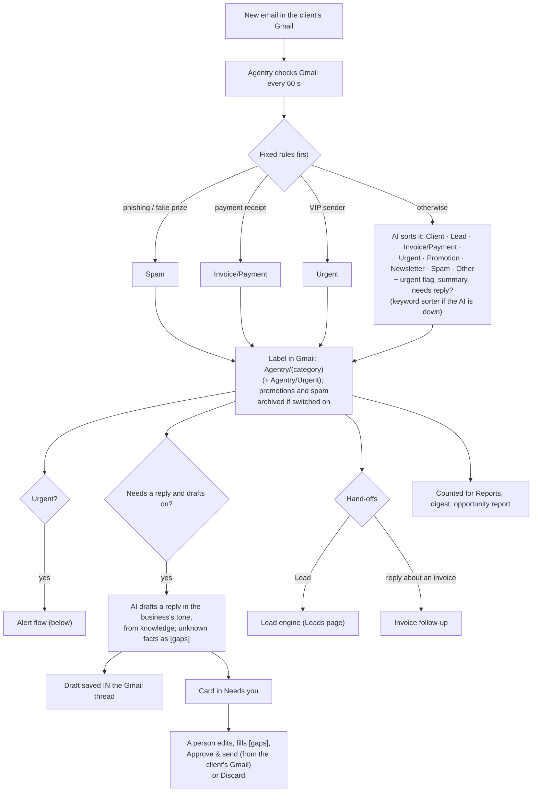
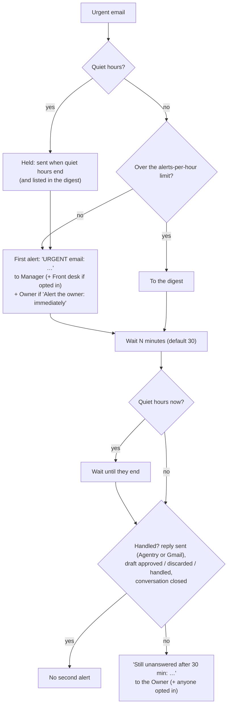

# Inbox triage

Sorts every new email in the client's Gmail, labels it, alerts the right people about urgent ones (and again if nobody answers), drafts replies for a person to send, and hands leads and invoice replies to the other agents. **It never sends an email by itself.**

## Setup (from [onboarding](../02-client-onboarding.md))

1. **Owner connects Gmail** (Connections → Connect Gmail; they sign in with Google and allow read, label and draft).
2. **Knowledge**: services, prices, policies, so drafts quote real facts.
3. **Settings**: VIP senders, alert channel, quiet hours, alerts per hour, alert the owner (immediately or only if unanswered), escalate after N minutes, drafts on or off, archive promotions, digest hour.
4. **Persona**: tone and sign-off.
5. **Go live**: needs a connected Gmail. Starts in approval mode.

## Diagram: every email

## Diagram: urgent alerts and escalation

If "Alert the owner: only if unanswered" is chosen but nobody else gets alerts (a one-person team), the owner is alerted immediately anyway.

## A day with a real client (example: Content Generation, owner Pooja)

| Time | Email | What Agentry does | Who acts |
|---|---|---|---|
| 9:12 | Client asks for the March blog calendar | Labels *Client*, drafts a reply, card in Needs you | Front desk edits and sends |
| 10:40 | "How much for 8 SEO articles a month?" | Labels *Lead*, adds to Leads, drafts with real prices (or a `[gap]`) | Front desk or manager sends |
| 13:05 | "URGENT: wrong post went live" | *Client + Urgent*, alert to Pooja and the manager, draft acknowledgement | Pooja acts; if nobody replies by 13:35 she gets "Still unanswered after 30 min" |
| 15:30 | "Paid INV-104, UTR …" | *Invoice/Payment*, handed to invoice follow-up | Finance |
| All day | Newsletters, offers, phishing | Labelled, no drafts, no alerts; archived if switched on | Nobody |
| 22:30 | Urgent email | Quiet hours: no alert at night; alert at 8:00, escalation at 8:30 if still open | Next morning |
| 9:00 next day | Digest | Urgent still open, clients waiting longest, new leads, payments mentioned | Owner, manager read it |

## Who does what

| | Owner | Manager | Front desk | Finance | Viewer | Agentry |
|---|---|---|---|---|---|---|
| Needs you: see, edit, approve, discard drafts | ✓ | ✓ | ✓ | invoice emails only | | ✓ |
| Conversations, Leads, Knowledge (read) | ✓ | ✓ | ✓ | invoice emails only | | ✓ |
| Settings, knowledge, persona, pause | ✓ | ✓ | | | | ✓ (+ categories) |
| Connect / disconnect Gmail | ✓ | ✓ | | | | |
| Urgent alerts | on | on | opt-in | | | |
| Second alert (still unanswered) | on | opt-in | opt-in | | | |
| Daily digest | on | on | opt-in | | | |
| Reports | ✓ | ✓ | ✓ | ✓ | ✓ | ✓ |

## Working the queue (added 2026-10-25)

| Feature | What it does | Who |
|---|---|---|
| **Fraud warnings** | Changed bank details, lookalike sender domains, a Reply-To on another domain, a fake display name, gift-card or OTP requests: a red warning on the card and conversation, label `Agentry/Suspicious`. A suspicious payment email is always urgent; the AI's draft says the team will confirm by phone | Everyone who sees the card |
| **Your own categories** | Up to 10 extra labels (e.g. Supplier, Job applicant) next to the built-in ones | Owner, manager |
| **Correct a label** | On a conversation, change the category: relabelled in Gmail/Outlook and **remembered** (that sender next time; a domain after two matching corrections) | Owner, manager, front desk |
| **Assign** | "Assign to…" on a card; the person gets an email and finds it under **Mine** | Anyone who can act on the card |
| **Snooze** | 1 h, 3 h, tomorrow 9 am, Monday 9 am; **Snoozed** tab; a snoozed urgent email counts as seen (no escalation) | Same |
| **Saved replies** | Answers used again and again: pick one on any draft; the AI also uses them when drafting | Managed by owner/manager; used by front desk and finance |
| **Follow-ups** | When your team wrote last and a client or lead has been quiet for N days (default 3), a follow-up draft appears in Needs you (10:30 IST daily) | Front desk |
| **Auto-send** | For categories the client chooses, once the agent is **automatic** and the team has sent ≥ 10 recent drafts of that category unchanged (≤ 20 % edited/discarded). Never urgent, suspicious, or with `[gaps]`. Shown as "Sent automatically by Agentry" | Owner, manager switch it on |
| **Languages** | Replies in the sender's language and script (Hindi, Marathi, Tamil…; Hinglish stays Hinglish); a language badge on the card | Automatic |
| **Writing style** | Learned from up to 50 sent emails when Gmail connects ("Learn again" on the inbox triage page); only the summary is kept | Owner, manager |
| **Attachments** | PDF, Word, text, CSV (≤ 5 MB, up to 3 per email) are read: invoice numbers, amounts and dates feed sorting and drafts; listed on the conversation | Automatic |
| **Several inboxes** | Connect more than one Gmail or Outlook inbox; replies go out from the inbox the email came to; "Cards from accounts@ go to: Finance" | Owner, manager |
| **Outlook / Microsoft 365** | The same features on Outlook (categories, createReply drafts, sent items) | Owner signs in with Microsoft |
| **Instant Gmail** | With Pub/Sub configured, new mail is sorted within seconds instead of the 1-minute check | Agentry (setup once) |
| **WhatsApp alerts** | Each person picks email and/or WhatsApp per alert and adds their number; sent from the client's WhatsApp number with an approved template, email otherwise | Each person; template set by Agentry/owner |
| **Monday summary** | Last week in numbers (sorted, urgent, leads, replies, typical first reply, fraud), on WhatsApp or email | Owner by default |
| **Old email text deleted** | After N days (default 30) the email text is removed; summary, labels and replies stay; emails still waiting in Needs you are kept | Owner, manager set the days |

**Numbers on the inbox triage page:** typical first reply this month (vs before Agentry, measured from Gmail at
connection), drafts sent as written / edited / discarded, possible fraud caught, categories ready for auto-send.

## Monthly
- **Reports:** emails sorted, time saved (about 2 minutes each), urgent caught.
- **Opportunity report** (Home): enquiries answered late or never, overdue amounts mentioned: the pitch for the next agent.
- **Statement:** retainer, plus emails over the included amount.

**Code:** `automations/inbox_triage/` (`workflow.py`, `rules.py`, `escalation.py`, `digest.py`, `config.py`), `connectors/gmail.py`, `notify/alerts.py`. Spec: [inbox-triage.md](../../automations/inbox-triage.md).
