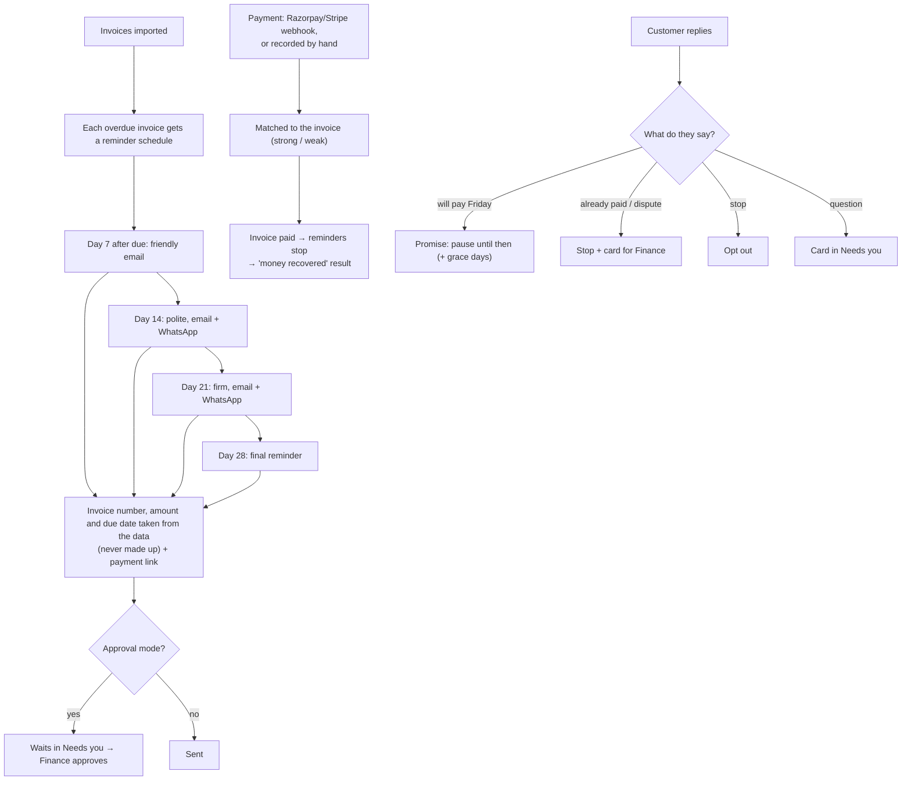

# Invoice follow-up

Chases unpaid invoices on a fixed schedule, using real figures from the client's data, understands what customers reply, and stops the moment an invoice is paid. Money recovered can be billed as a share.

## Setup

1. **Import invoices**: CSV or Excel exported from Tally, QuickBooks or Google Sheets. Columns are recognised automatically (the AI helps with unusual layouts).
2. **Connect** Gmail and/or WhatsApp to send reminders, and Razorpay/Stripe for payment links and automatic "paid" detection.
3. **Settings**: payment links in reminders, days to wait after a promised date.
4. **Compliance**, then **go live** (needs invoices imported + Gmail or WhatsApp).

## Diagram

## Fixed and added on 2026-10-25 (found by an end-to-end run on an invoice-only client)

| # | Before | Now |
|---|---|---|
| 1 | Invoices imported during setup never got reminders after go-live | Go-live starts their reminders |
| 2 | Email replies were only read when inbox triage was also on | Replies in a reminder thread are understood for every invoice client |
| 3 | WhatsApp replies to reminders never reached this agent (the sales assistant could answer them) | A reply within 14 days of a WhatsApp reminder goes to the invoice agent; the assistant stays out |
| 4 | "Payment link" setting did nothing | Reminders carry a Razorpay (INR) or Stripe (needs the Stripe secret key) link for the current balance |
| 5 | Approving a reminder after the invoice was paid still asked for money | Waiting reminders are withdrawn on payment, dispute or void; delivery re-checks the invoice |
| 6 | "Pause" didn't pause | Paused until someone resumes |
| 7 | Any "stop" in a reply unsubscribed the customer | Only a clear opt-out ("STOP" alone, "unsubscribe", "remove me"…) |
| 8 | "Resend the invoice", questions, part payments got no reply | A card for a person (part payment also pauses reminders 7 days) |
| 9 | Disputes, "customer says paid" and unmatched payments couldn't be resolved | Invoices: **Dispute resolved: reopen**, **Write off**, **Void**. Needs you: **Confirm paid**, **Match** a payment to an invoice |
| 10 | Reminders only went out through Gmail; Outlook clients' reminders were silently not sent | Gmail or Outlook; choose the inbox in settings ("Send reminders from", e.g. accounts@) |
| 11 | Every reminder started a new email thread | Later reminders continue the first thread |
| 12 | After the final reminder nothing happened | "Reminders finished: … still unpaid. Time for a call" card with a Call button, once the final reminder has really gone out |
| 13 | Reminder conversations had no customer | The customer is attached |
| 14 | Invoices without email or phone silently got no reminders | Import reports them; the Invoices page shows "no email or phone: no reminders" |
| 16 | WhatsApp reminders were always skipped (no consent on record) | An optional "WhatsApp consent" column at import records it |
| 17 | A payment for an already-paid or void invoice was absorbed silently | It goes to a "check a payment" card |
| 18 | Reminders went at 15:30 IST (10:00 UTC) | 10:00 in the client's timezone |
| 19 | After a part payment, the old link still asked for the full amount | A new link for the new balance |
| 20 | In approval mode, the schedule counted waiting reminders as sent | "Finished" only once the final reminder is actually sent |

## Who does what

| | Owner | Manager | Front desk | Finance | Viewer | Agentry |
|---|---|---|---|---|---|---|
| Invoices page, import, record payment, pause/stop reminders | ✓ | ✓ | | ✓ | view | ✓ |
| Approve reminders, work invoice replies in Needs you | ✓ | ✓ | | ✓ | see only | ✓ |
| Connect Razorpay/Stripe | ✓ | ✓ | | | | ✓ |
| Settings | ✓ | ✓ | | | | ✓ (commission basis) |

## Billing
"Money recovered" results (invoice paid after a reminder) can be billed as a capped share of the amount, with the reminders and match strength as evidence on the statement.

**Code:** `automations/invoice_follow_up`, `invoices.py`, `sequences.py`, `api/routes` webhooks. Spec: [invoice-follow-up.md](../../automations/invoice-follow-up.md).
