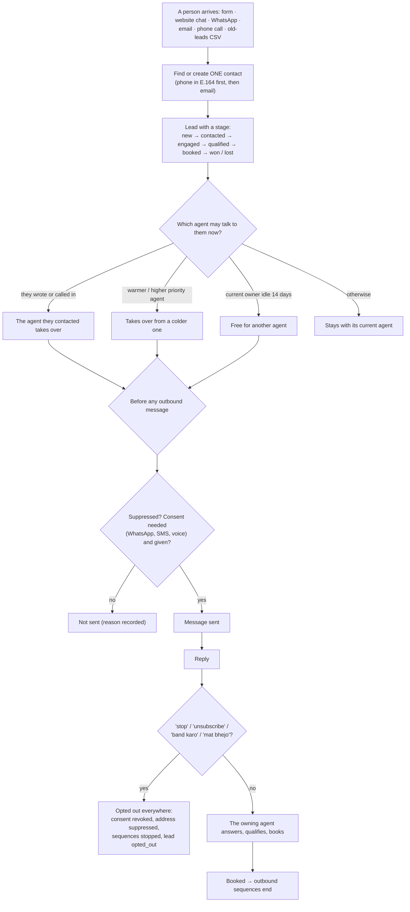

# Lead engine (shared by every lead agent)

Not an agent you sell on its own: the shared base under website chat, WhatsApp, speed-to-lead, reactivation, inbox triage and the receptionist. It makes sure **one person is one contact**, **only one agent talks to them at a time**, and **"stop" stops everything**.

## Diagram

## Rules

| Rule | How |
|---|---|
| **One contact per person** | Phones normalised to international format using the client's country; emails lower-cased; matched by phone first, then email. Duplicates can be merged |
| **One voice** | Each lead has one owning agent. Priority (high → low): receptionist 60, website chat 50, WhatsApp 45, speed-to-lead 40, inbox triage 35, invoice follow-up 30, reactivation 20, cold email 10. Someone writing in always takes over; an owner idle for 14 days lets go |
| **Consent** | WhatsApp, SMS and voice need recorded consent (form opt-in with time and source). Email to businesses relies on legitimate interest plus unsubscribe |
| **Opt-out** | "stop" on its own, or clear phrases anywhere ("unsubscribe", "remove me from", "stop messaging", "band karo", "mat bhejo") → consent revoked, address suppressed, all sequences stopped, lead stage *opted out*. "Stop by tomorrow" is not an opt-out |
| **Finished stages** | won, lost, disqualified, opted out: no agent will contact them |

## Who sees leads

| | Owner | Manager | Front desk | Finance | Viewer | Agentry |
|---|---|---|---|---|---|---|
| Leads page | ✓ | ✓ | ✓ | | | ✓ |
| Import old leads, lead forms | ✓ | ✓ | | | | ✓ |

**Code:** `backend/src/agentry/leads.py`, `sequences.py`.
