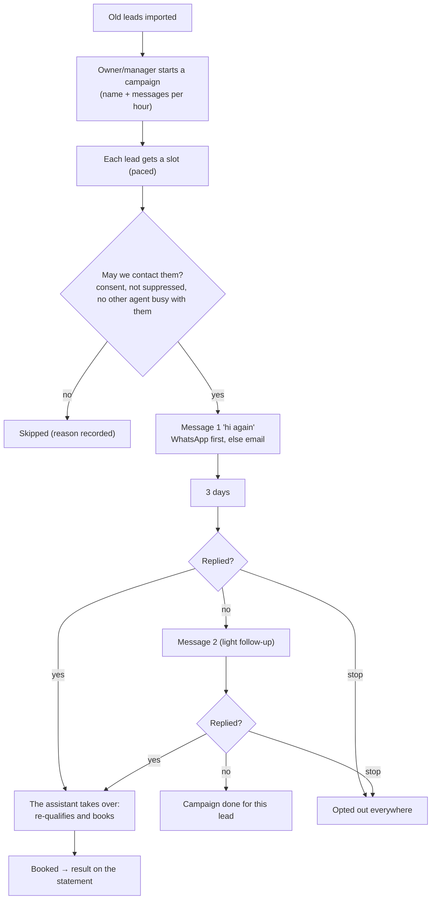

# Lead reactivation

Messages old leads and past customers again ("hi again"), paced so it never looks like a blast, and books the ones who reply.

## Setup

1. **Import old leads**: CSV/Excel (Leads page). Each row becomes one contact (duplicates merged), with consent recorded where it exists.
2. **Connect** WhatsApp and/or Gmail.
3. **Settings**: messages per hour (default 20), an offer you're happy to mention.
4. Persona, compliance, **go live**.

## Diagram

## Who does what

| | Owner | Manager | Front desk | Finance | Viewer | Agentry |
|---|---|---|---|---|---|---|
| Import leads, start / pause campaigns | ✓ | ✓ | | | | ✓ |
| See campaigns and progress | ✓ | ✓ | ✓ | ✓ | ✓ | ✓ |
| Approve messages (approval mode), reply, book | ✓ | ✓ | ✓ | | | ✓ |

**Note:** promotional messages by phone (voice reactivation) stay off until DLT registration is done (India).

**Code:** `automations/lead_reactivation`, `sequences.py`, `leads.py`. Spec: [lead-reactivation.md](../../automations/lead-reactivation.md).
