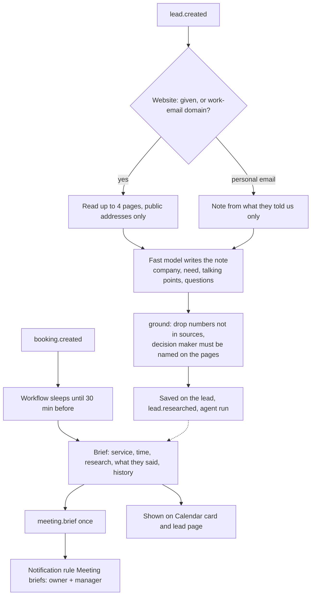

# Lead Research & Meeting Prep (ROADMAP-V2 9.4)

Every new lead gets a short research note within a minute, and the team gets a one-page brief before each meeting.

Code: `backend/src/agentry/automations/lead_research/`, prompt `prompts/lead_research/v1.md`, API in
`api/routes/business.py` (`GET /org/leads/{id}`, `POST /org/leads/{id}/research`), page `/leads/[id]`, migration 0025
(`leads.research`, `bookings.brief`). Tests: `tests/test_lead_research.py`.

## The research note (on `lead.created`)

1. **Which website.** A website the lead gave, else their work email's domain. Personal addresses (gmail.com, yahoo,
   outlook.com, rediffmail…) have no company site: the note is made from what they told us only (`no_company`).
2. **Read it.** Up to 4 pages (about/services/team first) with the knowledge crawler's safety checks (public
   addresses only). The cold-email sample businesses (`*.example`) are read from the mock data.
3. **Write it.** The `fast` model returns company, what they do, size, decision maker, likely need, up to 3 talking
   points and 3 questions, using only the pages and the lead's own words (form fields + first messages).
4. **Check it** (`ground()`): any field with a number that isn't in the sources is dropped; the decision maker must be
   named on the pages with a founder / owner / director / partner / head role. If the models are down, a note is built
   from the pages without a model.
5. **Store it** on the lead, fill in the contact's company if empty, record an agent run (`research:<lead>`), emit
   `lead.researched`.

The lead page shows the note with its sources and a **Research again** button (people who can act on conversations).

## The meeting brief (on `booking.created`)

- A DBOS workflow sleeps until 30 minutes before the appointment (setting: 5–240), then builds the brief: service,
  staff, time, contact details, the research (made on the spot if missing), what they said, and their history
  (earlier visits, no-shows).
- It's sent once (`bookings.brief.sent_at`) as event `meeting.brief`. The default Notification Center rule
  **Meeting briefs** sends it to owners and managers on Telegram, email and in-app; edit it in Settings → Notification rules.
- The brief also appears on the Calendar card and on the lead page.

## Who can do what

| | Owner | Manager | Front desk | Finance | Viewer | Agentry |
|---|---|---|---|---|---|---|
| Open Leads and a lead's research note | ✅ | ✅ | ✅ | — | — | ✅ |
| Research again | ✅ | ✅ | ✅ | — | — | ✅ |
| Get meeting briefs (default rule) | ✅ | ✅ | — | — | — | — |
| Change settings (brief timing) and the Meeting briefs rule | ✅ | ✅ | — | — | — | ✅ |

Leads need `conversation: read`; Research again needs `conversation: act` (`api/routes/business.py`). Opening is checked
by `tests/test_role_matrix.py` ([roles-matrix.md](../roles-matrix.md)). Roles without it are sent to Home and don't see
Leads in the menu.
