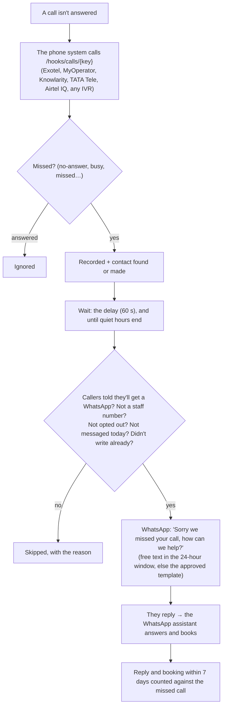

# Missed-call recovery: every missed call gets a WhatsApp in a minute

Plan: [PLAN-COMMERCIAL-2026-11.md](../../PLAN-COMMERCIAL-2026-11.md) (#2). Code: `backend/src/agentry/automations/missed_call/`,
API `api/routes/missed_calls_api.py` (`/hooks/calls/{key}`, `/org/missed-calls`), migration 0058; portal `/missed-calls`;
website agent page with a try-it box. Tests: `tests/test_missed_calls.py`. In the Clinic growth plan (on).

- **Consent.** Nothing is sent until the business switches on "Callers are told they'll get a WhatsApp" (IVR greeting or
  website). The missed call is then recorded as the caller's consent to that one service message (`consents.source =
  missed_call`); anyone who opted out is never messaged and their opt-out is never overwritten.
- **WhatsApp template.** Outside the 24-hour window Meta requires an approved template (one parameter: the business name),
  set by Agentry in the agent's settings. Until it's approved only callers who wrote in the last 24 hours get the message.
- **Fields understood** (JSON, form or query string): caller `From / CallFrom / caller / caller_id / msisdn / customer_number…`,
  called `To / CallTo / did / DialWhomNumber…`, status `Status / CallStatus / DialCallStatus / call_status / event…`, or `missed=true`.
- **Results** on `/missed-calls`: missed, messaged, replied, booked (30 days and today), every call with what happened, the
  webhook address to give the phone provider, and a test call from your own phone.

| Role | Can |
|---|---|
| Owner, Manager | See, test call, change the settings |
| Front desk, Finance, Viewer | See |
