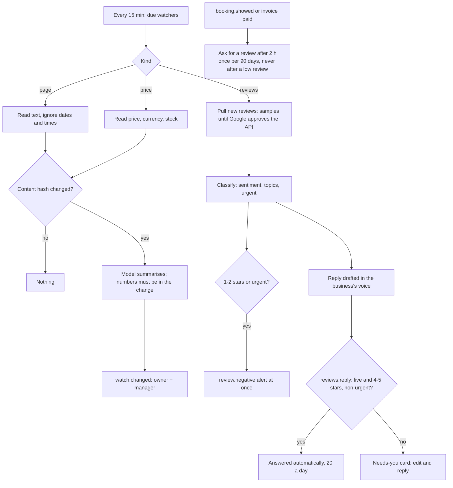

# Watchers, Review management, Competitor & price watch (ROADMAP-V2 7.3, 9.2, 10.1)

Code: `backend/src/agentry/watchers.py`, `automations/reviews/`, `automations/competitor_watch/`, APIs
`api/routes/reviews_api.py` and `watch_api.py`, pages `/reviews` and `/watch`, migration 0028. Samples:
`mock-data/reviews/sample.jsonl`, `mock-data/watchers/*.html`. Tests: `tests/test_reviews.py`.

## Watchers (the shared engine)

Every 15 minutes the due watchers run (each has its own interval):

| Kind | What it does | When it tells you |
|---|---|---|
| `page` | Reads the page's text; times and dates don't count as changes | Lines were added or removed: a short plain-words summary (the model may not add numbers that aren't in the change) |
| `price` | Reads title, price, currency, stock (model, with a price-pattern fallback; a price the page doesn't show is ignored) | The price moved by at least the threshold (default 5%) or stock changed |
| `reviews` | Pulls new reviews for Review management | New reviews are handled there |

The model only runs when the page's content hash changed. Three failed checks in a row pause the watcher and send
`watch.failing`. Changes send `watch.changed` (default rule "Competitor and price changes": owner + manager, Telegram + in-app).

## Review management

1. **Pull** every 6 hours. Google Business Profile needs Google's API approval, so the **sample reviews** are used until then
   and replies are recorded, not posted to Google.
2. **Classify:** sentiment, up to 3 topics (waiting time, staff, price…), urgent (health/safety, legal threats, abuse, a broken promise).
3. **Alert** at once for 1-2 stars or urgent: `review.negative` (default rule "Bad reviews", critical).
4. **Reply:** a draft in the business's voice (no compensation offers, no health details, no invented facts, no numbers the
   review didn't contain). Governance action `reviews.reply`: when the agent is live, 4-5 star non-urgent reviews may be
   answered on their own (daily limit 20); everything else is a Needs-you card. Reply from the card or the Reviews page.
5. **Ask for reviews** after a visit is marked Showed (`booking.showed`) or an invoice is paid in full, after a delay
   (default 2 h), once per customer per 90 days, never to someone whose review was 3★ or lower, only with the business's
   Google review link set. Governance `reviews.ask` (quiet hours, 40/day).
6. **Monthly report** on the 1st at 09:30 IST: count, average vs the month before, replies, what people liked and complained about.

Who: owners, managers and front desk (conversation permission); finance and viewers don't see reviews (they're sent
to Home and the menu hides it).

## Competitor & price watch

Owners and managers add pages (`/watch`): a competitor's offers or a product price. Checked every 6 hours by default,
up to 20 pages in the plan (Agentry can change both). Everyone in the business can see the list and recent changes.

## Who can do what

| | Owner | Manager | Front desk | Finance | Viewer | Agentry |
|---|---|---|---|---|---|---|
| Open Reviews | ✅ | ✅ | ✅ | — | — | ✅ |
| Reply to reviews, approve reply / ask cards | ✅ | ✅ | ✅ | — | — | ✅ |
| Open Watch (pages and recent changes) | ✅ | ✅ | ✅ | ✅ | ✅ | ✅ |
| Add, change or remove watched pages | ✅ | ✅ | — | — | — | ✅ |
| Review settings (review link, delay), plan limits | ✅ | ✅ | — | — | — | ✅ (limits: Agentry only) |

From `api/routes/reviews_api.py` (`conversation: read` / `act`) and `watch_api.py` (`dashboard: read` to see,
`automation: configure` to change). Opening is checked by `tests/test_role_matrix.py` ([roles-matrix.md](../roles-matrix.md)).
