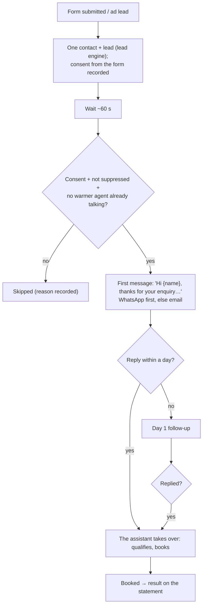

# Speed-to-lead (text)

A new lead from a website form or an ad gets a first message within about a minute, while they're still interested; the assistant then qualifies and books. (Phone calls to leads come with outbound calling, Phase 4.5.)

## Setup

1. **Lead forms** (Leads page): create a form source; Agentry gives a webhook URL or snippet for the client's form / ads tool.
2. **Connect** WhatsApp and/or Gmail.
3. **Settings**: send the first message after N seconds (default 60).
4. Persona, compliance (form consent), **go live**.

## Diagram

## Who does what

| | Owner | Manager | Front desk | Finance | Viewer | Agentry |
|---|---|---|---|---|---|---|
| Lead forms (create, get the snippet) | ✓ | ✓ | | | | ✓ |
| Leads page, approve messages, reply, book | ✓ | ✓ | ✓ | | | ✓ |
| Settings | ✓ | ✓ | | | | ✓ |

**Code:** `automations/speed_to_lead`, `sequences.py` (`speed_to_lead_default`), `leads.py`.
