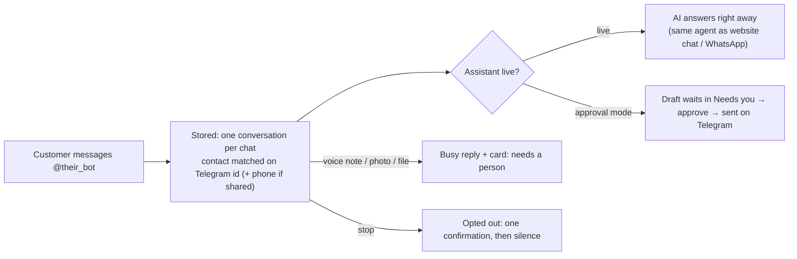

# Telegram

Two things in one: **a customer channel** (each business's own bot runs its AI assistant) and **Agentry's team bot**
(alerts, cards with buttons, and a Tools menu for every agent). Setup: [setup/telegram.md](../../setup/telegram.md).

## A. Customers on the business's bot

A person can reply from **Conversations**; it goes out on Telegram and the assistant steps back (as with WhatsApp).

## B. The team bot

| What | How |
|---|---|
| **Link** | Account & notifications → Connect Telegram → tap *Start* in Telegram (one-time code, 15 minutes) |
| **Cards** | Every new Needs-you card the person may act on (or that's assigned to them) arrives with buttons: **Approve & send**, **Edit** (send the new text as a reply), **Discard**, or **Mark handled**. Decisions are the same as in the portal and audited "via telegram" |
| **Alerts** | Any alert kind can be sent to Telegram (Account & notifications, Telegram column). If Telegram fails (e.g. the bot was blocked), it falls back to email |
| **Tools** (`/tools`) | One button per agent the business has and the person may see: 📋 Needs you, 📥 Inbox, 💰 Invoices, 🧲 Leads, 💬 Chats, 📞 Calls, ✉️ Cold email, 🎬 Content, 📈 Results |
| **Content by Telegram** | Owners/managers can send a video, audio or transcript (up to 20 MB) to the bot: it becomes a content recording, and the bot says when the posts are ready |
| **Several businesses** | `/business` switches which business the chat is working in |

## Who sees which tool

| Tool | Owner | Manager | Front desk | Finance | Viewer |
|---|---|---|---|---|---|
| Needs you (act on cards) | ✓ | ✓ | ✓ (conversation cards) | ✓ (invoice cards) | |
| Inbox, Leads, Chats, Calls, Cold email, Content | ✓ | ✓ | ✓ | | |
| Invoices | ✓ | ✓ | | ✓ | ✓ |
| Results | ✓ | ✓ | ✓ | ✓ | ✓ |
| Send a recording for content | ✓ | ✓ | | | |

Tools only appear for agents the business has.
