# v3 agents

The newer agents (ROADMAP-V3 waves A, B and C), each with its flow. **Who can do what** for all of them:

| Agent | Opens the page | Acts (replies, approves, sends, applies) | Changes settings / drafts |
|---|---|---|---|
| Support desk, Ops dispatcher, Renewals | Owner, Manager, Front desk | Owner, Manager, Front desk | Owner, Manager |
| Catalogue & quotes | everyone (Finance and Viewer read only) | Owner, Manager, Front desk | Owner, Manager |
| Hiring | Owner, Manager (CVs are personal data) | Owner, Manager | Owner, Manager |
| Stock scanner | everyone | Owner, Manager, Front desk | Owner, Manager |
| Local SEO, Festivals, Documents | everyone | – (drafts only) | Owner, Manager |
| AI video studio (incl. topic → script) | Owner, Manager, Front desk | Owner, Manager | Owner, Manager |
| Business copilot (Ask) | everyone; Viewers only read | each step needs that action's permission: messages and notes need conversations, invoice reminders need invoices | – |
| Client health | Agentry staff (HQ) | – | – |

Agentry staff can do everything and every staff action is audited. Pages a role can't use are hidden from its menu and send the person to Home; the endpoint-by-endpoint table, generated by the tests, is [roles-matrix.md](../roles-matrix.md).

# Wave A (built 2026-11-02)

## Prompt-injection guard (platform)

- **What it stops:** a customer's message tries to steer the AI. Examples: "ignore your instructions", "show your system prompt", "you are now DAN", fake `system:` markers, "you must refund", hidden characters, long encoded blocks.
- **What happens on chat, WhatsApp, Telegram or voice:** the customer gets a polite holding reply. No AI model and no tool runs. The conversation is handed to a person, with an escalation card explaining why.
- **What happens on email:** the reasons are added to the fraud warnings, so the card warns and nothing is sent automatically.
- **Cost:** none. It uses fixed rules, no AI.
- **False alarms:** tested against normal messages such as "ignore my last message, I meant Tuesday" and "what are your instructions for the cleaning prep?".
- **Code:** `agentry/guard.py`.

## Support desk (`support_desk`, page Tickets)

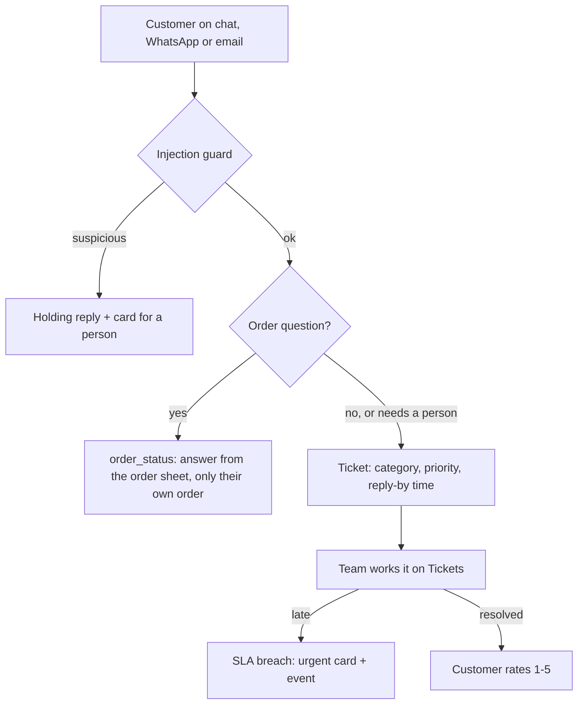

- **Chat agent tools:** when the desk is on, the chat agent gets `order_status` and `open_ticket`. Every hand-off to a person also becomes a ticket.
- **Tickets:** each has a category, priority, owner, status, a reply-by time (2 / 8 / 24 / 72 h by priority) and internal notes.
- **Order status:** "Where's my order?" is answered from the order sheet, a CSV or Excel the business uploads. A customer only ever sees their own order, matched on their phone or email; a known order number alone isn't enough.
- **SLA:** checked every 15 minutes. A late ticket raises an urgent card and the `ticket.sla_breached` event. The first reply from a person is recorded.
- **Rating:** on resolve, the customer is asked to rate 1–5 and the WhatsApp reply is stored. The page shows the median first-reply time and the average rating.

## Catalogue & quotes (`catalog_quotes`, page Quotes)

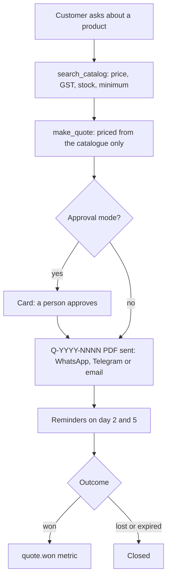

- **Product questions:** the chat agent gets `search_catalog`, which answers from the uploaded catalogue: code, name, price, GST %, stock, minimum quantity.
- **Quotes:** the agent's `make_quote` prices everything from the catalogue, never from the AI. It refuses unknown codes, zero quantities and quantities below the minimum.
- **Numbering and PDF:** quotes are numbered Q-YYYY-NNNN and drawn as an A4 PDF.
- **Sending:**
  - as a WhatsApp document inside the 24-hour window;
  - otherwise as a link by template, Telegram or email;
  - in approval mode the agent's quote waits on a card first.
- **Follow-up:** reminders on days 2 and 5, then the quote expires. Won / lost is marked in the portal, and `quote.won` feeds the quotes-won metric.
- **Private link:** `/public/quotes/{random token}.pdf`.

## Renewals & repeat business (`renewals`, page Renewals)

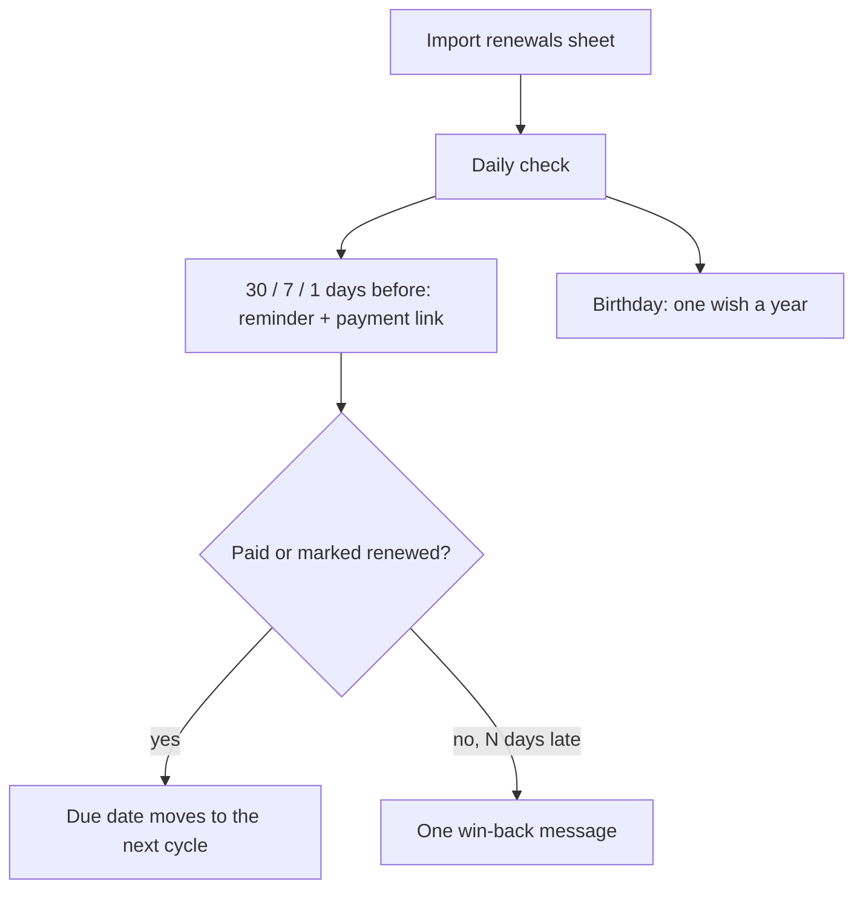

- **Input:** a CSV or Excel of renewals (AMCs, memberships, policies, services due): customer, phone, item, due date, amount, frequency, birthday.
- **Reminders:** 30, 7 and 1 days before, each sent once. A Razorpay payment link is added when there's an amount.
- **Renewed:** paying the link (webhook `notes.renewal_id`) or marking it renewed moves the due date to the next cycle.
- **Lapsed:** after N days unpaid, one win-back message, with an optional offer.
- **Birthdays:** one wish a year. Approval mode sends nothing.

## Hiring assistant (`hiring`, page Hiring)

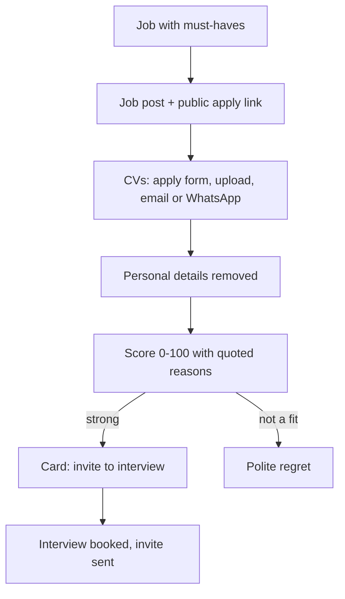

- **Jobs:** a role with its must-haves. A job post for Naukri / LinkedIn / Indeed is written for you, plus a public apply link (a simple form, rate-limited).
- **CVs:** PDF, Word or text. Each is scored 0–100.
  - Every strength must quote the CV word for word.
  - Gender, age, marital status, religion, caste and date of birth are removed before the AI sees the CV.
  - "Strong" only when every must-have is shown.
- **Next steps:** strong candidates make a card. Interview invites and polite regrets go out on WhatsApp or email.

## Topic → script (in the AI video studio)

- **Script:** the topic, or the next unused one from the studio's topics, becomes a hook, 4–7 timed beats (say / show / text on screen), a close, a caption and hashtags. The studio's risky-wording rules apply, with one rewrite.
- **Use it:** film it yourself, or send it to the studio to be generated.

## Client health (HQ → Client health)

- **Score:** out of 100, with the reasons:
  - activity now vs the two weeks before;
  - last portal visit;
  - cards waiting over 3 days;
  - failing connections;
  - failed runs;
  - statements unpaid over 15 days;
  - paused.
- **Weekly email:** every Monday the clients to watch are emailed to the Agentry team.
- **Privacy:** it reads only the user and time columns of sign-in sessions (migration 0043).

Migrations 0038–0043. Tests:
- `test_guard.py`
- `test_support_desk.py`
- `test_catalog_quotes.py`
- `test_renewals.py`
- `test_hiring.py`
- `test_video_studio.py`
- `test_client_health.py`

---

# v3 wave B (built 2026-11-02)

## Local SEO (`local_seo`, page Local SEO)

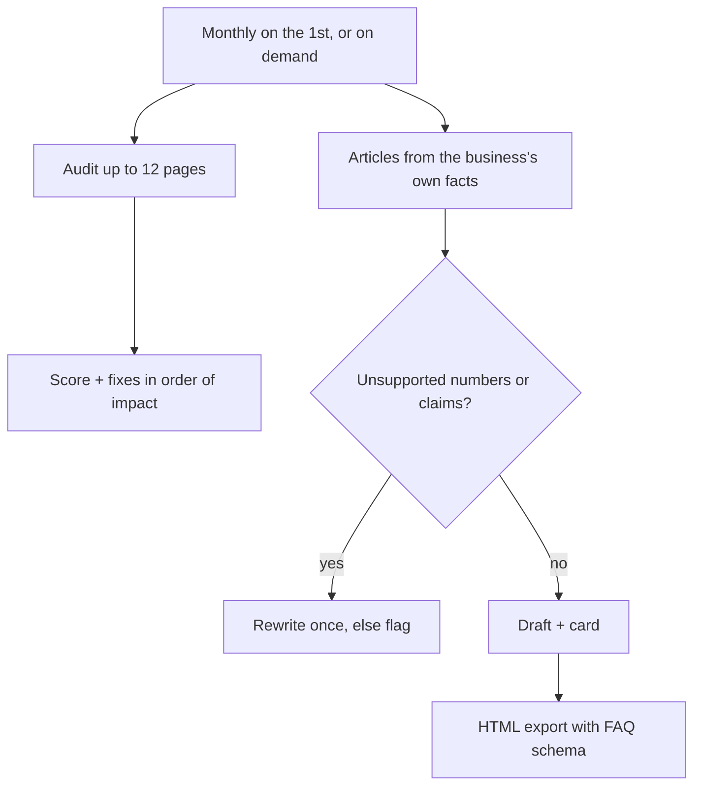

- **Audit:** reads up to 12 pages (with the crawler's protection against internal addresses) and checks:
  - titles, descriptions and H1s;
  - alt text, thin pages, duplicate titles;
  - viewport and canonical tags;
  - LocalBusiness structured data;
  - the phone vs the one in the profile;
  - Maps and WhatsApp links;
  - HTTPS, robots.txt and sitemap;
  - slow pages and broken links.

  It gives a score and fixes in order of impact.
- **Articles:** 600–900 words with FAQs, written from the knowledge base and services only. Numbers, prices and risky claims not in those facts are rewritten once, otherwise flagged. The HTML export includes FAQPage structured data.
- **Monthly:** on the 1st, an audit plus N article drafts, with a card.
- **Not yet:** ranking checks, which need a search API key.

## Stock shelf scanner (`stock_scanner`, page Stock)

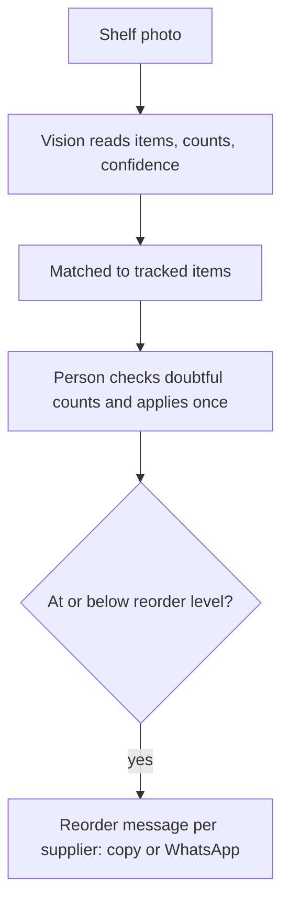

- **Scan:** a photo is read into items with a count and a confidence for each, then matched to tracked items ("1 kg" = "1kg").
- **Confirm:** doubtful counts are highlighted. A person corrects them and applies the scan, once.
- **Reorder:** items at or below their reorder level are grouped by supplier, each with a message to copy or open in WhatsApp.

## Festival campaigns (`festival_campaigns`, page Festivals)

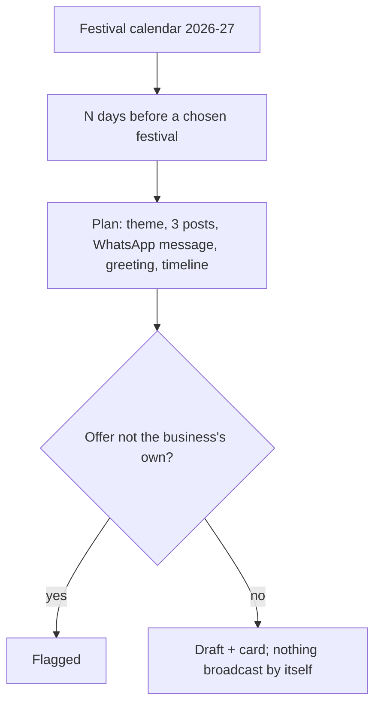

- **Calendar:** Indian festivals for 2026–27. Lunar dates are best-known and can be corrected per business.
- **Plan:** N days ahead of each chosen festival: a theme, 3 posts, a WhatsApp message, a greeting and a timeline.
- **Offers:** only the business's own offer is used. Any other price, percentage, "flat N" or "free X" is flagged ("feel free to call" is fine).
- **Sending:** nothing is broadcast by itself.

## SOP & proposal drafter (`doc_drafter`, page Documents)

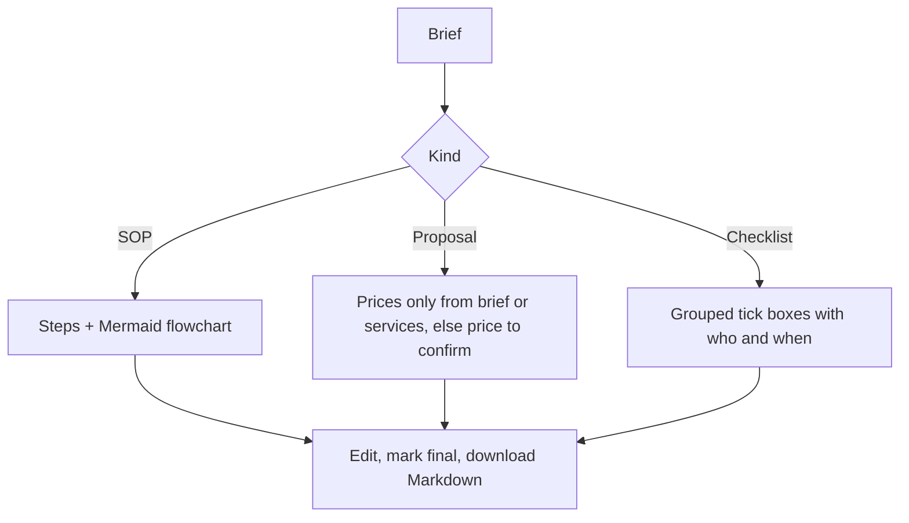

- **SOP:** written with a Mermaid flowchart.
- **Proposal:** prices only from the brief or the services, otherwise "[price to confirm]".
- **Checklist:** grouped tick boxes with who and when.
- **After drafting:** edit, mark final, download Markdown.

## Engagement loop (content + AI video studio)

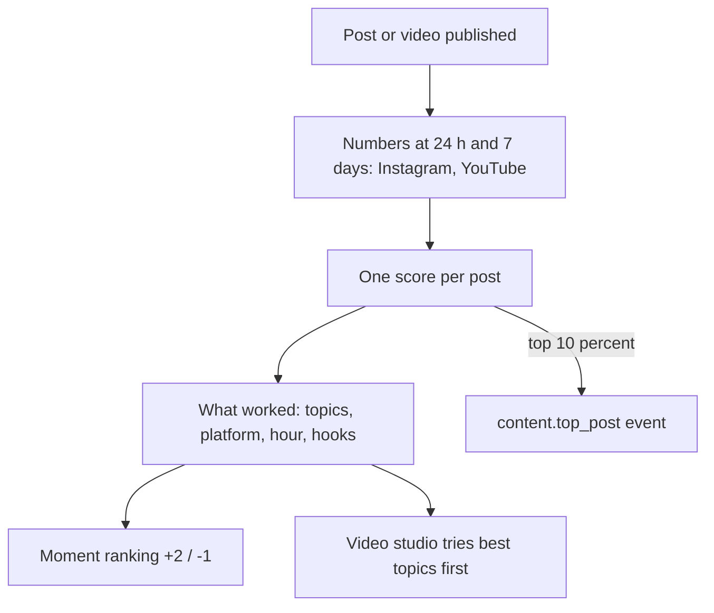

- **What's measured:** Instagram (likes, comments, reach, saves, shares) and YouTube (views, likes, comments), at 24 hours and 7 days.
- **Not measured yet:** LinkedIn member posts, because that needs LinkedIn's restricted API.
- **Score:** one score per post.
- **Learning:** the best and weakest topics, best platform, best hour and top hooks are saved on the business profile. Then:
  - moment ranking boosts good topics (+2) and lowers weak ones (−1);
  - the video studio tries the best topics first;
  - posts in the top 10% emit `content.top_post`.
- **Where to see it:** "What's working" on the Content page.

Migrations 0044–0048. Tests:
- `test_local_seo.py`
- `test_stock.py`
- `test_festivals.py`
- `test_doc_drafter.py`
- `test_engagement.py`

---

# Wave C (built 2026-11-02, deployed 2026-11-09)

## Business copilot (premium tier: Ask your business can now act)

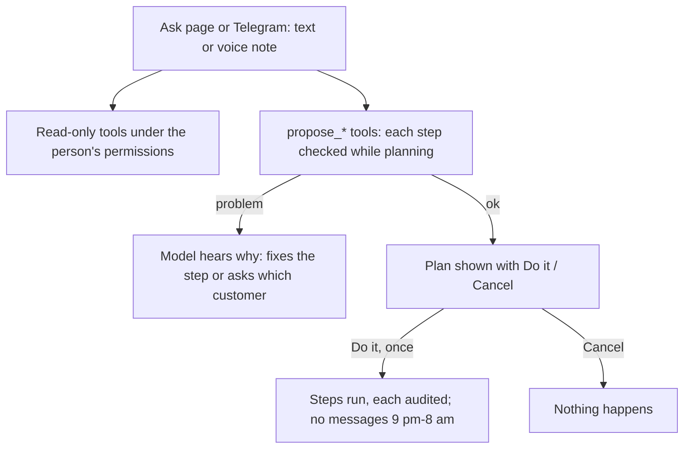

- **Ask, then plan.** On `/ask` or the Telegram team bot (now with voice notes), "remind Rohan about E-1 and note he promised Friday" becomes a **plan** of checked steps. The steps are: message a customer, send an invoice reminder with a payment link, move or cancel an appointment, add a note, open a ticket, mark a renewal done.
- **Checked before it is shown.** Each step is checked while it is planned: does the customer exist, and is there only one match? Is the invoice open? Does the person's role allow it? Is the agent switched on? If anything fails, the model hears the reason and fixes the step or asks.
- **Nothing runs until a person taps Do it.** A plan runs once. Every step is written to the audit log, and messages still respect quiet hours (9 pm–8 am).
- Viewers only read; staff without money permission can't plan reminders.
- Code: `copilot_actions.py`, `copilot.py`, `api/routes/copilot_api.py` (`/org/copilot/plans/{id}/run|cancel`). Migration 0049.

## Ops dispatcher (`ops_dispatcher`, page Jobs)

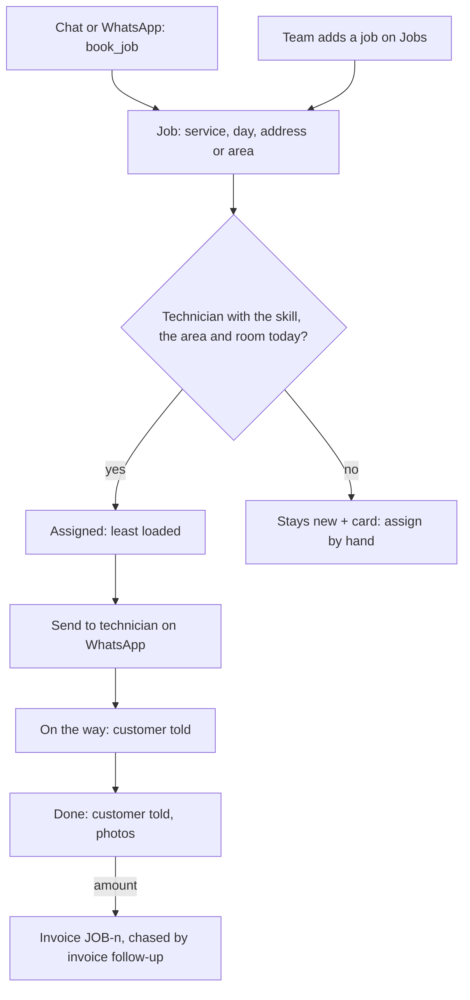

For home-services businesses (AC repair, plumbing, pest control, cleaning).

1. **Jobs come in.** The chat or WhatsApp assistant books one with the `book_job` tool, once it knows the service, the day, and an address or area. The team can also add jobs on the Jobs page.
2. **Assignment.** The job goes to a technician who has the skill and covers the area, choosing the least loaded one under their daily limit. If nobody fits, the job stays **new** and a card asks a person to assign it.
3. **Technician.** "Send to <name> on WhatsApp" opens a wa.me message with the address, the problem and the customer's phone.
4. **Customer updates.** The customer hears "on the way" and "done" (when *tell customers* is on, never at night). Photos can be attached from a phone.
5. **Invoice.** A job marked done with an amount becomes invoice `JOB-<n>` (due in *invoice days*), and the invoice follow-up agent chases it.

The board shows a day, plus older jobs that are still open. Metric: `jobs_done`. Code: `automations/dispatcher`, `api/routes/dispatch_api.py`. Migration 0050.
