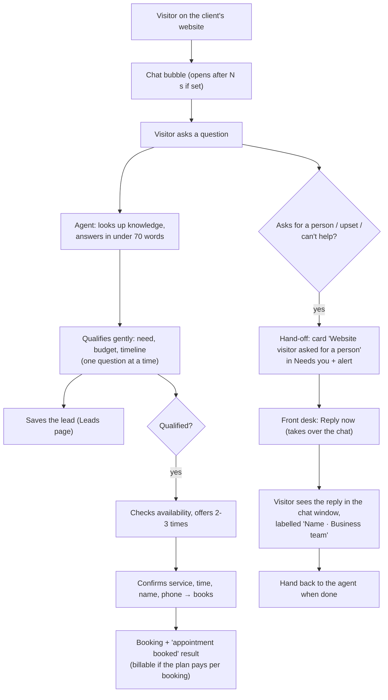

# Website chat agent

A chat bubble on the client's website. It greets visitors, answers from the client's knowledge, asks what they need, checks the calendar and books, and hands over to a person when asked.

## Setup

1. **Knowledge**: the client's website pages, prices, FAQs.
2. **Persona**: assistant name, tone, greeting.
3. **Settings**: bubble position, open automatically after N seconds, websites allowed to embed it, alert me on hand-off.
4. **Install**: paste the one-line snippet (shown in onboarding) into the website. Agentry can do this if they have access.
5. **Test chat**, then **go live**.

## Diagram

## Steps

| # | Step | Who |
|---|---|---|
| 1 | Visitor opens the chat and asks | Visitor |
| 2 | Agent answers from knowledge; never invents prices or offers ("I'll have the team confirm") | Agent |
| 3 | Agent learns need, budget, timeline and saves the lead | Agent |
| 4 | When qualified, offers times and books (no double-booking) | Agent |
| 5 | Visitor asks for a person → hand-off card in Needs you + alert | Agent → Front desk |
| 6 | Front desk replies from the portal; the visitor sees it in the chat; hand back when done | Front desk |
| 7 | Booking counted as a result on the monthly statement (if the plan pays per booking) | System |

## Who does what

| | Owner | Manager | Front desk | Finance | Viewer | Agentry |
|---|---|---|---|---|---|---|
| Hand-off cards, reply in the chat, take over / hand back | ✓ | ✓ | ✓ | | | ✓ |
| Conversations, Leads, Calendar | ✓ | ✓ | ✓ | | | ✓ |
| Knowledge, persona, widget settings, install snippet | ✓ | ✓ | | | | ✓ |
| Hand-off alerts | on | on | opt-in | | | |

**Code:** `automations/website_chat`, `agents/` (spec, runtime, tools), `api/widget.py`, `apps/widget`. Demo pages (`/demo/<slug>`) use this same agent.
