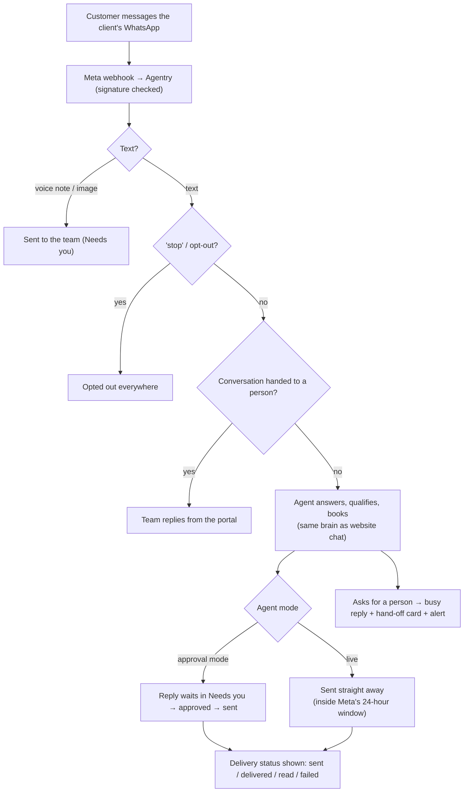

# WhatsApp assistant

The same agent as website chat, answering on the client's own WhatsApp Business number.

## Setup

1. **Owner connects WhatsApp** (Connections → WhatsApp): Meta phone number ID, WhatsApp Business account ID and access token. Agentry checks them and sends a test message.
2. Knowledge, persona, compliance (consent rules), go live (needs WhatsApp connected).
3. Agentry's Meta app webhook is set up once for all clients (docs/setup/whatsapp.md).

## Diagram

## Rules

| Rule | Detail |
|---|---|
| 24-hour window | Free-form replies only within 24 hours of the customer's last message; outside it only approved templates |
| Approval mode | Every reply waits for a person until the client switches the agent to automatic |
| Busy reply | "Thanks for your message! A member of our team will reply shortly." (editable) when handed off |
| Opt-out | "stop", "band karo"… stops all messages to that number |

## Who does what

| | Owner | Manager | Front desk | Finance | Viewer | Agentry |
|---|---|---|---|---|---|---|
| Approve replies, reply, take over / hand back | ✓ | ✓ | ✓ | | | ✓ |
| Connect WhatsApp, settings, switch to automatic | ✓ | ✓ | | | | ✓ |
| Alerts when a customer needs a person | on | on | opt-in | | | |

**Code:** `automations/whatsapp_assistant`, `connectors/whatsapp.py`, `worker/delivery.py`.
