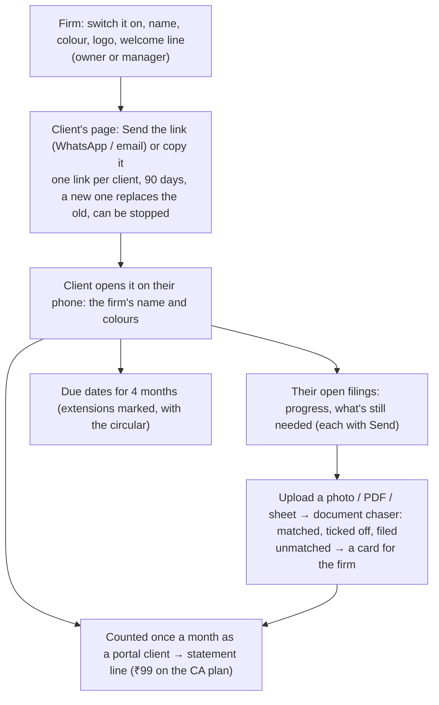

# CA client portal: each client's private page, under the firm's name

Plan: [PLAN-COMMERCIAL-2026-11.md](../PLAN-COMMERCIAL-2026-11.md) (#3). Code: `backend/src/agentry/automations/ca/portal.py`, API in
`api/routes/ca_api.py` (`/org/ca/portal`, `/org/ca/clients/{id}/portal`, public `/public/portal/{token}` and `/files`), billing
(`portal_clients` usage), migration 0059; website `apps/web/src/app/portal/[token]` (`components/client-portal.tsx`); portal
Clients → Client portal (settings) and each client's page (Client portal card). Tests: `tests/test_ca_portal.py`.

- No password: the link is the key, stored hashed; "please don't share it" is on the page. 20 uploads a day per client, 20 MB each.
- Agentry's own ads and analytics don't load on portal pages; "powered by Agentry" is the only mention.
- Not yet: the firm's own domain (portal.theirfirm.in). Today the address is on Agentry's site.

| Role | Can |
|---|---|
| Owner, Manager | Switch it on and brand it; send, copy and stop links |
| Front desk | Send, copy and stop links |
| Finance, Viewer | See whether a client has a link and uses it |
