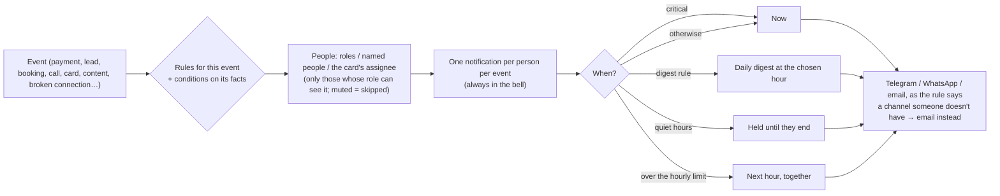

# Notifications

Two layers, side by side:

1. **Alerts** (since v1): urgent emails, escalations, the inbox digest, the weekly summary, statements and monthly
   reports. Each person chooses email, WhatsApp or Telegram per kind in **Account & notifications**, plus Telegram
   cards with buttons for every new Needs-you card.
2. **Notification Center** (ROADMAP-V2 §2.1): **any event**, through rules. In **Settings → Notification rules**
   (or the bell → Notification rules).

## How a rule works

## Events you can use

| Area | Events | Facts rules can check |
|---|---|---|
| Money | A payment arrives · A customer replies about an invoice · Agentry issues a statement | amount, currency, gateway, invoice · total |
| Leads & bookings | A new lead · An appointment is booked · A cold-email prospect is interested | source, stage · service, source |
| Calls & chats | A phone call ends · A WhatsApp / Telegram message arrives · An email is sorted | outcome, duration, follow-up · text · urgent, category |
| Work | A card lands in Needs you · A card has waited 4 hours | kind, urgent, agent, hours |
| Content | Posts are ready to review · A post is published | posts · platform |
| Platform | A connection stops working (always critical) · Your agents go live | provider |

Only events for agents the business has, and that the person's role may see, are offered.

## Defaults (created once per business, editable)

Money in (owner, finance → Telegram + bell) · New bookings (owner, manager, front desk → bell + Telegram) · New leads
(owner, manager → daily digest at 18:00) · Cards waiting too long (the assignee → Telegram + email; owner → Telegram) ·
Interested cold-email replies · Posts ready to review · Broken connections (critical).

## Who can do what

| | Owner | Manager | Front desk | Finance | Viewer |
|---|---|---|---|---|---|
| Create / change / switch off business rules | ✓ | ✓ | | | |
| Own personal rules, mute a business rule for themselves, quiet hours, hourly limit | ✓ | ✓ | ✓ | ✓ | ✓ |
| Bell | ✓ | ✓ | ✓ | ✓ | ✓ |

Agentry staff see each client's delivery log (what went where, failures, fallbacks) on the HQ client page.

## Channels

- **Telegram:** free; link it in Account & notifications.
- **WhatsApp:** needs a Meta-approved alert template on the business's number (set by Agentry in Connections) and the
  person's number.
- **Email:** always available, and the fallback.
- **The bell:** every notification, with unread counts.
