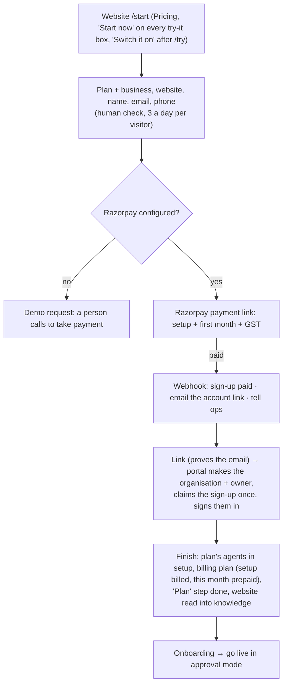

# Self-serve start: buy a plan on the website, open the account from the email

Plan: [PLAN-COMMERCIAL-2026-11.md](../PLAN-COMMERCIAL-2026-11.md) (#1). Code: `backend/src/agentry/signups.py`, API
`api/routes/signups_api.py`, the billing webhook (`api/webhooks.py`, `payment_link.paid` with `notes.signup_id`), worker
`worker/audit_jobs.py` (`signup.provisioned` → read the website), migration 0057; website `apps/web/src/app/start`,
`components/start.tsx`; portal `apps/dashboard/src/app/start/[id]` (route) and `start/[id]/finish`; HQ → Website sign-ups.
Tests: `tests/test_signups.py`.

| Plan (agent pack, `self_serve`) | Monthly | Setup | Agents on |
|---|---|---|---|
| Starter | ₹2,999 ($49) | none | Website chat, WhatsApp, speed-to-lead |
| Clinic growth | ₹6,999 ($99) | none | WhatsApp, website chat, appointment concierge, reviews, speed-to-lead (+ AI visibility, receptionist off) |
| CA Firm | ₹14,999 ($299) | ₹15,000 ($299) | the CA pack |

Prices are agent packs (HQ → Packs); `self_serve`, `sort` and `highlights` decide what the website shows. 18% GST for India.

- Nothing is created before payment. The account link goes only to the email that paid; the link's secret is stored hashed
  (to check) and encrypted (to email). A second click goes to the account (or sign-in).
- Only the owner who paid (same email, owner of the claimed organisation) can finish. A failed finish is shown in HQ.
- HQ → Website sign-ups: every sign-up, paid / opened / set up, with "Resend link" for paid ones not opened.
- Needs on the server: `AGENTRY_BILLING_RAZORPAY_KEY_ID`, `..._KEY_SECRET` and `..._WEBHOOK_SECRET` (Razorpay webhook for
  `payment_link.paid` → `/webhooks/billing/razorpay`). Without them the website still works and hands each sign-up to sales.
