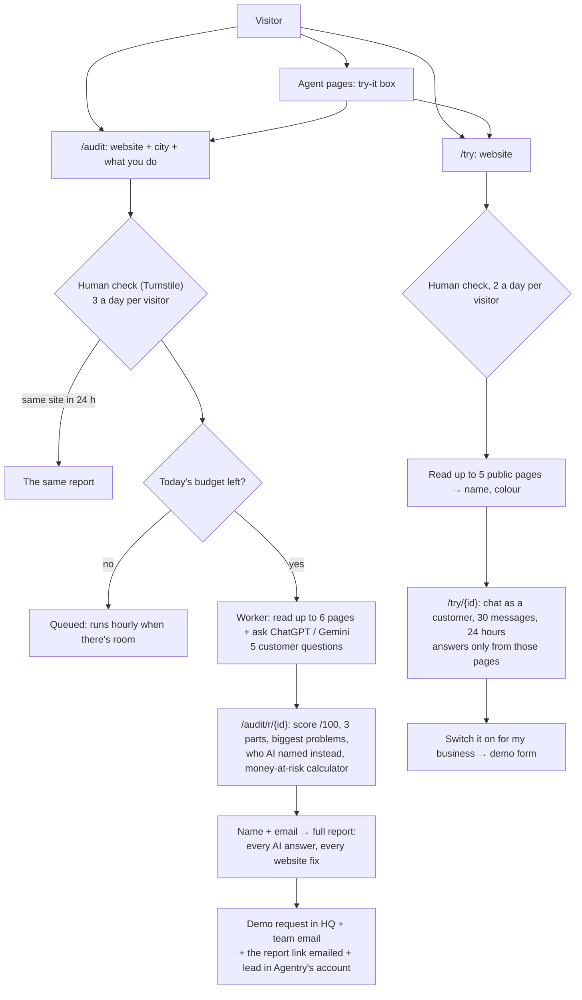

# The website's "try it now": free audit, instant demo, playgrounds

Plan: [PLAN-TRY-IT-AND-AI-VISIBILITY.md](../PLAN-TRY-IT-AND-AI-VISIBILITY.md) (part A). Code: `backend/src/agentry/site_audit.py`,
`instant_demo.py`, `ai_search.py`, `worker/audit_jobs.py`, API `api/routes/audit_api.py` (`/public/audits`, `/public/try`),
migrations 0052–0053; website `apps/web/src/app/audit`, `app/try`, `components/audit-form.tsx`, `audit-report.tsx`, `try-demo.tsx`,
`playground.tsx`, `turnstile.tsx`. Tests: `tests/test_site_audit.py`.

## The free audit (`/audit`)

| Part | Points | How |
|---|---|---|
| AI assistants | 40 | 5 customer questions (`AGENTRY_AUDIT_QUESTIONS`) to each assistant with web search, once each; points = share of answers naming them |
| Reaching you | 30 | Chat widget 12, WhatsApp link 8, online booking 5, phone number 5 (read from the pages) |
| Website basics | 30 | The Local SEO checks (business details, titles, speed, sitemap, broken links…) × 0.3 |

- **Shown at once:** the score, the three parts, up to 5 biggest problems, the three businesses named instead, and what an evening
  visitor finds. There's also a money-at-risk estimate whose numbers the visitor can change (visits, % with a question, value of a customer).
- **After name + email:** every AI answer word for word, and the website fixes in order. This creates a **demo request**
  (company, website, niche guessed from the service, a message with the score, problems, report link and ad source), emails the team
  and the visitor (the report link), and adds the visitor to Agentry's own leads.
- The report link (`/audit/r/{id}`) works for 30 days and isn't indexed by search engines.
- The business name comes from the site's own name tag, else a title that is a name (not "Best dentists near you"), else the domain.

## The instant demo (`/try`)

- Up to 5 public pages are read. An assistant answers as the business's website assistant, **only from those pages**. It answers in
  the visitor's language (English, Hindi, Hinglish), never invents prices, and offers to take name and phone when it doesn't know.
- 30 messages per demo, 40 messages per visitor per hour, 24 hours, removed after 2 days. Nothing is sent to anyone.
- It's a preview. The real website chat agent adds the knowledge base, bookings, lead capture and handoff.

## Agent page playgrounds

- **Talk-to-customers agents** have a "Try it on your own website" box that leads to `/try`.
- **AI visibility, Local SEO, Reviews and Competitor watch** have a "Does ChatGPT recommend you?" box that leads to `/audit`.
- **Invoice follow-up:** the visitor types a customer, an invoice number and an amount, and sees the day 7/14/21/28 WhatsApp
  reminders (sample wording, in the browser, no server).

## Limits and cost controls

| Control | Setting |
|---|---|
| Human check | Cloudflare Turnstile: `NEXT_PUBLIC_TURNSTILE_SITE_KEY` (website build) + `AGENTRY_TURNSTILE_SECRET` (API). Unset = off (local, tests) |
| Per visitor | 3 audits a day, 2 instant demos a day, 10 report unlocks an hour, 40 chat messages an hour (Postgres `app.public_hits`, shared by every API process; visitor = salted hash of the IP, never the IP) |
| Same website | One audit per website, city and service a day; the earlier report is shown |
| Daily budget | `AGENTRY_AUDIT_DAILY_BUDGET_USD` (default $5) across audits and instant-demo chats over 24 hours. Over it, audits wait (hourly job) and instant demos say "come back tomorrow" |
| Websites | Public addresses only (the crawler refuses private and local ones), page caps, timeouts |
| Honeypot | A hidden field; bots that fill it get nothing |

**Measured costs (2026-11-10, live):** an audit costs about $0.08 with ChatGPT only (5 questions) and takes about 30 seconds. An instant-demo
reply costs well under a cent.

## Tracking

- The ad source (utm, gclid, fbclid) is stored with the audit and the instant demo, and copied into the demo request.
- Events: `audit_start`, `audit_report_unlocked` (also counted as a lead conversion), `instant_demo_start`, `instant_demo_chat`. See
  [ADS.md](../ADS.md).
